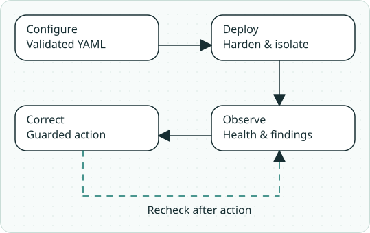

<p align="center">
  <picture>
    <source media="(prefers-color-scheme: dark)" srcset="webapp/public/brand/opstend-dark.svg" />
    
  </picture>
</p>

<h1 align="center">OpsTend</h1>

<p align="center">
  <strong>Self-hosted infrastructure operations</strong><br />
  Harden a Linux host, deploy isolated apps, and keep watch after deployment.<br />
  by <a href="https://github.com/grethel-labs">Grethel Labs</a>
</p>

<p align="center">
  <a href="#quick-start"><kbd>Quick start</kbd></a>
  <a href="docs/operations.md"><kbd>Operations</kbd></a>
  <a href="docs/diagrams/README.md"><kbd>Diagrams</kbd></a>
  <a href="docs/STATUS.md"><kbd>Status</kbd></a>
</p>

<p align="center">
  <picture>
    <source media="(prefers-color-scheme: dark)" srcset="docs/diagrams/readme/operations-dark.svg" />
    
  </picture>
</p>

<p align="center">
  <sub>Rendered with <a href="https://github.com/grethel-labs/excaliplant">Excaliplant</a> · <a href="docs/diagrams/readme/operations.puml">PlantUML source</a></sub>
</p>

> [!NOTE]
> **0.1.0rc1 source.** Earlier VM runs established the single-host baseline for
> installation, repeat deployment, reboot and isolation. The candidate subset
> also covers guarded configuration recovery, bounded project and host scanning,
> and the tested maintenance window and health probe paths. The signed candidate
> archive and its installation, upgrade, unchanged redeploy and reboot evidence
> are pending. See [current status](docs/STATUS.md) and the
> [documentation index](docs/README.md).

## What a deployment sets up on the server

| Capability | What it gives you |
| --- | --- |
| **Guarded deployment** | Review a plan before applying YAML and a signed release. SSH and firewall changes get syntax checks, rollback timers and a fresh-connection check. |
| **Workload isolation** | Each project runs as a dedicated user with Rootless Podman. Traefik exposes configured routes and outbound traffic follows per-service rules. |
| **Deterministic self-management** | The controller checks health and isolation, rechecks after guarded actions and escalates when limits are reached. Budgets and cooldowns limit retries. |
| **Operator visibility** | The private console shows health, findings, configuration diffs, jobs and audit records. The kill switch pauses automatic changes while observation continues. |

<details>
<summary>Host components and safeguards</summary>

- **Hardening:** nftables firewall (IPv4/IPv6, default drop), SSH drop-in,
  sysctls, bounded journald, automatic security updates. SSH and firewall
  changes undergo syntax checks, are armed with rollback timers, and are
  committed only after a demonstrably new connection succeeds.
- **Isolated workloads:** a dedicated user with Rootless Podman per project;
  read-only rootfs, no capabilities, `no-new-privileges`, RAM/CPU/PID limits,
  dedicated data storage. Outbound traffic is controlled per service
  (default: none).
- **Reverse proxy:** Traefik without a container socket or dashboard, only
  explicitly configured routes, internal TLS or ACME.
- **Small privileged executor:** runs registered host actions and maintains its
  own audit log.
- **Self-management controller:** checks services, health, isolation, and firewall
  every 30 seconds and restores them through the executor, with budgets,
  cooldowns, and escalation instead of endless loops. Runs without AI or web UI.
- **Event log:** a separate collector records mutations, refusals, finding
  transitions, deployment events and a bounded feed of warnings. It normalizes
  and redacts events, maintains correlation IDs and assigns a fixed delivery
  class. Retention is bounded.
- **Admin web UI:** status, findings, projects, configuration with diffs and
  conflict checks, jobs, audit. Access it over a private IPv4 LAN or an SSH tunnel.
  Public administration with OIDC/MFA (S03) is unsupported.
- **Kill switch:** immediately stops automatic changes; observation and audit
  continue.

</details>

## Zorec

<picture>
  <source media="(prefers-color-scheme: dark)" srcset="webapp/public/brand/zorec.svg?view=dark-neutral#dark-neutral" />
  
</picture>

Zorec is OpsTend's optional operations assistant. When the AI runtime is
enabled, **Ask Zorec** in Overview helps explain service health, backup status
and vulnerability findings. Answers include their sources, time range and
gaps in the available data. Suggested actions follow the usual approval path.
See [provider availability](docs/STATUS.md#card-state) for the current release gates.

The name is a nod to **ZORAC**, the ship's computer in James P. Hogan's
[*Giants' Star*](https://books.google.com/books?id=sB9seiMh38kC), who helps
open a path into the opposing computer system JEVEX.

## Prerequisites

**Target server:** an existing Ubuntu Server 26.04 LTS (x86_64) with systemd and
cgroup v2, SSH key access for a user with sudo, internet access to the Ubuntu
archive, PyPI, and the image registry. The toolkit expects an installed operating
system. See the [support matrix](docs/support-matrix.md) for architectures
and tested allocations. Additional OS and architecture profiles (S02),
including Ubuntu 26.04 arm64, are unsupported.

**Controller machine** (where you deploy from): Linux or macOS with Python ≥ 3.12
and `ssh`. The server host key must already be in `known_hosts`; the toolkit does
not accept unknown host keys. Building your own release also requires `uv` and
Node.js ≥ 22.

## Quick start

For the signed RC1 path, start from a separately trusted controller checkout
for the same OpsTend version as the archive. The checkout supplies
`./steward`, the Ansible playbooks, roles and connection plugin, and the
controller dependency pins. The signed archive supplies the target wheel
(including the web UI), runtime dependency pins and sample application bundles,
along with the signed manifest, subset, SBOM and provenance. Obtain the Ed25519
public key independently of the archive. The
[release process](docs/release.md) describes preparing the archive and signing
it on the operator's offline machine.

```bash
# 1. Create configuration (config/ is ignored by Git)
mkdir -p config && cp examples/server.lan.yml config/server.yml
$EDITOR config/server.yml            # adjust server.name, host, user

# 2. Generate admin token (≥ 32 random bytes, 0600, outside Git, never displayed)
./steward secrets init-admin-token --config config/server.yml

# 3. Verify the signed archive, validate configuration and deploy
./steward release verify /path/to/steward-release.tar.gz \
  --public-key /path/to/trusted-release-key.pub
./steward validate --config config/server.yml --limit my-server
./steward deploy --config config/server.yml --limit my-server \
  --release-archive /path/to/steward-release.tar.gz \
  --release-public-key /path/to/trusted-release-key.pub

# 4. Check status
./steward status   --config config/server.yml --limit my-server
```

The first invocation of `./steward` sets up a pinned, hash-verified controller
environment (Ansible, collections) under `.steward/`.

`deploy` requires the signed archive and trusted key from RC1 onward. It checks
the signature, version, hashes and attestations before contacting the target.
It then runs read-only preflight, checks resources and conflicts, and shows the
plan before confirmation. Enter the server name or use `--yes` to apply and
verify the running instance. For exact deployment resume, supply the original
archive and trusted key again.
`--yes` does not override blocked migrations or revision conflicts.

### Web UI

The quick-start configuration uses `admin.access: private-lan`. Read-only
preflight looks for a usable RFC1918 address with a directly connected subnet
on a guest Ethernet or Wi-Fi interface. If exactly one qualifies, deployment
pins that interface and address and prints the HTTPS URL. The bind subnet is
the default source scope. If no address qualifies or several qualify, set
`admin.lan.interface` and `admin.lan.bind` (IPv4 with prefix) or use loopback.
Use `admin.lan.allowed_sources` for explicit RFC1918 source CIDRs. Automatic
redeployment reuses the applied scope. Set the pair explicitly to change it.
Browser drafts for LAN access also require the explicit pair. Use
`./steward deploy` to activate a new scope or switch back to loopback.

On an existing guarded (schema 2) installation whose release predates LAN
support, run two ordinary signed deployments. First upgrade the release using
the applied admin settings, then deploy with `admin.access: private-lan` and
the desired scope. Fresh installations and schema 1 use the normal deploy path.

If clients reach the guest through a different RFC1918 address, set
`admin.lan.advertise_ipv4` to include that address in the certificate and allow
it as an admin origin. Your network must route or forward it to the guest on the
same admin port. Import the server's internal CA (`/etc/steward/pki/ca.crt`) from
a trusted copy into the browser or operating system trust store. Open the printed
URL and sign in with the token file contents.

Set `admin.access: private-loopback` and remove `admin.lan` for SSH tunnel access. Existing
`admin.access: private` and configs with that field omitted also use loopback.
Use the SSH host and port from the configuration when opening the tunnel.

```bash
ssh -N -p 22 -L 9443:127.0.0.1:9443 deploy@my-server
# then open https://localhost:9443; sign in with the token file contents
```

### Kill switch

```bash
./steward killswitch on --config config/server.yml --limit my-server
# or directly on the server, independently of the web UI and controller:
sudo /opt/steward/current/venv/bin/steward-host killswitch on
```

## Commands

Run `./steward --help` for command options. These are the usual controller entry
points.

| Command | Purpose |
|---|---|
| `validate` | Check configuration, secret references and rendering locally |
| `plan`, `deploy`, `status`, `doctor` | Preview, deploy, read verified status or diagnose the target |
| `killswitch on\|off\|status` | Control automatic host changes |
| `config pull`, `config apply --head FULL_REVISION` | Recover a reviewed revision or apply supported pending changes on the host |
| `secrets init-admin-token [--force]` | Generate or rotate the token file |
| `release build`, `release pack`, `release sign`, `release verify` | Build, package, sign offline and verify release artifacts |

Standalone `plan` uses local `dist/release` metadata. The signed deployment
path shows its plan using the verified archive.

The CLI also exposes candidate backup and restore-drill commands, verified-update
rollback and AI login tooling. Public activation of those workflows remains
guarded while their release gates are open. See [STATUS](docs/STATUS.md).

## Configuration at a glance

A YAML file is the single source of desired state
([example](examples/server.lan.yml), JSON schema in [schemas/](schemas/)). Key rules:

- Images require a fully qualified registry **and digest**.
- Secrets are references only (`env:NAME`, `file:/path`); values never appear in
  configuration, plans, or logs.
- `manage: false` skips a project; `deploy: false` stops it and preserves data.
  Removing it from the list deletes nothing.
- `automation.profile` starts with `observe`: updates and code repairs are never
  automatic. The controller still restarts failed or hung services; disable this
  per project with `maintenance.allow_restart: false`.
- Scheduled scanning, outbound notifications and the read-only bot are opt-in.
  The scanner evidence covers the bounded host-package and registered project
  image baseline, with incomplete coverage reported explicitly. Released public
  HTTPS and real Discord delivery acceptance are still open. See the
  [operations guide](docs/operations.md) and [card state](docs/STATUS.md#card-state).
- Weekly maintenance windows and admission are available. The healthy container
  probe host gate and announced maintenance drills remain open.
- Public configuration validation blocks Restic backup activation, application
  stacks and per-application critical-risk response, verified image updates,
  repository deployments and builds, automatic patch/repair, AI providers and
  the local AI profile. The VM101 evidence for separate group operations covers
  the guarded private renderer. See the [card state](docs/STATUS.md#card-state).

## Development

```bash
uv sync --extra controller
uv run pytest -n auto                      # unit and contract tests
uv run ruff check . && uv run ruff format --check .
(cd webapp && npm ci && npm run build)
tests/integration/local_rootless.sh        # real Rootless Podman test, no root
```

See the [working guide](docs/working-guide.md), [testing guide](docs/testing.md)
and [contribution rules](CONTRIBUTING.md) before changing OpsTend.
The [brand guide](docs/branding.md) covers the shared assets and UI tokens.

## License

Apache-2.0, see [LICENSE](LICENSE). All code in this repository was written from
scratch; no code was copied from other repositories.
