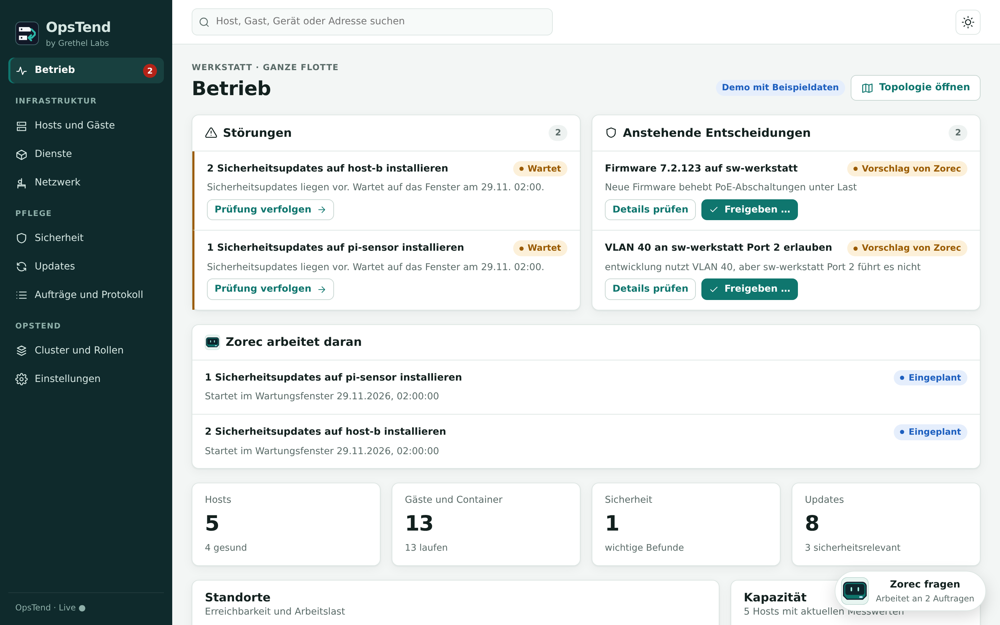
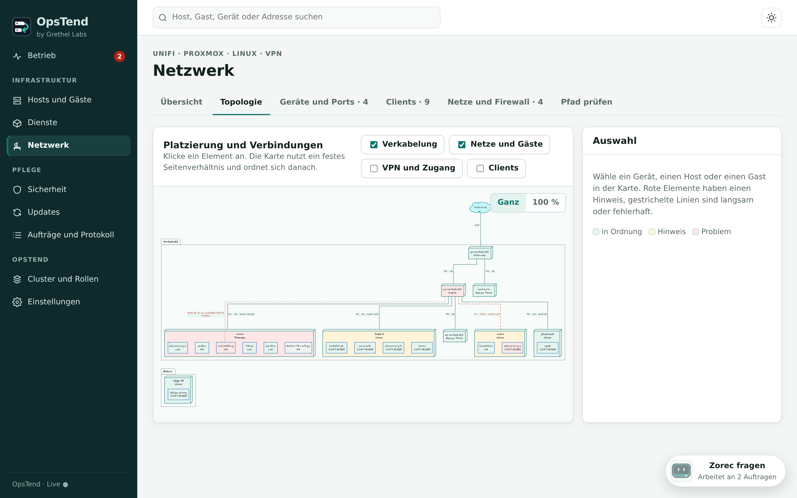
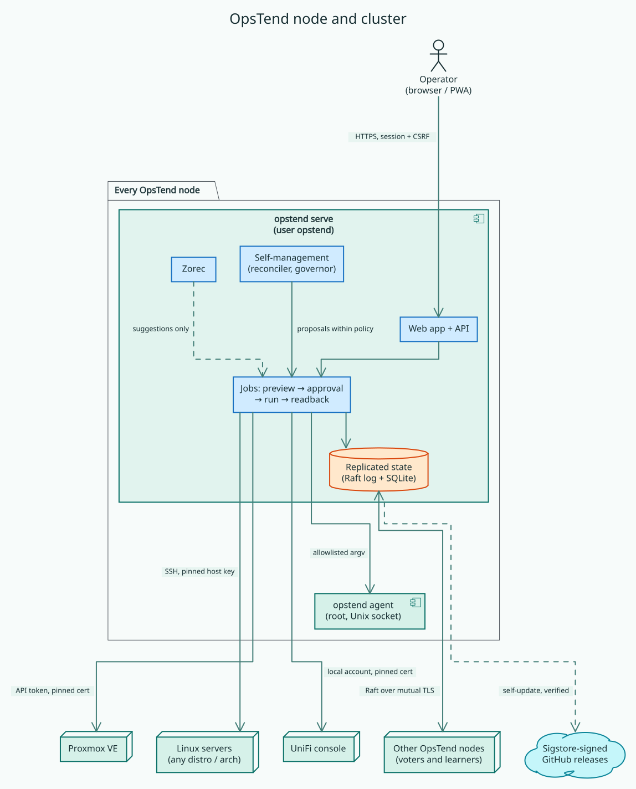

<p align="center">
  <picture>
    <source media="(prefers-color-scheme: dark)" srcset="web/public/brand/opstend-dark.svg" />
    
  </picture>
</p>

<h1 align="center">OpsTend</h1>

<p align="center">
  <strong>Self-managing operations for Proxmox, Linux and UniFi</strong><br />
  One app for your servers, guests, containers and network – it watches, explains,
  scans, updates and repairs, and asks you before anything risky.<br />
  by <a href="https://github.com/grethel-labs">Grethel Labs</a> · assistant: <b>Zorec</b>
</p>

<p align="center">
  
</p>

## What it does

| | |
| --- | --- |
| **Operations first** | Opens with incidents and pending decisions. Every change is a job with a plain-language preview, your approval (or policy), execution, readback and rollback. |
| **Proxmox and beyond** | Start, stop, snapshot, back up, clone from templates and migrate VMs, LXC and containers – the same buttons on Proxmox VE, libvirt and Podman, on any Linux distribution and architecture. |
| **Network insight across systems** | Joins UniFi ports, VLANs, PoE and clients with Proxmox bridges, guest NICs, firewall rules, WireGuard and published services. Finds what no single system sees, e.g. *a guest tagged with VLAN 40 on a switch port that does not carry it*, and explains paths: *why can't my phone reach the media server?* |
| **Interactive topology** | Drawn with [excaliplant](https://github.com/grethel-labs/excaliplant): fixed aspect ratio, clickable elements, layers for cabling, networks and access. |
| **Independent security scans** | Packages and images via Trivy or OSV, prioritised with CISA KEV and EPSS and by whether a service is actually reachable from outside; host hardening checks. |
| **Self-management** | Restarts failing services, patches in the maintenance window, withdraws exposure of known-exploited services, moves roles off failed nodes – within budgets, cooldowns and a kill switch you control. |
| **Coordinated updates** | One rollout for OS packages, Proxmox, UniFi firmware, apps and OpsTend itself: canary first, access points before switches before the gateway, never losing quorum, health gate after every wave. |
| **AI-assisted deployment** | Paste a repository URL: Zorec reads the Compose file or Containerfile, proposes a hardened rootless deployment and asks only for what it cannot know. |
| **Highly available** | Several nodes share the work instead of all running everything. A Raft-replicated control state survives the loss of the leader; roles move automatically. New nodes join with a one-line command. |
| **Installable app** | The web app is a PWA: install it on phones, tablets and desktops. |

<p align="center">
  <picture>
    <source media="(prefers-color-scheme: dark)" srcset="docs/screenshots/topology-dark.png" />
    
  </picture>
</p>

## Try it

```sh
uv sync && (cd web && npm ci && npm run build) && uv run opstend demo
# open http://127.0.0.1:8080 – example site with Proxmox, Linux, UniFi and a few real-looking problems
```

## Install

On any Linux machine (amd64, arm64, armv7, ppc64le, s390x, riscv64, 386; Debian, Ubuntu,
Fedora/RHEL, openSUSE, Alpine, Arch; systemd or OpenRC):

```sh
curl -fsSL https://github.com/grethel-labs/opstend/releases/latest/download/install.sh | sudo sh
```

Open `https://<host>:8443` and create the admin account. To add another node, create
a join command under **Cluster und Rollen** and run it on the new machine. Details:
[docs/operations.md](docs/operations.md).

## How it is built

<picture>
  <source media="(prefers-color-scheme: dark)" srcset="docs/diagrams/architecture-dark.svg" />
  
</picture>

Read [docs/architecture.md](docs/architecture.md) and [docs/security.md](docs/security.md).
What is verified and what comes next: [ROADMAP.md](ROADMAP.md).

## Develop

```sh
uv sync && (cd web && npm ci && npm run build)
uv run pytest && (cd web && npm run test:e2e)
```

Conventions, security rules and maintenance steps are written as skills for people and
coding agents: [`.claude/skills`](.claude/skills). Pull request titles follow
Conventional Commits; merging to `main` releases, signs and publishes automatically.

## Auf Deutsch

OpsTend betreibt Proxmox, Linux-Server und UniFi-Netze selbstständig: Es beobachtet,
erklärt, scannt, aktualisiert und repariert – und fragt vor allem Riskanten nach. Die
Oberfläche ist deutsch (Englisch umschaltbar), läuft als App auf Handy und Desktop und
zeigt zuerst, was deine Aufmerksamkeit braucht.

## License

Apache-2.0
