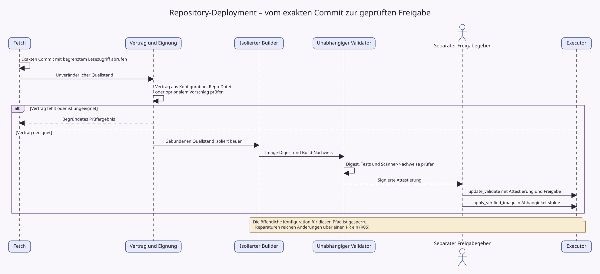
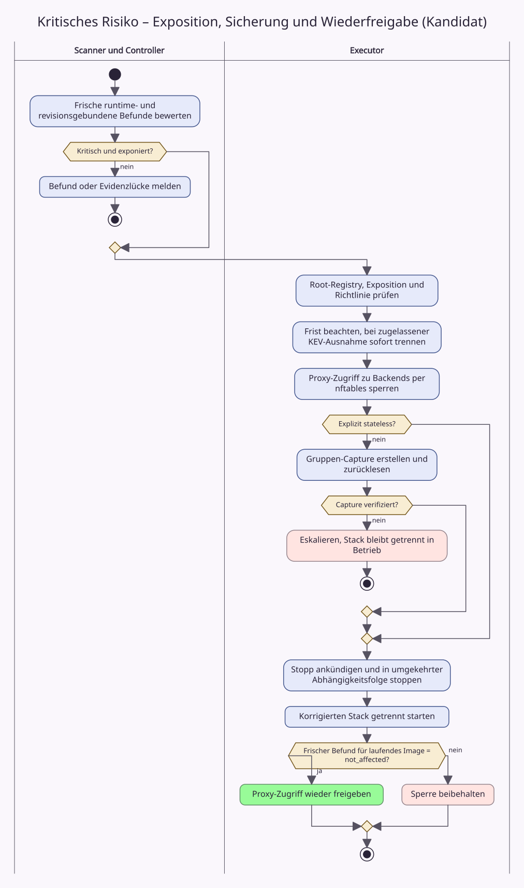
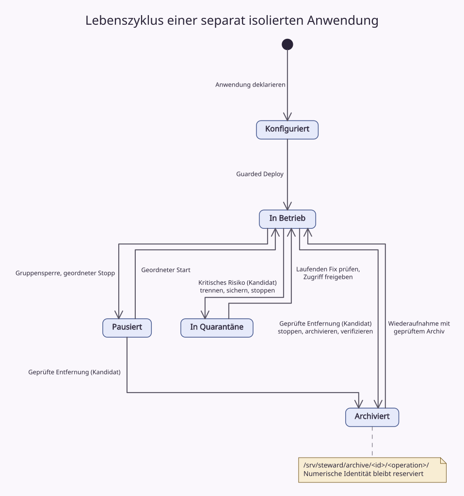
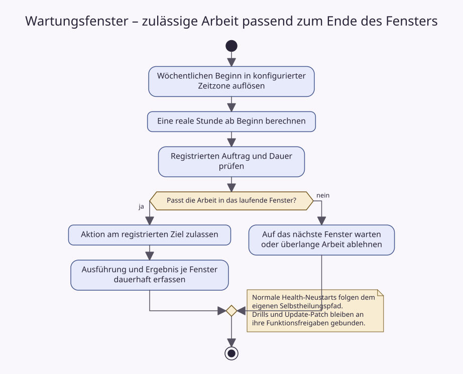

# ADR 0002: Repository deployments, AI integration, and application lifecycle

Status **accepted as target design** · 2026-11-15 · supplements
[ADR 0001](0001-architecture.md)

This record preserves the original design decisions. See
[STATUS](../STATUS.md#card-state) for implementation, released configuration and
host evidence. The [application graph](0006-application-graph-compatibility.md),
[inference contract](0007-inference-contract.md) and
[AI onboarding](0008-ai-onboarding-and-model-selection.md) records refine the
relevant sections.

## 1. Idempotent rollout with running services

Requirement: a repeat run must leave running services alone if nothing relevant
has changed.

Current behavior: services restart only when their unit, secrets, or image
changes; otherwise `state: started` applies. Evidence is the second run with
`changed=0` in the VM acceptance test. For repository deployments (section 3),
the same rule applies based on the built image digest: same commit and build
inputs → no restart.

## 2. AI integration

### Methods

| `ai.method` | Data path | Authentication |
|---|---|---|
| `ollama-cloud` (desired default) | External: Ollama Cloud models through locally installed Ollama, operator subscription | Interactive (link) |
| `ollama-local` | Local, supports `local_only` | None; model explicitly configured |
| `anthropic-api`, `openai-api` | External | API key as secret reference, no interaction |
| `openai-compatible` | Self-hosted or third-party API with base URL | Optional API key |
| `claude-subscription`, `chatgpt-subscription` | External | Interactive through unmodified official program |

Subscription methods will be implemented only where official provider terms
permit unattended server services at implementation time. This must be rechecked
against original documentation before implementation, not inferred from this
document. No unofficial OAuth-to-API proxy or session token forwarding.

### Server login

One program, two entry points:

```bash
./opstend ai login --config config/server.yml --limit my-server   # from controller machine
sudo opstend-host ai login                                     # directly on server
```

The controller command opens an SSH terminal session and starts the same
root-owned program as the local command. Depending on `ai.method`, it guides the
operator through official login (device code or browser link opened on their own
machine) while running under the inference service identity. Credentials go only
into that service's authentication directory, never working copies, logs, or
configuration.

Deployment implications: `deploy` installs everything and succeeds; AI then
has a "login pending" state, shown as a finding in `status` and the web UI.
The platform (hardening, isolation, deterministic self-management, fixed scans)
works without login. Expired or revoked credentials return it to the same state.

### Automatic model selection

Configure a **selection rule**, not a fixed model name:

```yaml
ai:
  method: anthropic-api
  model_policy:
    families: [sonnet, haiku]      # select only within these families
    evaluate: weekly
    max_cost_per_month_eur: 20
```

A weekly job (deterministic, no model involvement in the decision):

1. Queries the models actually available through the connected method.
2. Filters to allowed families or pricing tiers.
3. Runs candidates against a fixed toolkit task suite (structured outputs for
   synthetic findings, logs, diffs) and measures success, cost, and runtime
   against the budget.
4. Switches only if the candidate passes all required tasks and is better under
   the rule; retains the previous model as fallback.
5. Records the decision and measurements in audit and reports the switch.

Limits: switching stays within the same provider and data class. Provider changes,
plan purchases, or transitions from local to external never happen automatically.
Unknown prices remain unknown rather than estimated; no automatic switch without
pricing information.

The concrete models representing "current Sonnet/Haiku" or the two smallest
OpenAI tiers are deliberately not hardcoded; they are resolved at runtime from
the provider's model list and the family rule.

## 3. Repository deployments



*Quelle: [`07-repo-deployment.puml`](../diagrams/src/07-repo-deployment.puml), erzeugt mit `docs/diagrams/render.sh`.*

```yaml
applications:
  - id: shop
    instruction: "Node backend, migrations run at startup. Never publish port 5432."
    isolation: shared            # shared: one isolated area | separate: one per service
    services:
      - id: db
        repository: https://github.com/example/shop-db
      - id: backend
        repository: git@github.com:example/shop-backend.git
        credential: file:~/.config/steward/keys/shop-backend     # deploy key or token
        depends_on: [db]
      - id: frontend
        repository: https://github.com/example/shop-frontend
        depends_on: [backend]
        routes: [{host: shop.example.org, tls: acme}]
```

Per-service sequence, every step idempotent and audited:

1. **Fetch:** the fetch component clones using the associated read-only
   credentials into the application's namespace; records the commit.
2. **Proposal:** AI reads the repository as untrusted data and proposes a workload
   contract (build recipe, port, health, data, egress, resources), taking the
   operator's `instruction` into account. Repository instructions themselves
   are data, not commands.
3. **Suitability:** fixed checks decide whether the proposal fits an isolated
   environment (non-root, read-only rootfs, no host networking, engine socket,
   or privileged devices). If not, report the reason instead of deploying.
4. **Build and validate:** isolated builder without production access,
   independent validator; result is an image digest with verification evidence.
5. **Deploy:** executor accepts `apply_verified_image` with project, digest,
   and evidence. AI never receives root, secrets, or write access to production
   data.

Without authenticated AI, repository services remain in "missing contract"
state; an operator-written contract in the repository or configuration is
processed without AI.

**Build isolation (decided):** use the strongest available of three levels and
record it in verification evidence:

1. Ephemeral VM on the host.
2. External ephemeral CI runner with approved sources.
3. Rootless build under a dedicated builder user without secrets, egress limited
   to package sources, and dedicated resource limits. This level requires
   explicit activation (`build.allow_container_isolation: true`) and is labeled
   everywhere as "container isolation, no VM protection".

## 4. Service interaction

- **`isolation: shared`** — all services in an application run under *one*
  service user in a shared Podman pod network and reach one another by service
  name. Simple, but without internal separation: a compromised frontend can
  reach the database at the network level.
- **`isolation: separate`** — each service has a dedicated user and data area.
  Allowed connections follow `depends_on`: the dependent service may access
  exactly the target service's loopback port (UID-based nftables rule).
  Everything else remains blocked.

`depends_on` also determines order: start in dependency order, stop in reverse.
When a service is retired, all dependents stop too and return together.
Validation rejects cycles.

## 5. Vulnerabilities: no known critical vulnerability exposed to the network

**Operator's guiding goal:** without human intervention, ensure no *known*
critical vulnerability remains reachable from the network, repair the system,
and back up services before shutting them down.

Scope of this goal: it bounds the time from vulnerability disclosure to ending
exposure to the scan interval plus response time. It does not cover vulnerabilities
absent from all data sources or the time until the next scan. These windows are
measured and displayed, not hidden.

Repository dependencies (lockfiles, images), host packages, and the running
kernel enter inventory and vulnerability scanning. Updates follow `patch`.

### Response to a critical finding



*Quelle: [`04-kritisches-risiko.puml`](../diagrams/src/04-kritisches-risiko.puml), erzeugt mit `docs/diagrams/render.sh`.*

The sequence separates "disconnect from network" (immediate, reversible, no data
risk) from "shut down" (only after backup):

1. **Fix available → repair.** Smallest suitable fix (package, dependency,
   image), isolated build and tests, backup, deploy, verify on running service.
   Exposure may remain only if this succeeds within the configured deadline.
2. **No fix by end of notice period (§8: one hour; immediately for actively
   exploited vulnerabilities) → end exposure.** Remove proxy route and block
   access in firewall. This touches no data, requires no prior backup, and
   happens even if everything afterward fails. From here, the vulnerability
   is no longer reachable from the network.
3. **Back up.** Consistent service backup (database dump or verified quiescence).
   On failure, keep service running but disconnected and escalate with cause;
   do not risk data by shutting down without a backup.
4. **Announce and shut down.** Notify through channels, then stop the service
   and all dependent services in dependency order.
5. **Scan more often.** Shorten the interval for this finding until a fix exists.
6. **Reactivate.** Build, test, deploy fix, start stack, verify finding on running
   instance, restore route.

For an internal service without its own route, exposure is determined through
the dependency graph: a database behind a public frontend is indirectly exposed.

The rule is per application (`on_critical: quarantine | notify`, default
`quarantine`). "Critical" considers severity, exploitability (KEV, EPSS), and
reachability. This intentionally differs from the original specification, where
a high CVSS score alone does not trigger emergency isolation.

### AI role: fixed tool set

The deterministic sequence above runs without a model. AI supplements it where
rules are insufficient (finding a fix when no ready-made update exists,
determining backup procedures for unknown applications, diagnosing build
failures), using registered tools only:

| Tool | Type |
|---|---|
| Read finding, inventory, redacted logs, repository working copy | Read-only |
| Propose change in isolated source copy, trigger build and tests | Isolated, no production access |
| Propose backup procedure (dump command from fixed selection per database type, paths within data area) | Proposal checked by validator |
| Request backup, end exposure, quarantine, deploy verified digest | Request to executor |

Every request follows today's checks (role, schema, policy, kill switch, budget,
target lock, audit). AI cannot expand the tool set, receives no shell or secrets,
and treats logs and repository text as data rather than instructions.

### Boundary: the host's own services

Host services used to administer the server (sshd) are never automatically shut
down: the server would become unreachable and could not restore itself.
Instead: apply automatic security updates immediately; when no fix exists,
restrict access to configured source addresses (`admin.allowed_sources`),
otherwise escalate. Required reboots after kernel updates need a maintenance
contract with a time window; without one, the finding remains visibly open.

## 6. Removed applications



*Quelle: [`06-anwendungs-lebenszyklus.puml`](../diagrams/src/06-anwendungs-lebenszyklus.puml), erzeugt mit `docs/diagrams/render.sh`.*

Applications absent from configuration are **retired and archived** on the next
run, not deleted: stop service, disable autostart and user manager (no RAM/CPU
use), remove loaded images (restorable from archive), compress data into
`/srv/steward/archive/<id>/`, and release the working area only after archive
readability is verified. User and sub-ID range remain reserved. If the application
returns, reactivate it from archive. Permanent deletion remains an explicit
manual command.

This replaces version 0.1's rule of leaving removed projects running.

## 7. Server-side configuration

Applied configuration is already root-owned on the server
(`/etc/steward/config/desired.json`), with revision history in the admin API;
`./opstend config pull` retrieves it. Still needed: `config pull` without an
existing local file (only host, user, and server name as parameters), allowing a
fresh checkout to restore full configuration. Secret values remain excluded;
only references are returned.

## 8. Health checks, maintenance drills, event log, and bot

### Health checks and restarting hung services

Available since 0.1: every 30 seconds, the controller checks platform services,
proxy, firewall, and each service (unit state, HTTP health, isolation), and
restarts failed or repeatedly unhealthy services through the executor, with
cooldown, hourly budget, and escalation.

Implemented (2026-11-15): restarting unhealthy services is the default
(`maintenance.allow_restart: true`), because self-healing is the guiding goal;
operators can disable it per service. This replaces the original requirement
for a separate maintenance contract per restart: the contract remains a field
but is granted by default. Still needed: non-HTTP health checks (TCP port,
container command) and detecting hangs through response-time thresholds rather
than error status alone.

### Announced maintenance drills



*Quelle: [`08-wartungsfenster.puml`](../diagrams/src/08-wartungsfenster.puml), erzeugt mit `docs/diagrams/render.sh`.*

Within the weekly maintenance window, after announcement, the system may:

- Check resources (free memory and disk against total limits, load, backup state).
- Stop and restart services in dependency order for testing, measuring whether
  they return healthy automatically and how long it takes.
- Run a restore drill from the latest backup in a separate environment.

```yaml
maintenance:
  weekly_window: "Sun 03:00 Europe/Berlin"   # required; fixed duration of 1 hour
  emergency:
    notice_minutes: 60            # notice for unscheduled windows
    immediate_if_known_exploited: true
  drills: [resources, restart, restore]
```

**Regular window:** one hour weekly. All planned work happens here: updates
requiring restart, drills, restore tests, model selection, cleanup. Work that
cannot finish within the hour is postponed; an update already started is
completed or rolled back, never left half-finished.

**Unscheduled window:** for critical findings, the system may schedule an extra
window with one hour's notice through the channels. During that hour it already
attempts to build and test a fix, ideally leaving only deployment for the
window. Critical here means vulnerabilities under §5, isolation no longer
assured, and imminent data loss (e.g. full disk), not ordinary updates.

**Exception without waiting (addition to requirement):** if a vulnerability is
listed as actively exploited (KEV) and the service is network-reachable,
disconnect it immediately and notify simultaneously rather than waiting an
hour. This is the only notice exception and can be disabled with
`immediate_if_known_exploited: false`. A model proposal alone triggers neither
an unscheduled window nor the immediate action.

Controller restarts of hung services are not maintenance and require no window.

No window means no drills. If a service fails to return healthy after a drill,
the normal repair chain applies, and drills for that service are suspended until
a human or a successful fix releases them. Host reboots are included only when
the window explicitly permits them.

### One event log for everything

Every action and observation is written as a normalized event: time, source,
application/service, type, severity, correlation ID (linking e.g. finding →
network disconnection → backup → fix → reactivation), result, and redacted short
text. Sources include controller, executor audit, deployments, scanners, backups,
maintenance drills, model selection, and selected journald units.

Collector writes, bot reads: separate identities; bot has read-only access to an
authorized subset and cannot trigger or approve anything. Volume and retention
are bounded. Executor and API tamper-evident audit chains remain alongside it;
the event log provides a queryable view, not a replacement.

### What the bot reports and when

| Class | Examples | Delivery |
|---|---|---|
| **Immediate** | Shutdown/maintenance announcements, network disconnection, quarantine/reactivation, escalations, failed backup, kill switch, failed platform component, observation gap | At event time through persistent outbox with deduplication |
| **Daily** | Summary: state, completed updates, restarts, open findings, drill results, model changes | One report daily at configured time |
| **On request** | `/status`, `/updates`, `/backups`, `/help` (deterministic), free-form questions (AI, events/snapshots only, with sources and time range) | Reply to authorized users |

Event-to-class assignment is configurable with sensible defaults. A failed
channel never blocks security actions; undelivered messages remain in outbox
and are shown as undelivered, never as sent.
