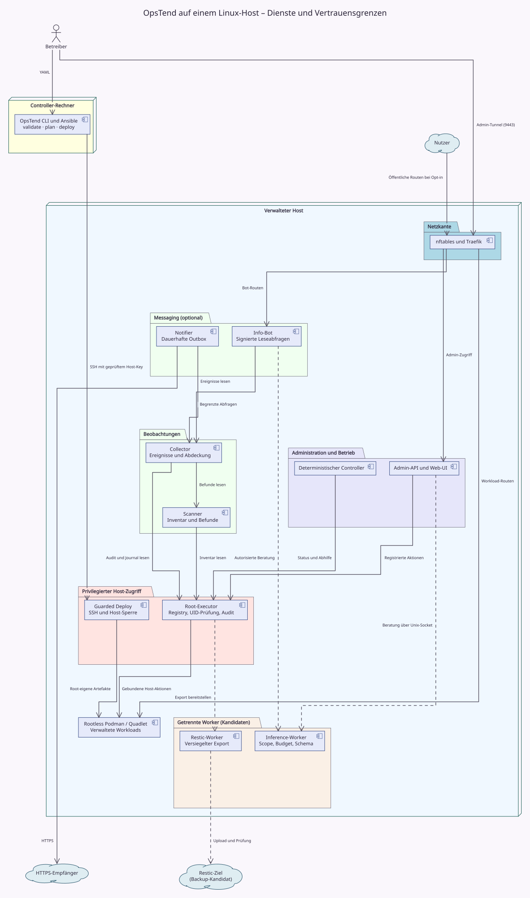
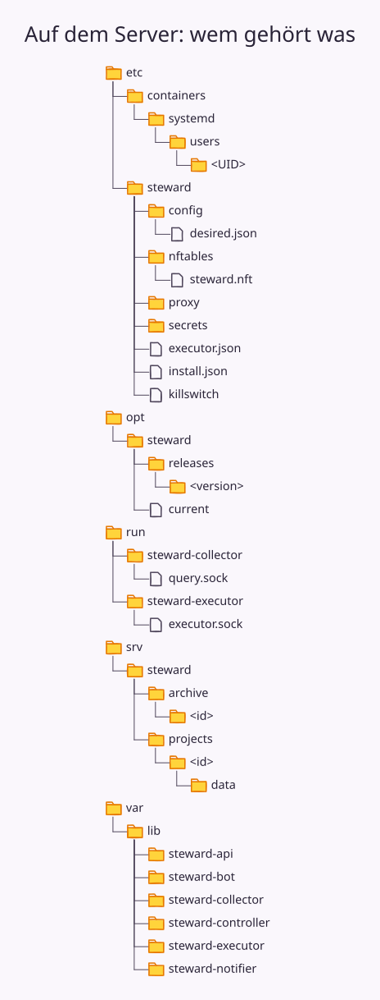
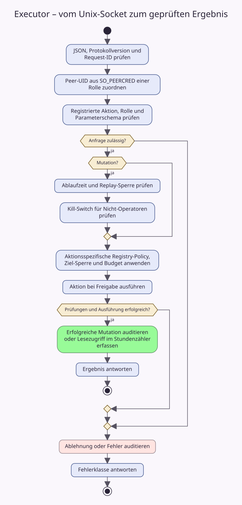
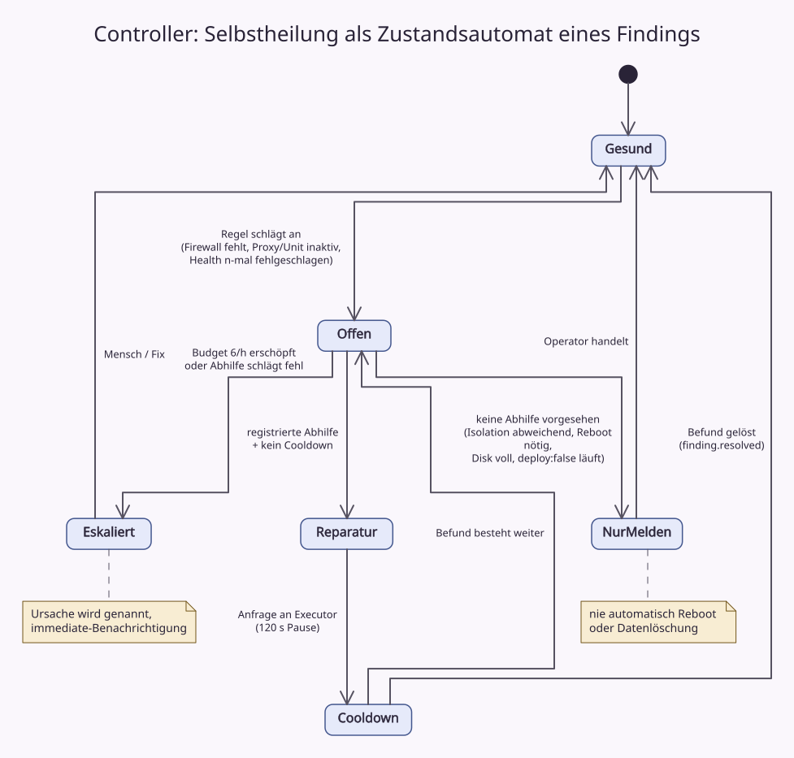
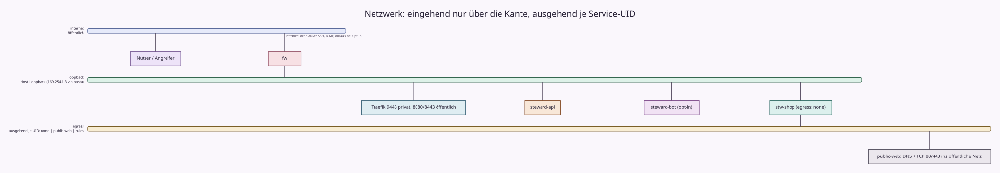

# Architecture

[ADR 0001](adr/0001-architecture.md) explains the foundational decisions.
This page traces the main runtime paths. Check [STATUS](STATUS.md#card-state)
for the acceptance and availability of optional or guarded paths.

## Repository



*Quelle: [`00-gesamtbild.puml`](diagrams/src/00-gesamtbild.puml), erzeugt mit `docs/diagrams/render.sh`.*

```
steward                    Entry point: sets up pinned controller environment and starts CLI
src/steward/
  core/                    Schema, revisions, jobs, audit, events, IPC, secrets, rendering (no host access)
  cli/                     Controller CLI (validate, plan, deploy, status, …)
  api/                     Admin API and web UI serving
  executor/                Privileged host executor: protocol, actions, host access
  controller.py            Deterministic self-management controller
  collector.py             Event collector and its read-only query socket
  notifier.py              Durable outbound HTTPS notification worker
  scannerd.py              Scheduled scanning and private evidence queries
  backupscheduler.py       Host-side scheduling for registered captures
  backupworker.py          Unprivileged Restic upload/check worker
  inference_worker.py      Optional model inventory, admin and advice worker
  bot.py                   Authorized, read-only information queries
  adapters/                Versioned service contracts and adapters
  hostcli.py               steward-host: direct server operation (root)
webapp/                    React/Vite/TypeScript UI
ansible/                   Playbooks and roles (copy rendered artifacts, verify, start)
sample-app/                Example application (notes service with SQLite state)
examples/                  Example configurations for starter profiles
schemas/                   Generated configuration JSON schema
tests/                     Unit/contract tests; tests/integration: real Podman/VM tests
requirements/              Hash-locked controller dependencies
```

## On the server



*Quelle: [`10-dateibaum.puml`](diagrams/src/10-dateibaum.puml), erzeugt mit `docs/diagrams/render.sh`.*

```
/etc/steward/                 Root-owned configuration
  install.json                Marker: binds host to server.name
  config/desired.json         Applied configuration (readable by steward-api)
  executor.json               Registry: projects, allowed actions, peer UIDs (0600)
  nftables/steward.nft         Firewall ruleset
  proxy/                      Traefik configuration, routes, certificates
  secrets/                    Admin token (0600), one env file per project (root:stw-<id>, 0640)
  killswitch                  File present = automatic changes stopped
/etc/containers/systemd/users/<UID>/   Root-owned Quadlet units per service user
/opt/steward/releases/<version>/       venv, wheel, bundled example application
/opt/steward/current                   Symlink to active release
/srv/steward/projects/<id>/data        Persistent project data (stw-<id> only)
/var/lib/steward-api/                  Revisions, jobs, sessions, API audit
/var/lib/steward-controller/           Controller state; export/state.json (group steward-obs, read-only)
/var/lib/steward-collector/            Event log (SQLite, steward-col only)
/var/lib/steward-notifier/             Outbox/cursors/digests (steward-notify only)
/var/lib/steward-bot/                  Request replay/rate-limit state (steward-bot only)
/var/lib/steward-inference/            Separate state for managed inference candidates
/run/steward-collector/query.sock      Event queries (group steward-obs; reader checked by peer uid)
/var/lib/steward-executor/, /var/log/steward-executor/   Replay/budget state, executor audit
```

## Configuration and revisions

- The Pydantic model in `core/config.py` is the sole schema. CLI, API, and UI
  validate against it; the UI displays effective configuration including defaults.
- A revision is the SHA-256 hash of the canonical JSON of effective configuration.
- The API imports the root-owned `desired.json` as the applied revision. A
  browser save checks the expected predecessor and creates a pending head.
  A concurrent change returns HTTP 409.
- The UI or `steward config apply --head FULL_REVISION` can apply a reviewed
  head through the executor when only eligible maintenance/project settings
  change and the other generated Ansible inputs stay identical. The installed
  release, expected head and applied revision bind the operation. Pull the
  resulting revision back to the controller before the next plan or deploy.
- Changes to generated host artifacts go through `config pull`, review, and
  `deploy`. A conflicting pending head blocks deployment by default. An
  interrupted guarded deployment can be resumed against its original revision
  and release. See [configuration operations](operations.md#changing-configuration)
  and [guarded recovery](operations.md#resuming-an-interrupted-guarded-deployment).
- `render.py` generates the nftables ruleset, Traefik files, Quadlet units, and
  executor registry as pure functions. Generated files carry a notice and are
  overwritten on every run.

## Executor



*Quelle: [`01-executor-pruefkette.puml`](diagrams/src/01-executor-pruefkette.puml), erzeugt mit `docs/diagrams/render.sh`.*

Protocol: one JSON request line, one JSON response line over
`/run/steward-executor/executor.sock` (group `steward-exec`).

The server obtains the peer UID through `SO_PEERCRED`. The executor validates
the request envelope, loads the root-owned registry, resolves the UID to a
role, and checks the registered action and parameter schema. Mutations require
freshness and replay checks. The common kill-switch guard blocks non-operator
mutations. Action handlers enforce their own policy, target locks and budgets
as applicable. Host effects use fixed arguments.

Selected actions are below. The authoritative action and role registry is
[`ACTIONS` in the executor](../src/steward/executor/server.py).

| Action | Roles | Effect |
|---|---|---|
| `platform_status` | operator, api, controller | Verified state: units, health, isolation per container, firewall, resources, maintenance policy with current/next regular window and recent runs |
| `inventory_page` | operator, scanner | Bounded, revision-bound package/source/kernel inventory |
| `image_inventory` | operator, scanner | Configured and observed image identifiers for a registered project only |
| `audit_tail` | operator, api | Latest audit entries and chain verification |
| `audit_since` | operator, collector | Audit records after a cursor (byte offset + hash); collector receives redacted views with original hash anchors; reports discontinuities |
| `journal_since` | operator, collector | Warnings/errors of registered units and service users only, redacted (patterns + deployed secret values), ≤ 1000 chars per line |
| `workload_restart` | operator, api, controller | Restart registered project; maintenance contract granted by default |
| `maintenance_admit` | operator | Run one registered read-only maintenance check (`resource_check`) if the regular window admits it: kill switch honoured, no reboot, once per window, recorded durably |
| `config_apply` | operator, api | Apply an eligible pending revision bound to the current host and installed release |
| `proxy_restart` | operator, controller | Restart proxy |
| `firewall_reassert` | operator, controller | Reload root-owned ruleset |
| `update_validate` | operator, controller | Verify a signed image attestation and approval against the root-owned `projects[].update` contract and record it single-use (guarded by release availability) |
| `apply_verified_image` | operator, controller | Apply one validated image: rechecks evidence, kill switch, window, backup age, revision, lock and budget; journals prepare/install/restart/verify; reports success only after the running image, health and isolation are observed; restores the previous image on failure (and, for a `restore_required` migration, the exact capture taken with the workload stopped just before the update). Automatic callers also need `automation.profile: patch` |
| `update_status` | operator, controller, api | Read-only journal summaries of update approvals for a registered project |
| `application_retire` | operator | Archive, verify and release one removed, disabled, `isolation: separate` application; journaled and resumable; never deletes an archive |
| `application_retirement_status` | operator | Read the archive journal of one application |
| `rollback` | operator, controller | Roll back the exact approval and digest. Operator rollback can restore the journaled capture with acknowledgment. Automatic rollback is limited to eligible `none` migrations under the patch policy |

Audit policy: every mutation and every refused request is one record. Successful
read-only requests are counted and written as one `reads` summary per hour; up to
one hour of read counts is lost if the executor restarts.

Stable error classes: `bad_request`, `unauthorized_peer`, `forbidden_role`,
`unknown_action`, `policy_denied`, `kill_switch`, `expired`, `replay`,
`target_busy`, `budget_exhausted`, `execution_failed`, `unavailable`, `internal`.

## Controller



*Quelle: [`02-selbstheilung.puml`](diagrams/src/02-selbstheilung.puml), erzeugt mit `docs/diagrams/render.sh`.*

Cycle: retrieve status from executor → fixed rules (`controller.evaluate`) →
request executor actions for findings with registered remediation → export
snapshot. The baseline rules are listed below.

| Finding | Automatic handling |
|---|---|
| Firewall ruleset missing | `firewall_reassert` |
| Proxy inactive | `proxy_restart` |
| Project unit inactive | `workload_restart` (default; can be disabled per project) |
| Health fails `health.retries` consecutive times | `workload_restart` (default; can be disabled per project) |
| Container deviates from isolation contract | None; report "deployment required" |
| Project running despite `deploy: false` | None; report |
| Reboot required, low disk space, failed units | None; report (no automatic reboot or data deletion) |

After an attempt, a 120-second cooldown applies; the executor limits restarts to
6 per hour per target. Beyond that, the finding is marked as escalated with the
specific cause.

## Event log

The collector (`steward-col`, no network, no host privileges) turns everything
observable into normalized events and is the only writer of the event database.

| Source | How it is read | Events |
|---|---|---|
| Executor audit | `audit_since` with a cursor stored in the same transaction as the events | `action.<name>` for every mutation, `request.denied`, `kill_switch.on/off`, `deployment`, `platform.executor_start`, `audit.discontinuity` |
| Journal | `journal_since`: priority warning or worse, registered units and service users only | `log`, `log.suppressed` (more than 50 lines per unit and cycle), `log.backlog` (sustained flood, skipped) |
| Controller snapshot | file in the controller's export directory | `finding.opened`, `finding.escalated`, `finding.resolved` |
| Collector itself | reachability of its sources | `observation_gap`, `observation_restored` (one each per gap) |

Each event has time, source, kind, severity, project/target, correlation id,
outcome, a redacted summary (≤ 500 chars), small structured data and a
**delivery class** derived from fixed rules: `immediate` (kill switch,
observation gaps, high/critical findings, escalations, failed automatic
actions, unknown peers, audit discontinuities, log floods), `digest`
(everything else except logs) or `none` (logs; queryable only).

Correlation: the controller gives every open finding an id and sends it as the
prefix of its executor request ids; API jobs use the job id. A finding, the
actions taken for it and its resolution therefore share one correlation id.

Retention is bounded by `events.retention_days` (default 30) and
`events.max_events` (default 200 000). Queries go through
`/run/steward-collector/query.sock` (`events_query`, `events_coverage`); the
answer always includes coverage (time span, pruning, collector lag, open gaps)
so readers can report gaps. The API, notifier and bot have distinct read-only
query roles. The collector owns ingestion and durable cursors.

## Network



*Quelle: [`09-netzwerk.puml`](diagrams/src/09-netzwerk.puml), erzeugt mit `docs/diagrams/render.sh`.*

- Inbound: drop except SSH, basic ICMP, and — only when public routes are
  configured — 80/443, redirected to unprivileged proxy ports 8080/8443.
- The proxy reaches backends through host loopback (`pasta` maps `169.254.1.3`
  for this). The `loopback_guard` rule allows only root and the proxy to access
  backend ports.
- Outbound per service UID: `none` (default), `public-web` (DNS + TCP 80/443 to
  public addresses; not a domain allowlist), or `rules` (explicit
  CIDR/protocol/port rules, separate UDP rules). Link-local addresses, including
  metadata endpoints, and all host-owned addresses are always blocked.
- `steward-api`, `steward-ctl` and `steward-col` cannot initiate connections
  (controller and collector additionally run with `PrivateNetwork=yes`).

## Versioned contracts

See [Extending Steward](extending.md) for versioned adapter contracts and their
tests. The Ubuntu 26.04 target check lives in preflight. The
[support matrix](support-matrix.md) records the tested platforms.

## Messaging trust domains

`steward-notify` reads events over the collector socket and sends bounded HTTPS
messages. It alone owns the outbox. DNS results are checked and pinned at TLS
connection time; redirects, proxies and private destinations are refused. Its
credentials are supplied by systemd and it is not an executor peer.

`steward-bot` accepts signed query requests on host loopback behind Traefik. It
verifies HMAC or Discord Ed25519 signatures and timestamp, then authorizes an
explicit endpoint/tenant/user grant before reading a snapshot or collector data.
It owns a separate replay database and has no executor or outbound network
access. Scoped identities receive only registered project observations.
`host: true` explicitly grants host-wide reads. In the guarded advice path the
bot reaches a separate UID-checked inference socket after authorization.
Neither the bot nor notifier can trigger host jobs or approve changes. Public
bot hosting uses its own hostname and routes.

## Scanner trust domain

`steward-scan` owns scanner jobs, evidence, observations and the Trivy cache. Its
executor role can only read registered package/kernel/image inventory. Scanning
is an explicit metadata/network opt-in; it grants no remediation permission.
The source inventory and configured/observed images are revalidated before
publication. The worker holds a process lock and durable renewed job leases;
provider rate-limit cooldowns persist separately from the schedule.

The scanner query socket authenticates kernel peer UIDs: the API reads bounded
subject/finding pages and recent jobs; the collector reads summaries/change feed.
Neither caller can trigger work. Each published snapshot and its grouped events
share one SQLite transaction. Collector cursors advance atomically with ingestion.
No database is shared between trust domains. Time/configuration mismatch changes
read-time evidence to stale/unknown; successful old queries remain historical.

## Backup and inference boundaries

The root executor captures registered data and seals a read-only export. The
separate Restic worker writes upload and integrity receipts for an exact
snapshot. A restore drill supplies separate readback evidence. Root still owns
retention admission. [Backup foundation](backup-foundation.md)

The optional inference worker receives bounded evidence from authorized API or
bot requests over caller-specific Unix sockets. It filters inputs, reserves
budget before access to a provider and validates the result. Advice carries
the coverage of the observations used. Deterministic remediation continues
through the executor. [Inference contract](adr/0007-inference-contract.md) ·
[Inference and advice diagram](diagrams/out/svg/13-inferenz-und-advice.svg)
