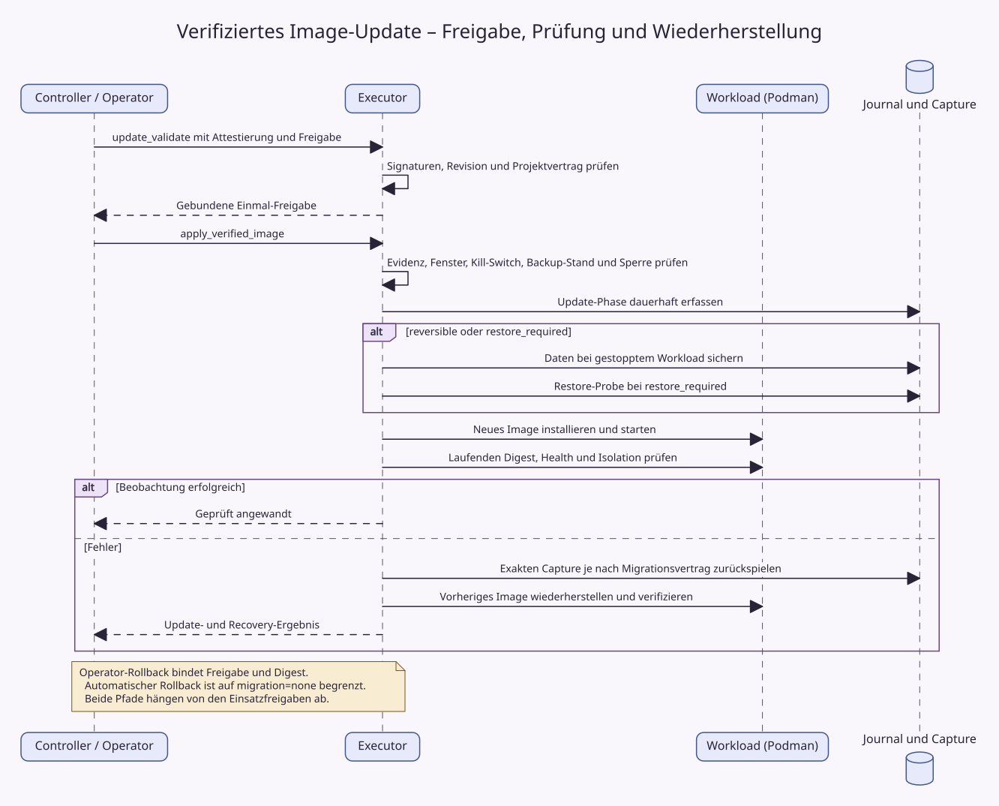
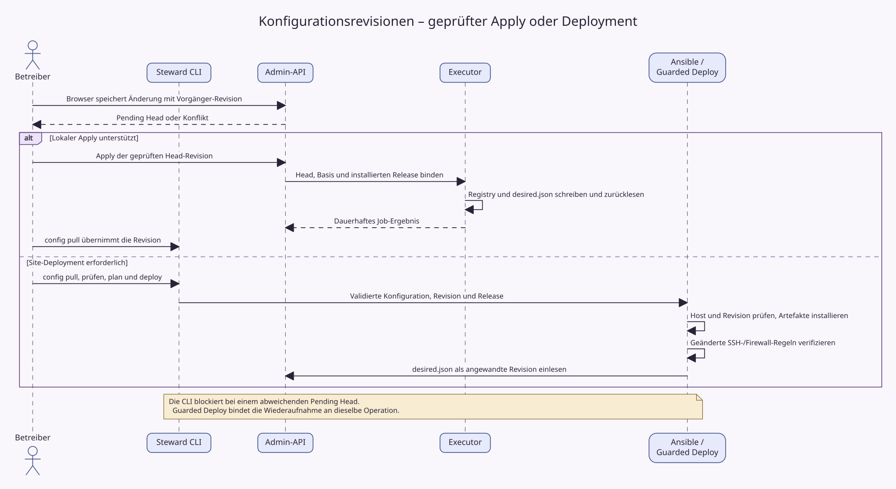

# Operations

Unless otherwise stated, run commands from the repository/release directory on
the controller machine. `C` stands for
`--config config/server.yml --limit my-server`.

| Task | Start here |
|---|---|
| Install or upgrade | [Quick start](../README.md#quick-start) · [Upgrade](#upgrade) |
| Recover a deployment | [First install](#resuming-an-interrupted-first-installation) · [Platform upgrade](#retrying-an-interrupted-platform-upgrade) · [Guarded deployment](#resuming-an-interrupted-guarded-deployment) |
| Change configuration or credentials | [Configuration](#changing-configuration) · [Token rotation](#token-rotation) |
| Inspect the host | [Inventory](#package-kernel-and-image-inventory) · [Scanning](#scheduled-vulnerability-scans) · [Events](#event-log) |
| Configure outbound or inbound messaging | [Notifications](#outbound-notifications) · [Read-only bot](#read-only-information-bot) |
| Pause, recover, or retire workloads | [Kill switch](#kill-switch) · [Recovery](#recovery) · [Retirement](#retiring-or-removing-a-project) |

## Upgrade

Use a trusted controller checkout for the target release version and keep the
signed archive and independently obtained public key on the controller. Pass
both to [`deploy`](release.md#deploy-a-signed-archive).

```bash
./steward deploy --config config/server.yml --limit my-server \
  --release-archive /path/to/steward-release.tar.gz \
  --release-public-key /path/to/trusted-release-key.pub
```

`deploy` shows the configuration diff before confirmation. `./steward plan C`
uses a local `dist/release` build for its separate file preview.

The new release is installed into `/opt/steward/releases/<version>/` before
activation through the `/opt/steward/current` symlink. Platform services restart;
workloads restart only if their unit changed. Old release directories remain
and are not automatically deleted.

Before using guarded application removal for the first time, upgrade the installed
host release with the application still declared. Verify that deployment, then
submit the removal as a separate exact deployment using that same release
manifest and files. The installed host release handles admission and checks
the release binding before the playbook applies changes.

To return to the previous platform release, use its matching trusted controller
checkout and deploy from its archive. The `rollback` command is for a verified
workload image update and depends on
that feature's release guard. Make an independent data backup before a
data-changing upgrade. See [backup availability](STATUS.md#card-state).

Generated controller artifacts live in private per-invocation directories under
`.steward/generated/<server>/run-*/`. A read-only command cannot overwrite an
ongoing deployment's variables. `deploy` holds a controller-local SSH-endpoint
lock (including preflight); a second deployment to that host/port fails with
exit 4. A stale lock file is harmless: the kernel-held lock is released when its
process exits. An enrolled host with the schema 2 installation marker also
holds a root-owned deployment lock. For other hosts, coordinate deployments
across controllers and SSH aliases with the other operators.

## Resuming an interrupted first installation

After the read-only preflight passes, `deploy` atomically publishes
`/etc/steward` together with a root-owned `install.json` ownership marker before
base hardening or workload directories are created. Its `initializing` state
lets the same server name resume after an interruption. The original revision is
recorded for diagnosis; a corrected validated configuration can resume the
installation. The marker becomes `installed` only after the verification role
succeeds. `plan` identifies an incomplete installation.

Run the usual `plan` and `deploy` again after resolving the interruption. Do not
create a marker manually to adopt an unmarked directory. Foreign layouts,
`/srv/isobox`, Docker sockets, different server names, symlinked ownership paths
and markers writable by other users remain blocked. Ownership claims do not
serialize deployments from different controllers. This mechanism resumes
installation; it does not undo changes already made before interruption.

## Retrying an interrupted platform upgrade

For an enrolled host with the schema 2 installation marker, follow
[guarded deployment recovery](#resuming-an-interrupted-guarded-deployment).

The desired files may already be new while the API export and running services
remain old. A retry accepts an unchanged stale API head automatically only when
its head, applied pointer and body hash all match this controller's known
revision and the root desired configuration exactly matches the requested file.
Genuine pending UI changes and inconsistent exports remain blocked.

If the reviewed interrupted revision differs from the new file (for example,
an explicitly reviewed schema-default addition), bind recovery to its complete
root desired hash:

```bash
./steward plan --config config/server.yml --limit my-server \
  --resume-from EXACT_REVIEWED_ROOT_DESIRED_SHA256
./steward deploy --config config/server.yml --limit my-server \
  --release-archive /path/to/steward-release.tar.gz \
  --release-public-key /path/to/trusted-release-key.pub \
  --resume-from EXACT_REVIEWED_ROOT_DESIRED_SHA256
```

The hash must match the actual remote desired bytes, and the API export must be
consistent with no pending UI edit. This option cannot be combined with
`--discard-pending`. Review the previous apply's generated inputs and the current
diff; do not infer that a desired file proves successful runtime activation.

The platform role calculates an activation fingerprint from release file hashes,
configuration revision, rendered units and private credential-content hashes.
It queues service restarts whenever this differs from the root-private
`/etc/steward/platform-activation` record, including when copies are already
unchanged after an aborted run. It also reinstalls the local wheel while
activation is pending, so a same-version wheel copied before interruption is
not mistaken for the package already installed in the venv. Handlers run before
runtime verification, and the activation record advances only after those
checks pass. Secrets and intermediate credential hashes are not logged.

The local successful-deployment checkpoint now records the exact release
manifest fingerprint as well as the configuration revision/version. Aborted
applies preserve the preceding successful checkpoint.

## Resuming an interrupted guarded deployment

On an enrolled host running a release with exact recovery support, query the
protected status on the server over a trusted SSH connection.

```bash
sudo /opt/steward/current/venv/bin/python -I -m steward.executor.site_deployment \
  status --current
```

The output includes the operation, run and boot IDs, original base and desired
revisions, and release manifest hash. If the current query returns `null`, use
`status --operation-id OPERATION_ID` to check a known operation for completion.
A completed operation can be queried again after later deployments.

If the interrupted controller has exited but its host coordinator is still
active, confirm with the original operator that the run should stop. Use the
exact IDs from the protected status to close its intake and drain its scopes
while retaining the pending deployment intent.

```bash
sudo /opt/steward/current/venv/bin/python -I -m steward.executor.site_deployment \
  revoke --operation-id OPERATION_ID --run-id RUN_ID --boot-id BOOT_ID
```

For public CLI recovery, use the original desired configuration, release archive
and secret references from the controller. Review the plan and confirm the
recovery. For an interrupted private application removal, use the
[protected site runner](#resuming-a-private-application-removal).

```bash
./steward deploy --config config/server.yml --limit my-server \
  --release-archive /path/to/steward-release.tar.gz \
  --release-public-key /path/to/trusted-release-key.pub \
  --resume-deployment OPERATION_ID
```

The same operation gets a new run ID after the previous coordinator and scopes
have stopped. The host checks the recorded revisions and release, the root-owned
files and the API export before permitting the new run. If the desired
configuration and registry were interrupted at different revisions, the host
requires exact evidence for both files and the active target release. A pending
UI edit or an unrecognized host state blocks recovery. Verification produces a
completion receipt and releases the pending intent. Repeating the command for a
completed operation reads that receipt without applying the roles again.

The active host release must already support exact recovery. An interruption
before the first recovery-capable host release activates may require diagnosis
using the installed release's tools. Keep the original release and configuration
and preserve the root deployment intent while investigating.

### Resuming a private application removal

Use the protected status and, if necessary, the exact revoke command above.
From the controller, rerun the existing protected `ansible/playbooks/site.yml`
runner with the original generated desired configuration, installed release
manifest and files, and secret references. Use the same private authorization
procedure even if the desired file has no applications. Supply these reviewed
inputs to the runner.

- `steward_private_application_deployment` is `true`.
- `steward_resume_deployment` is the operation ID from protected status.
- `steward_base_revision` is the original base revision from protected status.
- `steward_observed_revision` is the revision of the current root-owned desired
  configuration observed during recovery review. It must match the original
  base or target revision.

The runner selects `resume-private`. Host admission checks the original
private grant, deployment inputs and installed state. The host can preserve a
divergent pending UI edit during this private recovery if its configuration
and digest validate and its applied revision matches the original deployment
boundary. The pending edit stays separate from the retirement inputs. Query
protected status by operation ID to verify completion before retrying.

## Pausing a private application group

On an enrolled host with a guarded, routeless and separately isolated
application, the root operator can use the existing Unix-socket client
`steward.executor.protocol.call` from the installed host release. Supply the
installed configuration revision as `expected_revision` on every call.

- `application_group_status` takes the application ID as `application` and
  reports the durable checkpoint. `idle` means there is no checkpoint.
- `application_group_stop` takes `application` and `service`. The executor
  includes the service and its transitive dependents in the stop and locks
  their prerequisites. A `paused` checkpoint records a confirmed stop.
- `application_group_resume` takes `application`, `operation_id` and
  `generation` from the current checkpoint. It restores services that ran
  before the stop, in dependency order. For an interrupted stop, the same
  request restores the previously running services.
- To stop a group again after a terminal `complete` or `recovered` result,
  pass that checkpoint's `previous_operation_id` and `previous_generation`
  with the new stop request. The executor retains the predecessor in history.

After an interrupted or timed-out request, read the checkpoint before retrying.
A confirmed pause survives boot. If boot cannot establish the authorized state,
inspect `steward-applications.service` and the executor audit before attempting
recovery. The kill switch blocks group changes. A group pause provides no
backup or restore evidence.

## Recovering a failed verified update



*Quelle: [`05-update-pipeline.puml`](diagrams/src/05-update-pipeline.puml), erzeugt mit `docs/diagrams/render.sh`.*

Not available in this release: it needs `projects[].update` (and for automatic
updates `automation.profile: patch`), which the configuration still rejects. Behavior
of the implemented code follows the L06 criteria in the [work queue](implementation-plan.md).

- The signed migration kind decides the recovery. `none` returns only the previous image.
  A `reversible` update (the old version reads the new data) also takes an update-time
  capture, as the exact fallback, but without a restore rehearsal: a revert or `rollback`
  returns the image only, and only if the old image cannot run on the new data does the
  revert fall back to the capture; `rollback --acknowledge-data-restore` asks for the
  exact restore explicitly. A `restore_required` update stops the workload, captures its
  data, rehearses the restore and only then installs the new image; data above 1 GiB is
  refused. A migration for a project without registered data or without the backup pause
  contract is refused before anything changes.
- A failed start, health/isolation check or install triggers recovery.
  An interrupted migration update reverts to the previous image using the
  signed migration contract.
- `steward rollback --project P --approval-id A --digest sha256:... [--acknowledge-data-restore]`
  returns an applied update. It refuses when a later configuration change superseded it.
  A data restore moves the live tree to `data.preserved-<token>` next to `data/`;
  nothing is deleted, at most 8 such trees are kept (remove old ones yourself) and the
  captures stay in the executor spool until you retire them.
- A failed revert or rollback stays visible (`revert_failed`, `rollback_failed` in
  `update_status`) and a rollback can be retried; a repeated restore never overwrites
  data the restored application wrote since.
- Pending web UI revisions are not touched. Limits: the restore source is the executor
  spool capture bound by the journal, not a repository snapshot; the capture retention
  does not yet protect that capture from an operator's export-and-retire.

### Emergency update outside the maintenance window

An operator (role `operator` only, never the controller or the API) may apply a validated
update outside the window: `steward-host update-apply PROJECT --approval-id A --digest
sha256:... --emergency-confirm --reason "why this cannot wait"` (reason 10-200 printable
characters). Only the window check is waived: evidence, approval, fresh backup, recovery
admission, target locks and the journal are the normal path, and a project without any
configured window is still refused. Every use is audited as `update_emergency` before the
update starts and announced as the immediate event `update.emergency`; an attempt by an
automatic caller is refused and audited with `outcome: denied`.

### Automatic rollback of an update that turns unhealthy

With `automation.profile: patch` the controller rolls an update back by itself only when the
update declared migration `none`, was verified healthy when applied and its health checks
then fail durably (twice the project's `health.retries` in a row, after the ordinary
restart did not help) within `update.rollback_window_s` of the apply (default 1800 s, `0`
disables). Only the newest applied update of the project is ever a candidate, and only if it
is itself eligible; an older `applied` approval is never rolled back in its place (the
controller records the skip reason instead). It uses the existing `rollback` action with `"automatic": true`; the executor
re-checks the profile, kill switch, migration kind, window, the current health (an unknown
probe never counts) and a budget, journals `auto_rollback` and attempts it once per update,
success or not. Announced as the immediate event `update.auto_rollback`. Updates with a data
migration keep escalating to the operator.

### Stability gate for automatic updates

The patch controller offers an update only after the service has been continuously healthy
and isolated for `update.min_healthy_s` (default 1800 s; `0` = healthy now). It tracks this
in `/var/lib/steward-controller/stability.json`; any unhealthy or unknown observation, a
controller outage longer than 5 minutes, or an apply restarts the clock. A lost file only
delays updates.

A planned, audited backup pause or capture restart is neutral: while the executor holds a
durable backup pause without a recovery error (up to 5 minutes), and for 3 minutes after its
audited `backup_resume`, an unhealthy observation of that project neither resets nor counts
against the clock. An unplanned unhealthy observation still resets it, and a pause that
needs recovery does too. Consequence for the defaults: a capture taken shortly before the
update does not restart the 1800 s stability clock, so `update.backup_max_age_s` may be as
low as 900 s together with `min_healthy_s` 1800 s (the default for `backup_max_age_s` stays
3600 s).

### Retention of update captures and preserved trees

Update captures (`captures/<project>`) and `data.preserved-*` trees are never deleted
automatically. After 30 days they are reported as cleanup candidates, and a hint appears
when at most two slots remain of the 8-tree and 10-capture limits: the controller exports
the findings `update_retention:<project>:candidates` and
`update_retention:<project>:preserved_trees` / `:spool_captures`. List them read-only with
`steward-host update-retention [--project P]` (action `update_retention_status`; names,
approval ids, ages; no paths). Every spool artifact is listed and aged, plain
`backup-capture` ones included (`bound_to_update: false`), and all of them count toward the
10-artifact limit hint and the `spool_captures` finding. Export what you want to keep (`steward-host backup-export`),
then remove old captures with `backup-retention-purge` and old preserved trees by hand.

### Capture spool limit

Each project's executor capture spool holds at most 10 artifacts (`captures/<project>`).
At the limit `backup-capture` and a `restore_required` update refuse with `unavailable`
("holds 10 artifacts"). Nothing is deleted automatically: export the captures you want to
keep (`steward-host backup-export`), then retire the ones no longer needed
(`steward-host backup-retention-purge`, which refuses protected or still needed captures),
and retry. Do not retire the capture named in the journal of an applied
`restore_required` update (`update_status` shows its `capture_id`) while you may still
need `rollback`.

### Plan and deploy after an executor-applied update

An applied update changes the server's configuration revision. `./steward plan` and
`deploy` then refuse with exit 4 until the local file contains it: run
`./steward config pull` (restart `steward-api` first if the pull still returns the old
revision), review, and plan again. This also protects a rolled-back update from being
re-applied by a stale file. Pending web UI revisions are unaffected.

### Client timeouts

`apply_verified_image`, `rollback` and the controller's patch path use a call timeout
of `600 + 2 x verify_timeout_s + 120` seconds (at most 1800). A killed executor or a
client timeout is reported as `unavailable`; the update may still be running or being
recovered, so check `update_status` before retrying.

## Changing configuration



*Quelle: [`03-deploy-und-revisionen.puml`](diagrams/src/03-deploy-und-revisionen.puml), erzeugt mit `docs/diagrams/render.sh`.*

For a local file edit, run `plan` and then `deploy`. When the web UI has a
different pending head, `deploy` returns exit 4. Use `./steward config pull C`
to copy the pending head into your file and review it before deploying.
Use `--discard-pending` to explicitly discard the pending UI edit.

To restore configuration from a fresh checkout without a local file:

```bash
./steward config pull --host server.example.org --user deploy --port 22 \
  --limit my-server --out config/server.yml
```

The SSH host key must already be trusted. Optional `--known-hosts-file` selects
that trust store; `-K` prompts for the remote sudo password. The pull reads the
installation identity and exported head revision without running workload
preflight checks. It verifies the configuration hash and server name, validates
the schema, and atomically writes a private (0600) local file. Connection fields
come from the explicit SSH options; all secret values remain excluded. Review
and restore referenced secret files or environment variables before deploying.
Existing `--config` pulls retain the local connection and admin token reference.

### Applying a pending web UI revision on the server

The UI offers **Apply on server** for an eligible pending head. The CLI
equivalent is `./steward config apply C --head FULL_REVISION`. The plan allows
only maintenance/project changes that leave all other generated Ansible inputs
identical. Enabled backups and application stacks require a site deployment.
The server binds the reviewed head, applied revision and installed release,
then reads back its files before the job reports success. Run
`./steward config pull C` to adopt the applied revision locally before planning
or deploying again. Approvals bound to the previous revision become invalid.

While `./steward deploy` runs, a server-side apply is refused with `target_busy`. A
guarded deployment holds the deployment fence and lock for its whole run; an unguarded one
(install marker schema 1) leaves `/etc/steward/config/deploy-run.json` from its first
play until its last task. An interrupted unguarded run keeps that marker, so applies stay
refused until `./steward deploy` is repeated and finishes. The deployment writes
`desired.json` and the executor registry only if both still carry the revision it started
from; otherwise it stops before writing (exit 4, "run `./steward config pull`"), so a
revision applied meanwhile is never lost.

## Token rotation

```bash
./steward secrets init-admin-token --config config/server.yml --force
./steward deploy C --release-archive /path/to/steward-release.tar.gz \
  --release-public-key /path/to/trusted-release-key.pub
```

Deployment transfers the new token and restarts the admin API. Sessions are
bound to the token fingerprint: all existing sessions become invalid.
The old token no longer works.

## Package, kernel and image inventory

On the server:

```bash
sudo /opt/steward/current/venv/bin/steward-host inventory
sudo /opt/steward/current/venv/bin/steward-host inventory --project notes
```

Package inventory retains binary/source names, exact distribution versions,
architecture and the running kernel. Pages bind to a content/configuration
revision; collection fails rather than combining changing package snapshots.
Image inventory separates configured manifest digest from observed runtime
image id/digest. A missing runtime digest does not prove the configured image
is running. Neither command executes package scripts or exposes container env.

OCI archive loading can change the reported transport manifest while preserving
the image content/config ID. The executor can bind a registered pinned reference
to its own root Podman cache, requiring that cache's manifest digest to match the
configuration exactly. Runtime verification then requires a running container
with that exact content ID; Trivy must independently report the same ImageID.
Tags, labels and superficially similar digests do not establish equivalence.
Missing cache/content/running proof stays unknown; older incomplete observations
do not acquire fresh verification merely from a software upgrade.

## Standalone vulnerability scans

Export inventory as root and scan as an unprivileged operator:

```bash
umask 077
sudo /opt/steward/current/venv/bin/steward-host inventory > inventory.json
/opt/steward/current/venv/bin/steward-scan --inventory inventory.json \
  --provider osv --provider trivy --out scan-report.json
```

OSV receives package/source names, release and exact versions; Trivy fetches
registered image references remotely, without production mounts or a container
socket. OSV is the default provider if none is specified. Trivy uses the verified
platform tool when installed, otherwise `/usr/bin/trivy`. Enabling scheduled
Trivy scans installs pinned 0.76.2 with SHA256 verification (see below). A real
local image/database scan passed; VM service acceptance remains pending.

The report binds every observation to its subject and inventory revision.
`confirmed` means a provider match for that package version/digest, not proven
exploitability or permission to act. `not_affected` means no published matches
from the completed queried source, not absence of unknown vulnerabilities.
Provider failures, incomplete pagination, old data and unsupported subjects
never become a successful negative result. Last successful evidence remains
explicitly historical under `last_success` when a new attempt fails.

Exit 0 means the requested queries, kernel-package/reboot assessment and runtime
image identity evidence are complete; it may still contain confirmed findings.
Exit 3 means partial/unknown/stale/failed coverage. Input/state errors leave the
report unreplaced. Kernel metadata from older inventory exports lacks reboot
proof and therefore yields unknown. A configured image digest alone does not
prove which image is running. Reports include those limits separately.

State defaults to `~/.local/state/steward-scanner`, with private SQLite and
30-day/50,000-subject retention. `--state-dir` selects another private directory;
`--max-requests` bounds OSV calls. No scan can trigger repairs, updates, backups,
quarantine or approvals. Fresh running-state verification remains necessary
before any future remediation claims a finding fixed.

Each CLI scan also publishes a validated snapshot to private `observations.db`.
Its atomic change feed groups transitions by source/project, records completed
attempts, suppresses duplicate publications and retains at most 100,000 changes
for 30 days. Queries derive freshness and configuration coverage at read time;
historical successes remain separate from current failures. Subject and finding
pages are bounded by bytes and expose a snapshot ID. The scheduled service uses
the same observation contract in its separate state directory.

The adapters use the official [OSV batch API](https://google.github.io/osv.dev/post-v1-querybatch/),
[Ubuntu ecosystem naming](https://ossf.github.io/osv-schema/#affectedpackage-field),
and [Trivy image CLI](https://trivy.dev/docs/latest/references/configuration/cli/trivy_image/).

## Scheduled vulnerability scans

Scanning is disabled by default. Opt in through Configuration form fields or YAML,
review the diff, then deploy the revision:

```yaml
scanning:
  enabled: true
  osv: true
  trivy: true
  interval_s: 21600
  max_age_s: 86400
  max_requests: 1000
  kev: false              # opt-in: fetch the public CISA catalog
  epss: false             # opt-in: send matched CVE identifiers to FIRST
  context_max_requests: 100
```

Enabled providers receive package/source identifiers and exact versions or
configured image references. The service runs as `steward-scan`, never root,
and obtains only registered inventory through the executor. It has no production
mounts, container socket, secret credentials or mutation actions. Public DNS/HTTPS
egress uses a dedicated UID rule; private targets are blocked when managed
firewall isolation is enabled. Private registry authentication is not yet provided.

`steward-scanner.service` always serves read-only observations, even when scans
are disabled. Only the API and collector UIDs (and root) are registered readers;
their roles expose different actions. Each scheduled attempt is a durable job
with target locking, a renewed lease and bounded retries for interrupted inventory
collection. Provider failures remain explicit evidence until a later scheduled
attempt. OSV Retry-After delays, including HTTP dates, persist across restarts;
one quota response stops further requests to that source during the attempt.
Unchanged interval slots are not rescanned after restart. Inventory/configuration
and image observations are rechecked before result caching/publication. Completed
scanner jobs expire after 30 days or 10,000 retained jobs; active jobs are kept.

The collector ingests the atomic change feed with durable cursors; resets,
retention loss, stale/unavailable snapshots and feed backlog are visible gaps.
High/critical vulnerability transitions notify immediately under fixed rules;
completed attempts and lower severity observations join the digest. Existing
bot `/updates` reads these events under its configured project/host grants.

The Vulnerabilities page and authenticated `GET /api/scans` show current states,
kernel/reboot evidence, explicit historical successes, scan jobs and bounded
subject/finding pages. Snapshot IDs fence pagination across scan publications.
Reading a page cannot start scans, install updates or approve a fix. The service
state lives privately under `/var/lib/steward-scanner`.

The installer fetches the architecture-specific archive from the official
[Trivy 0.76.2 release](https://github.com/aquasecurity/trivy/releases/tag/v0.76.2),
verifies its pinned SHA256, and extracts only `trivy` into a root-owned versioned
tool directory. It runs no package maintainer scripts. Local amd64 archive
installation and second-run idempotence passed; arm64 and full VM scanner service
acceptance remain unproven. Enablement reserves an additional 768 MiB in preflight.

### KEV and EPSS context

Enable `scanning.kev` / `scanning.epss` independently, or pass `--kev` / `--epss`
to `steward-scan`. Both default off. KEV fetches CISA's public catalog; EPSS sends
only explicit CVE IDs/aliases already present in matched advisories. Package
names, host identities and secret values are not sent to these context sources.
No CVE is guessed from advisory prose or package names.

KEV membership comes from a validated complete, nonempty catalog with matching
count and unique CVEs. It means the vulnerability is listed in the
[CISA catalog](https://www.cisa.gov/known-exploited-vulnerabilities-catalog),
not that this host is being exploited. EPSS supplies a dated 0–1 probability and
percentile: FIRST describes it as the probability of observed exploitation of
a CVE in the next 30 days, not a local exploitability or impact verdict.
See [FIRST's interpretation](https://www.first.org/epss/using-epss) and
[API contract](https://api.first.org/epss/).

Context states are `disabled`, `unknown`, `available`, `stale` and `fetch_failed`,
independent of the version scanner's states. Missing EPSS rows remain unknown,
never score zero. Failed lookups retain prior values as historical evidence.
Both retrieval and publication must be within 72 hours to use context as fresh;
future timestamps stay stale. A backward catalog/date cannot overwrite newer
cached evidence. Cache reuse is six hours, with 30-day/10,000-entry retention;
HTTP 429 cooldowns survive restarts and do not block the other source.

Requests are sequential, budgeted and capped at 5,000 CVEs per attempt. EPSS
batches fit its documented CVE-parameter length. At most 20 CVEs per advisory
are attached, with explicit truncation/unknown states for bounded omissions.
Source payloads retain the shared pinned-TLS/SSRF and byte bounds. The private
cache is `intelligence.db` in the scanner state directory.

Ordering at snapshot publication is fresh KEV first, then unchanged provider
severity, then EPSS probability. KEV-listed matches notify at least at high
priority. Unrelated unknown findings cannot downgrade an already known critical
match. Context retrieval timestamps and daily score drift do not repeat finding
alerts; semantic state/membership changes do. Read-time source freshness is
shown in the API/UI, even when the snapshot's ordering is historical. Scanner
query completeness excludes optional context lookup success. Context alone
cannot authorize a repair, approval or quarantine.

Deploy with `scanning.enabled: false` to stop the scanner and disable its
autostart. The administration UI reports scanning as disabled with unknown
coverage. The collector closes scanner observation gaps as disabled, and the
private scanner state and feed cursor remain available for reactivation.
Deploy with `scanning.enabled: true` to resume scanning.

## Event log

On the server:

```bash
H=/opt/steward/current/venv/bin/steward-host
sudo $H events --coverage                       # span, pruning, collector lag, open gaps
sudo $H events --min-severity high --since-minutes 60
sudo $H events --project notes --kind-prefix finding.
sudo $H events --correlation-id <id>             # one finding with its actions and resolution
```

The web UI shows the same data under **Events**. Retention is set with
`events.retention_days` and `events.max_events` in the configuration.

## Outbound notifications

Add destinations to `channels`, then validate and deploy:

```yaml
channels:
  - id: ops
    adapter: webhook
    url_ref: env:STEWARD_OPS_URL
    signing_key_ref: env:STEWARD_OPS_KEY
    heartbeat_interval_s: 60  # optional, 30..3600 seconds
    audit_export: true        # optional, signed webhooks only
  - id: discord-ops
    adapter: discord
    url_ref: file:~/.config/steward/discord-webhook
```

Use a random signing key of at least 32 bytes; secret files must be mode 0600.
URLs must use public HTTPS on port 443. Discord URLs must be incoming webhook
URLs on `discord.com`, without query parameters. Credentials are deployed into
root-only files and supplied to `steward-notifier` through systemd credentials.
The notifier can read the collector socket but cannot access the executor.

Deploy with an empty or absent `channels` list to stop and disable the notifier.
The information bot runs when `bot.endpoints` contains an endpoint. Deploy with
an empty or absent endpoint list to stop and disable the bot. The next deploy
also stops previously installed services whose configuration is empty. Their
local state is retained. Reusing the same destination or endpoint IDs preserves
the corresponding notification queue or query history.

Immediate events send their redacted summary; digest events become a daily UTC
count summary; `none` events stay queryable without outbound delivery. Queue
transactions include feed cursors, so restarts do not silently skip messages.
A feed backlog above 100,000 pending messages stops further ingestion. Completed
queue history is pruned after 30 days. Collector retention loss or replacement
produces an observation-gap notification; a new collector stream resets the
reader cursor and uses separate message keys. Monitor `journalctl -u steward-notifier`
and the private `/var/lib/steward-notifier/outbox.db` for failed/pending messages.
No webhook delivery is attempted by validation or by local health checks.

Signed webhook body: JSON `{v: 1, id: <stable key>, payload: {...}}`. Verify
`X-Steward-Signature: v1=<hex HMAC-SHA256>` over the exact timestamp header,
a literal dot and the raw body bytes, using the shared key. Reject stale
`X-Steward-Timestamp` values (for example outside five minutes), compare the
signature in constant time, deduplicate `id`, and return 2xx only after accepting
the message. Redirects are refused; 429/5xx/network failures retry, other non-2xx
responses fail permanently. Crash recovery provides at-least-once delivery.

Discord uses `wait=true` and requires a returned message id, with mentions
suppressed. This follows the official [webhook contract](https://github.com/discord/discord-api-docs/blob/main/developers/resources/webhook.mdx)
and [rate-limit contract](https://github.com/discord/discord-api-docs/blob/main/developers/topics/rate-limits.mdx).
A live-provider acceptance test has not been performed.

External heartbeat receivers should expect the configured interval plus a
reasonable delivery allowance and alarm on missing messages. The payload's
`observed_at` is the observation time; do not treat a newly signed retry of an
old observation as fresh health. `collector_current` covers collector freshness,
not host/workload health. Missing/stale collector data produces an explicit gap
heartbeat. Old unleased heartbeats are superseded instead of replaying a backlog;
heartbeats/gaps/immediate events take precedence over daily digests. Signing ids
include a persistent queue identity to distinguish separate server installations.
The receiving watchdog must run outside the managed server; configuring a
channel does not create that external service.

With `audit_export: true`, a signed webhook also receives structured executor
audit views in `payload.audit`: `original_hash`, `previous_hash`, `redacted: true`
and `view`. Redaction happens in the executor before leaving root. Oversized
views become `{truncated: true}` while retaining their hash anchors. Each record
uses the same atomic feed cursor and outbox acknowledgments as notifications.
Enabling export on an existing destination starts at that destination's current
cursor; use a new destination id if retained history should also be exported.

The external receiver should preserve these anchors independently, deduplicate
message ids and detect missing predecessor hashes. Compare anchors against the
verified original local audit chain when investigating changes or truncation.
The redacted view cannot be rehashed to reproduce the original hash and is not
a byte-for-byte recovery copy. Export covers the executor audit, not the admin
API's separate audit. Retention gaps and permanent delivery failures still need
operator monitoring. No external receiver was contacted during development.

## Read-only information bot

```yaml
bot:
  port: 9090
  # Optional: opens the existing public web entrypoints for this bot only.
  # Requires proxy.acme_email and public DNS. Omit for private/tunnel access.
  # public_hostname: bot.example.org
  endpoints:
    - id: ops
      adapter: webhook
      verification_key_ref: env:STEWARD_BOT_KEY
      grants:
        - tenant: team
          user: alice
          projects: [notes]
          # host: true explicitly grants host-wide/all-project read access.
```

The default configuration has no endpoints or public bot hostname. Deploy
configured endpoints, then POST to `https://localhost:9443/bot/ops` through the
admin tunnel (or `https://bot.example.org/bot/ops` with explicit public hosting).
Inbound keys are separate from notification keys; use at least 32 random bytes.
The exact request body is `{v: 1, id: <unique request>, tenant: "team", user:
"alice", command: "status"}`. Sign it using the timestamp/HMAC header scheme
specified above. The signing caller is trusted to attest the user; grants still
limit each identity to configured projects. Signatures expire after five minutes.
Exact retries return a cached response; changed content with the same id fails.
Requests are bounded to 16 KiB and authorized identities to 30 new queries/minute.

For Discord use `adapter: discord`, `application_id: "<app snowflake>"`, and
`verification_key_ref` pointing to the application's hexadecimal Ed25519 public
key. Configure the public bot endpoint in Discord and register application
commands named `status`, `updates`, `backups`, `help`. Grants use guild snowflake
as `tenant` and user snowflake as `user`. DMs are denied. Responses are ephemeral
and suppress mentions. No bot token or administrator permissions are needed for
incoming interactions. Verification and responses follow the official
[Discord interaction contract](https://docs.discord.com/developers/interactions/receiving-and-responding).
Provider registration and live acceptance remain operator steps.

The bot reads controller snapshots and scoped collector events. Missing
scan or backup evidence is reported as unknown, and stale or missing snapshots
appear as observation gaps. The guarded advice candidate adds scoped `ask`
through a separate inference socket. Regular deployments expose the configured
read-only queries and help. See [the A04–A06 gates](STATUS.md#card-state).

## Kill switch

```bash
./steward killswitch on C        # or: sudo /opt/steward/current/venv/bin/steward-host killswitch on
./steward killswitch status C
./steward killswitch off C
```

The common executor guard blocks mutations by non-operator roles. Status,
findings and audit continue. Root operator actions remain subject to their
action-specific checks, including any dedicated kill-switch checks. Existing
firewall rules, limits and running services stay active.

## Recovery

| Situation | Procedure |
|---|---|
| Service will not start | `./steward status C`; on the server: `sudo -u stw-<id> XDG_RUNTIME_DIR=/run/user/$(id -u stw-<id>) journalctl --user -u <id>.service` |
| Web UI unreachable | `./steward status C` shows `steward-api` and proxy; `sudo journalctl -u steward-api` (intentionally refuses to start without a valid token) |
| Firewall ruleset missing | Controller reloads it automatically; manually: `sudo systemctl restart steward-firewall` |
| SSH/firewall change failed | Rollback timer restores previous state after 180 s. Check with `systemctl list-timers 'steward-*'` |
| Locked out despite timer | Provider console: `rm /etc/ssh/sshd_config.d/50-steward.conf && systemctl reload ssh`, `nft delete table inet steward` |
| Verify audit chain | `sudo /opt/steward/current/venv/bin/steward-host audit-verify` |
| Rebuild server | Prepare fresh Ubuntu 26.04, verify and trust its host key, then deploy. Restore persistent data separately from a verified backup. See [backup and restore evidence](backup-foundation.md). |

## Uninstalling while preserving data

Record the deployed services, their user UIDs and the data you intend to
preserve before removing the installation.

1. Turn on the [kill switch](#kill-switch). List installed Steward system units
   with `systemctl list-unit-files 'steward-*'`. Stop and disable the units and
   any timers or sockets installed by the release. Stop the corresponding
   rootless workloads and proxy. Review each user's units before disabling
   lingering.
2. Review the host's firewall and SSH settings from console access. Use the
   installation's pre-Steward settings to restore host access before removing
   Steward's firewall or SSH configuration.
3. Remove the confirmed Steward-owned files and unit definitions, including
   each managed workload's generated Quadlet files by UID and workload name.
   The parent `/etc/containers/systemd/users/` can contain Quadlets belonging to
   other workloads. Reload systemd after removing the unit definitions.

Keep project data in `/srv/steward/projects/<id>/data`, any application archives
and any required backup receipts. Preserve the corresponding service users and
sub-ID ranges while their data is still needed.

## Retiring or removing a project

Two different rules apply, depending on where the workload is declared.

**Legacy `projects` (version 0.1 behavior, unchanged):**

- `deploy: false` → service stops, does not start after reboot, data remains.
- `manage: false` → toolkit stops managing the project (continues running as is).
- Delete entry → same as `manage: false`. Nothing is deleted; cleanup is manual.
  `steward plan` lists such a project as "stays running, unmanaged"; it is never
  retired or archived, and no change of this rule is planned for `projects`.

**`applications` with `isolation: separate` (ADR 0002 section 6).** Removing a
fully managed application from an exact private schema 2 guarded deployment
retires and archives it. The production guards for `applications` and
`backup.enabled` remain in effect. This procedure requires a host enrolled
for private guarded deployment and an installed release that supports guarded
removal. Each service with registered data needs `allow_backup_pause: true`
to authorize archiving.

`steward plan` reports candidates by comparing the applied configuration
with the complete desired file. The host checks the removal against its
root-owned applied registry and the exact guarded deployment. A pending UI
revision, an unreadable or incomplete registry, or a change to `manage: false`
or `deploy: false` while an application remains declared cannot trigger
retirement. The guarded deployment refuses removal of an absent Shared
application or an absent application with any unmanaged service.

1. With the application still declared, [upgrade the installed host release](#upgrade).
   Services with registered data require `maintenance.allow_backup_pause: true`.
   Resolve any open incident or retirement for a different revision while the
   application is still declared.
   Then remove the application from the file, review the plan, and deploy that
   exact configuration through the private guarded path with the installed release's
   exact manifest and files. The deployment stops
   the application's services and disables autostart, verifies its archived
   data and images, and releases its working data and images before completing
   removal. It keeps the accounts, UIDs and sub-ID ranges reserved.
2. If interrupted, use the [protected exact recovery procedure](#resuming-a-private-application-removal)
   with the original removal configuration, release and operation ID. Use the
   same private guarded path for recovery. After a successful removal of the
   last application, a fresh deployment of the same graph-free configuration
   uses the regular schema 2 guarded path.
3. To bring the application back, add it to the file again and deploy through
   the private guarded path. After the layout step and before any secret, image
   or unit is installed, the deployment runs
   `python -m steward.application_archive reactivate`. The helper verifies the
   archive and pinned numerical identity. It restores the data into the empty
   prepared directory with a no-replace rename and restores the image archive
   into the root cache. A corrupt archive, changed UID or sub-ID range, changed
   data binding or non-empty target stops the deployment before the application
   starts. If retirement never released the data, re-addition cancels retirement
   after checking that the working data matches the archive.

**Manual fallback.** With the application still declared, set `deploy: false`
on every service and deploy to stop it and disable autostart. Prepare the
desired file with the application absent. On the server, as root, run
`steward-host application-retire <id> --desired-config <file-you-will-deploy>`.
The executor checks its own registry and requires the services to be stopped.
It archives each data tree and image under
`/srv/steward/archive/<id>/<operation>/`, rereads the archive, checks for changes
in the working data, then releases the working area and stops the dedicated
user managers. Repeat the same command after an interruption. The journal
resumes a verified or releasing operation and rebuilds an unverified archive.
Use `steward-host application-retirement-status <id>` to see the journal, then
deploy the removal file after the operation reaches `released`.

Data larger than `backup.max_mib` (default 256 MiB, maximum 1 GiB) is refused.
Each retirement preserves its archive, with up to 64 per application.
Permanent archive deletion is a manual operation on the server.
