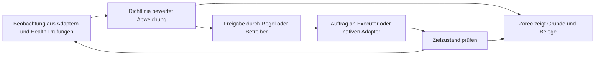

# RC2 Bedienkonzept für OpsTend und Zorec

OpsTend soll die tägliche Verwaltung einer gemischten Infrastruktur an einem
Ort ermöglichen. Der Einstieg zeigt, was Aufmerksamkeit braucht, wo ein Dienst
läuft und welches Gerät, Netz oder Speichersystem davon abhängt. Dieselbe
Oberfläche führt von der Flotte bis zur einzelnen Maschine und begleitet eine
Änderung von der Vorschau bis zur Prüfung des Ergebnisses. Zorec erklärt dabei,
was das System beobachtet, bereits selbst bearbeitet oder vom Betreiber braucht.

Die Webapp bekommt zuerst eine verlässliche Navigation und die wichtigsten
Betriebsabläufe. Darauf bauen die weiteren Adapter und Verwaltungsfunktionen
auf. Der [RC2-Fahrplan](../post-rc1.md) ordnet die Umsetzung den bestehenden
Meilensteinen zu.

Der [klickbare Bedienentwurf](../design/rc2-webapp/index.html) zeigt den
Betrieb, eine eigene **Configuration** und die Maschinenansicht mit
Beispieldaten. Die [Browseraufnahmen und Darstellungsentscheidungen](../design/rc2-webapp/README.md)
vergleichen den Entwurf mit der bestehenden Webapp.

## Stabilisierung der bestehenden Webapp

Die aktuelle App hat eine flache Navigation für einen Host. Die Status-API
liefert `HostStatus`, der Formulareditor deckt ausgewählte Einstellungen ab und
das Farbschema folgt der Systemvorgabe. Zorec ist bereits in der Navigation,
der Beratung und der KI-Einrichtung eingebunden. [Navigation](../../webapp/src/App.tsx) ·
[API-Vertrag](../../webapp/src/api.ts) · [Konfigurationsfelder](../../webapp/src/pages/ConfigFields.tsx) ·
[Gesten](../branding.md#zorecs-gestures)

Der erste Umsetzungsschritt sammelt reproduzierbare Fehler entlang der
vorhandenen Bedienpfade und hält sie mit Schritten und erwarteter Wirkung fest.
Zwei Kandidaten aus der Quellprüfung sind die Behandlung eines API-Ausfalls
als Abmeldung und der Polling-Hook, der überlappende Antworten zulässt. Beim
künftigen Zielwechsel muss die Ansicht verspätete Antworten des vorherigen
Ziels verwerfen. Entwürfe, Auftragsstatus und Zielkontext müssen auch bei
Polling, Neuladen oder Nutzung eines zweiten Tabs verlässlich bleiben.
[Sitzungsprüfung](../../webapp/src/App.tsx) · [Polling](../../webapp/src/hooks.tsx)

## Flottenweite und lokale Bedienung

Oben stehen die Suche, der aktuelle Geltungsbereich und das anklickbare
Symbol für Hell und Dunkel. **System** lässt sich unter **Configuration**
als Vorgabe wiederherstellen. Der Navigator führt von der Flotte über Standort,
Cluster oder Einzelhost bis zu Gast, Container oder Dienst. Die gewählte
Ressource steht in der URL und im Navigationspfad. Ein Wechsel etwa von
Inventar zu Änderungen übernimmt den passenden Kontext. Dieselben
Informationen lassen sich innerhalb der eigenen Berechtigungen sowohl
flottenweit als auch gefiltert auf die gewählte Maschine abrufen.

**Betrieb** ist der tägliche Einstieg. Oben stehen **Störungen** und
**Anstehende Entscheidungen**. Ein Vorgang nennt die Auswirkung, das
betroffene Ziel, den belegten Zustand und den nächsten Schritt. Er zeigt,
ob Zorec eine automatische Abhilfe oder eine Nachprüfung verfolgt und ob
der Betreiber eingreifen oder über einen Entwurf entscheiden muss. Fälle
mit akutem Handlungsbedarf stehen zuerst. Der Einstieg führt direkt zum
Beleg, zur laufenden Prüfung oder zur konkreten Änderungsvorschau.
Kennzahlen, Kapazität und letzte Aktivität folgen darunter.

Der Einstieg öffnet den konkreten Auftrag mit seinem Geltungsbereich und
setzt den Fokus auf den Titel. Auf schmalen Bildschirmen springt **Zur
Auftragsliste** von den Details wieder zur Auswahl. **Betroffene Ressourcen**
verbindet den Auftrag mit Dienst, Ausführungs- und Zielhost, Dienstnetz,
Topologie und gefiltertem Protokoll. Die Links bleiben nach Auflösung des
Falls verfügbar. Ein Netzlink öffnet die referenzierte Verbindung im
Geltungsbereich eines ihrer Endpunkte. Die Topologie zeigt die Belegart
der Verbindung. Der Auftrag zeigt seine eigenen Prüfschritte und Ergebnisse.

Die **Systemübersicht** vereint Hosts, Gäste und Dienste, Netz und
Veröffentlichung, offene Vorgänge, Aufträge und Systemkonfiguration im
gewählten Geltungsbereich. Jeder Bereich führt direkt zur passenden Ansicht
und behält die Auswahl. Die **Gesamttopologie** verbindet dieselben Objekte
und Zusammenhänge in einer Karte. Jede Ebene ist einzeln schaltbar.

In der Hostliste stehen Betriebszustand, Erreichbarkeitsbeleg und
Messstand zusammen. Die Hostzeile führt zum Detail, zur Überwachung oder
zu den Diensten dieses Hosts. In der Karte zeigt derselbe Host den
Beleg mit Quelle und Zeitpunkt. Eine Aufnahme bestätigt den Bestand.
Erreichbarkeit und Health erhalten eigene Belege. In der Kapazitätsansicht
steht die aktuelle Nutzung mit der gemessenen Teilkapazität und der Anzahl
der erfassten Hosts. Die bekannte Gesamtkapazität bleibt separat sichtbar.
Geteilte Speicherpools werden über ihre eigene Identität gezählt, sobald
ein Adapter die Poolkapazität liefert.

| Bereich | Flottenweit | Im Maschinenkontext |
|---|---|---|
| **Betrieb** | Priorisierte Störungen und Entscheidungen mit direktem Einstieg. Zustand der Standorte, Kapazität und Quellen geben Kontext. | Dieselben Vorgänge gefiltert auf die betroffenen Maschinen, mit Health, Ressourcenverlauf und Auswirkungen auf abhängige Dienste |
| **Überwachung** | Vergleich der Hosts nach CPU, RAM und Speicher mit letztem Messwert, Spitze im Zeitraum und Datenstand | Verlauf, Messzeit und Quelle für den gewählten Host mit Einstiegen zum Maschinendetail und Protokoll |
| **Dienste** | Anwendungen und Core-Dienste, neue Deployments, Stilllegung und geplante Entfernung | Container, VMs und Dienstinstanzen auf der Maschine mit Rolle, Zuteilung und Lifecycle |
| **Inventar** | Suchbare Hosts, VMs, Container, Dienste, Geräte, Netzwerke und Speicher | Zugeordnete Gäste, Dienste, Geräte, Netzanschlüsse und effektive Konfiguration |
| **Netzwerk** | Geräte, Switchports, Netze, VLANs, Regeln und Zugangspfade. Filterbare Tabellen mit direktem Einstieg zur Karte und zur jeweiligen Aktion. | Geräte und Pfade mit Bezug zur Maschine. Ports zeigen beobachteten Link, Gegenstelle und ausgehandelte Rate. |
| **Topologie** | Standorte, Verbindungen und gemeinsame Ausfalldomänen | Ein fokussierter Graph um das ausgewählte Objekt, mit Details zur gewählten Verbindung |
| **Änderungen** | Freigaben, geplante Wartung, Automation und Verlauf je Auftrag | Vorschau, Ausführung, Ergebnis und überprüfter Istzustand für das Ziel |
| **Protokoll** | Chronologisches Ereignisprotokoll mit Suche und Filter nach Ereignisart | Dieselben Ereignisse für den Host oder das gewählte Objekt, mit Direktlink zum Auftrag |
| **Configuration** | Systemzugriff und Anmeldemethoden, Rollen, Hostverwaltung, Zorec und KI, Funktionen, Basisdienste, Schutz und Richtlinien | Geerbte und lokal wirksame Werte, Host-Aufnahme und -Austritt, zulässige Ausnahmen und verfügbare Integrationen |

**Überwachung** ist aus **Betrieb → Datenquellen**, der Systemübersicht und
der Hostansicht erreichbar. In der Flotte führt die Vergleichstabelle zu
den Messwerten eines Hosts. Im Maschinenkontext lädt die Ansicht direkt
dessen Verlauf. CPU, RAM und Speicher lassen sich über 1, 6 oder 24 Stunden
betrachten. Der Direktlink enthält Zeitraum, Metrik und ausgewählten Host.
Maschinendetail und Protokoll übernehmen den Host aus der Messwertansicht.
Die Hostauswahl und die Vergleichswerte sind auch per Tastatur erreichbar.

Die Ansicht zeigt die Quelle, die Zeit der letzten Messung und den höchsten
vorliegenden Messwert im gewählten Zeitraum. Messlücken bleiben im Verlauf
offen. Ein zuletzt bekannter Wert mit überschrittener Gültigkeit steht als
veraltet mit seinem Messzeitpunkt in der Ansicht. Ein Zeitraum ohne Messwerte
erhält einen eigenen Hinweis. Die Demo verwendet feste Messreihen zu den
Hosts ihres Beispielinventars. Im Produkt bestimmt der Datenstand der
zuständigen Quelle die Gültigkeit, und die Leseberechtigung begrenzt den
sichtbaren Geltungsbereich.

**Configuration** steht als eigener Eintrag in der Seitenleiste.
Die Administration dieses Systems hat dort ihre Profile für lokale
Anmeldung, LAN, SSH und gegebenenfalls öffentliche Anmeldung mit OIDC und
MFA. Der Bereich zeigt Rollen, Sitzungen, Zorecs Werkzeugfreigaben und
verfügbare Funktionen mit deren Bedingungen. Aktivitäten wie Anlegen,
Deployen, Aktualisieren, Stilllegen und Entfernen eines Dienstes bleiben
bei **Dienste** und **Änderungen** im Betrieb.

Das **Protokoll** und die Auftragsdetails zeigen dieselben protokollierten
Schritte aus einer gemeinsamen Projektion. Ein Eintrag zeigt Zeitpunkt,
Ereignisart, Ziel und die verfügbare Quellen- oder Auslöserangabe. Er öffnet
den zugehörigen Auftrag im passenden Geltungsbereich. Ereignisart und
Textsuche sind kombinierbar. Die URL hält Flotte, Host oder Objekt sowie
die gesetzten Filter fest. Erwartete Schritte stehen im Auftragsdetail
als ausstehend. Die Demo projiziert ausgeführte und beobachtete Schritte
aus ihren Beispielaufträgen. Die produktive Einbindung weiterer System-
und Journalquellen folgt den Abnahmen der jeweiligen Adapter.

Hosts, Gäste, Dienste und verwaltete Netze haben je eine Kurzansicht und
eine eigene Seite mit Direktlink. Inventar, Suche, Karte und zugehörige
Vorgänge öffnen dieselbe Seite im aktuellen Geltungsbereich. Die
Hauptaktionen stehen am Objekt. Die Übersicht zeigt Zustand, Hauptaktionen
und einen fortlaufenden Ticker für die letzten Ereignisse des Objekts. Der
Ticker verlinkt in das Ereignisprotokoll im jeweiligen Kontext und zeigt
Quelle, Zeitpunkt und den Stand der Aktualisierung. Nach einem
Verbindungsabbruch übernimmt er neue Einträge anhand der letzten
Ereignis-ID. Bei einem Wechsel des
Objekts werden Einträge und laufende Abfragen dem jeweiligen Ziel
zugeordnet.

Eine Konsolenkachel lässt sich vergrößern, wenn eine autorisierte Konsole
für das Objekt verfügbar ist. Der Wechsel zur eingebundenen Oberfläche
erscheint nur bei einem für dieses Objekt registrierten Zugang. Fehlt eine
Integration, nennt die Übersicht den Verfügbarkeitsgrund. Konsole und
Anwendungsoberfläche verwenden ihre jeweils gebundenen Sitzungen und
Berechtigungen. Die produktive Abnahme folgt PX04 und den bereits
vorgesehenen Remote-Profilen.

**Hardware und Netzwerk** kann als gemeinsamer Bereich Zuteilungen,
Gerätebindungen, Schnittstellen und Verbindungen zeigen. **Einstellungen**
enthält die Felder des geprüften Dienstadapters. Sicherung und
Wiederherstellung erscheinen bei passender Fähigkeit. Auf kleinen
Bildschirmen führt der Listenpfad zu denselben Details und Aktionen.
Ein gemeinsamer Designzustand steuert Oberfläche, Anmeldung, Logo,
Zorec, Graph und Diagramme. Die Auswahl bleibt im Browser gespeichert
und greift beim Laden. Farben werden durch Text oder Symbole ergänzt.

**Configuration** gruppiert Darstellung, Systemzugriff und Identität,
Zorec und Werkzeuge, Richtlinien, Integrationen, Basisdienste und Schutz.
Die Suche findet sowohl Einstellungen als auch Funktionen. Sichtbare
Bedienelemente navigieren, ändern einen Entwurf oder führen zu einem
nachvollziehbaren Ergebnis. Ist eine Funktion geplant, nicht angebunden
oder wegen fehlender Rechte gesperrt, steht ihr Zustand dort, wo der
Betreiber sie sucht.

Unter **Configuration → Sprache** hat das globale Konto zwei Vorgaben,
für die Weboberfläche und für Zorecs Antworten. In einem persönlichen
Konto lässt sich jede davon separat erben oder überschreiben. Die Ansicht
zeigt die wirksame Sprache und ihre Herkunft. Die Demo bietet Deutsch und
Englisch mit einem gemeinsamen, einem OIDC- und einem lokalen Beispielprofil.

Im Produkt speichert OpsTend die persönlichen Werte am authentifizierten
Konto. Bei OIDC gehören Aussteller und Subject zur stabilen Identität. Bei
lokaler Anmeldung und anderen Anbietern gilt die gebundene interne Konto-ID.
Ein Benutzer ändert die eigenen Werte. Die Änderung globaler Vorgaben
erfordert Administrationsrechte. Ein Wechsel der Anmeldung lädt die Werte
des neuen Kontos. Eine Spracheinstellung beim Anbieter kann als Vorschlag für
ein neues Konto erscheinen. Explizit gespeicherte Werte bleiben wirksam.

Die Oberfläche rendert Steuerelemente, Zustände, Datumswerte und Meldungen
aus sprachspezifischen Katalogen. Namen, technische Bezeichner und
historische Originalbelege bleiben in ihrer gespeicherten Form. Zorec
bindet die Antwortsprache beim Start der Anfrage. Das gilt auch für
regelbasierte Antworten sowie Diagrammtexte. Frühere Antworten bleiben
in ihrer ursprünglichen Sprache. Hintergrundaufgaben verwenden die globale
Zorec-Vorgabe. Berichte können eine eigene Empfängersprache führen.

Desktop und Mobilansicht halten dieselben Zielpfade bereit. Am Desktop
bleiben Geltungsbereich und Suche erreichbar, Objektaktionen stehen am
Objekt, Tabellen enthalten vergleichbare Werte, Vorgänge führen zum
Protokoll. Mobil klappt die Hauptnavigation ein. Kurze Seiten und Listen
folgen dem normalen Seiten-Scroll. Breite Tabellen und die Karte lassen
sich gezielt horizontal bewegen. Chat und Formulare halten Titel und
Bedienung erreichbar. Die Tastaturabnahme umfasst Suche, Navigation,
Objektauswahl, Bearbeiten, Bestätigen und Abbrechen.

Ressourcenbaum und Aufgabenprotokoll von Proxmox, die Gruppierung von
Gerät, Port und VLAN in UniFi sowie kontextbezogene Protokolle in Cockpit
und Grafana dienen als Referenzen. Die OpenShift-Konsole zeigt einen
kompakten Einstieg am Knoten mit Details, zugehörigen Ressourcen und
laufenden Beobachtungen. OpsTend überträgt dieses Navigationsmuster auf
die gemeinsame Objektseite für Host, Dienst und Netz.
[Proxmox](https://pve.proxmox.com/pve-docs/pve-admin-guide.pdf) ·
[UniFi](https://help.ui.com/hc/en-us/articles/33402927617047-UniFi-Switch-Settings) ·
[Cockpit](https://docs.cockpit-project.org/cockpit-guide/latest/guide/features.html) ·
[Grafana](https://grafana.com/docs/grafana/latest/alerting/monitor-status/) ·
[OpenShift-Workload-Ansicht](https://docs.redhat.com/en/documentation/openshift_container_platform/4.20/observability/tutorials/dev-app-web-console)

Wer etwa einen Dienst mit Zeitüberschreitungen untersucht, springt aus
**Betrieb** direkt zum Dienst. Dort sieht er die zugehörige VM, ihren Host und
die aktuelle Netzverbindung. Ein Klick auf die Kante zum Switch zeigt
Linkrate und letzte Beobachtung. Der Wechsel zu **Änderungen** zeigt die
Aufträge derselben Ressource, und ein Klick auf den Standort öffnet die
übergeordnete Sicht.

**Vollständigkeit** wird über einen Funktions- und Einstellungskatalog geprüft.
Jede freigegebene Funktion aus Backend, CLI oder Konfigurationsschema bekommt
einen auffindbaren Einstieg mit Geltungsbereich, erforderlicher Berechtigung,
Voraussetzungen und Ergebnis. Bei sichtbaren Ressourcen zeigt die UI, warum
eine Funktion dort gesperrt, extern verwaltet oder vom Adapter ununterstützt
ist. Jede darstellbare Einstellung zeigt Vorgabe, wirksamen Wert, Herkunft,
Vererbung und Bearbeitbarkeit. Eingabefelder verwenden dieselben Regeln wie
die API. Referenzen auf Zugangsdaten können verwaltet werden, geheime Werte
bleiben beim zuständigen Dienst. Der YAML-Editor bleibt ein Expertenzugang.

## Grundverwaltung für Proxmox und Linux

Proxmox VE bleibt für seine Hosts und Gäste die führende Quelle. OpsTend nutzt
die dokumentierte REST-API, auf der auch die PVE-Weboberfläche aufsetzt. Der
Backend-Adapter verwendet getrennte, zielgebundene Berechtigungen für Lesen
und freigegebene Aktionen. Native Tasks werden mit dem OpsTend-Auftrag
verknüpft und anschließend am Istzustand überprüft. Ein Link in die native
Oberfläche führt bei Spezialfunktionen zum zuständigen Objekt oder Host.
[PVE-Verwaltung](https://pve.proxmox.com/pve-docs/pve-admin-guide.pdf) ·
[PX02 und PX03](proxmox.md#px02--natives-inventar-und-api-vertrag)

Der lesende PVE-Adapter aus PX02.1 liefert `InventorySnapshot` Version 1
aus `src/steward/core/pve_inventory_models.py`. Knoten, Gäste, Pools und
Datastores behalten je Beleg Quelle, Zeitpunkt und Zustand. Der UI-Adapter
übernimmt `coverage=token_scope` und weist die sichtbare Abdeckung als
Berechtigungsumfang aus. Den Gast identifizieren Knoten, VMID und Typ.
Native Task-Beobachtungen zeigen Ausführungsschritte aus PVE. PX03 bindet
künftige OpsTend-Aufträge mit lokaler Auftrags-ID, UPID und Abgleich des
Zielzustands an diese Beobachtungen. PX02.2 liefert die Anbindung an die
HTTPS-Admin-Oberfläche. Auf deren nativer Loopback-HTTPS-Schnittstelle
liefern `GET /inventory` und `GET /guests/<vmid>` mit
`Accept: application/json` das Profil `pve-native/v1`. Die Antwort enthält
den Token-Berechtigungsumfang und den beobachteten Belegzustand. Bei einem
verborgenen oder unbekannten Gast kommt derselbe Zustand `restricted` mit
`guest: null`. Ein abgelaufener Snapshot liefert `stale` mit leeren
Ressourcenlisten. PX02.2 ist in `main` zusammengeführt. Die installierte
M9-Abnahme steht separat aus. [PX02.1](https://github.com/grethel-labs/opstend/pull/12) ·
[PX02.2](https://github.com/grethel-labs/opstend/pull/13)

In der Browser-Demo öffnet **Proxmox-Inventar** den Lesestand aus
**Inventar** oder **Configuration → Integrationen**. **Proxmox-Belege**
führt aus Host, Gastdetail und Karte zur jeweiligen nativen Projektion.
Die Ansicht zeigt den Zeitpunkt und die Quelle je Beleg, Bridge und VLAN,
Ressourcenmesswerte, native PVE-Tasks sowie sichtbare Pools und Datastores.
Der Demo-Server liefert für diese Wege dasselbe JSON-Antwortformat und
wechselt zwischen sichtbarem, eingeschränktem, abgelaufenem und fehlendem
Lesestand. Die native HTTPS-Anmeldung und der Abruf auf PVE gehören zur
Abnahme von PX02.2.

Für Linux beginnt der gemeinsame Bedienvertrag mit einem lokalen
Podman-/Quadlet-Profil. Der Host-Agent vermittelt die freigegebenen Aktionen
über den Executor. Ein beobachteter Container behält seine bisherige
Verwaltungszuständigkeit bis zur ausdrücklichen Übernahme. Die UI zeigt für
PVE-LXC und OCI-Container den gleichen Bedienpfad, nennt aber Typ und
Runtime. Debian, Ubuntu, Fedora und Arch bilden die Zielmatrix. Die erste
Abnahme verwendet das freigegebene Linux-Referenzprofil. Jede weitere
Distribution wird mit Kernel, systemd, Podman, Netz und Speicher separat
qualifiziert. Docker, Incus und KVM/libvirt können später eigene Adapter
erhalten. [Podman-Dienst](https://docs.podman.io/en/latest/markdown/podman-system-service.1.html) ·
[Quadlet](https://docs.podman.io/en/latest/markdown/podman-systemd.unit.5.html)

Der erste durchgängige Ablauf deckt Inventar, Status, Anlage aus einer
freigegebenen Vorlage oder einem Dienstprofil, Start, geordneten Stopp und
Neustart ab. IN01 qualifiziert diese Aktionen für Ubuntu mit rootless
Podman und Quadlet. PX04 qualifiziert die erweiterte Grundverwaltung
für das PVE-Referenzprofil. Dazu gehören native Konsole, gängige CPU-,
RAM-, Storage- und Netzänderungen, Snapshot und Restore, geplante
Verlagerung sowie kontrolliertes Entfernen nach Daten- und Freigabeprüfung.
Die Support-Matrix nennt für jeden Bedienpfad die geprüften Zielprofile.
[IN01](infrastructure.md#in01--eigenständige-linux-server) ·
[PX04](proxmox.md#px04--erweiterte-grundverwaltung-in-proxmox-ve)

Im Gastdetail stehen beobachteter Laufzustand, Gesundheitsprüfung und
gegebenenfalls laufender Auftrag mit ihrem jeweiligen Prüfstand. Die
Vorschau für Start, geordneten Stopp und Neustart nennt den konkreten
Gast auf seinem Host, den Ausgangszustand und die erwartete Wirkung.
Fehlende Rechte, Verwaltungszuständigkeit und nicht unterstützte Aktionen
sind am Gast nachvollziehbar. Der Verlauf zeigt Bestätigung, Abschluss
des nativen Tasks beziehungsweise der Aktion am Linux-Host und erneutes
Auslesen des Zielzustands als eigene Schritte. Ein fehlender Readback bleibt
als offen sichtbar. Derselbe Auftrag ist am Objekt und in **Änderungen**
auffindbar. Aus dem Auftragsdetail gelangt der Betreiber zurück zum Gast.

Die Demo speichert Start, geordneten Stopp und Neustart zuerst als Auftrag.
Ausführung und Beobachtung haben eigene Schritte. Bei einer simulierten
verlorenen Antwort bleibt der Auftrag im Abgleich. Der Abgleich ordnet den
vorhandenen Task beziehungsweise den Executor-Vorgang zu. Erst bestätigte
Rückmeldung aktualisiert den Gastzustand. Bei Fehlschlag ist die Störung aus
**Betrieb** erreichbar. **Protokoll** führt zu den einzelnen Schritten.

Für die produktive PX03-Vorschau werden aktuelle und ausstehende native
Gastkonfiguration getrennt geprüft. Auf PVE 9.3.1 kann ein natives Reboot
ausstehende Gastkonfiguration anwenden. Die Demo zeigt den Beispielunterschied
bei Medien und hält den Neustart zur Prüfung offen. `ha.managed` führt in den
nativen HA-Ablauf aus PH02. Der geordnete produktive Neustart aus PX03.1
führt Shutdown und Start als jeweils einmalige, abzugleichende Schritte.
Die Demo veranschaulicht den Auftragsablauf mit einem simulierten
Dispatch. [PX03](proxmox.md#px03--gast-lebenszyklus-und-provisionierung) ·
[PH02](proxmox.md#ph02--ha-aktionen-und-geplante-node-wartung)

**Gast aus Vorlage** ist an der Maschine und in der Diensteliste
erreichbar. Das Ziel bestimmt den Vorlagenkatalog für QEMU, LXC oder das
Linux-Containerprofil. Vorschau und Auftrag zeigen dieselbe Vorlage, das
Speicherziel, das Netz, die Zuteilung und das Startverhalten. Eine
vorgemerkte Anlage erscheint mit ausstehendem Readback am Objekt. Erst
der belegte Abschluss zeigt den beobachteten Laufzustand und schaltet
die passenden Laufzeitaktionen frei. Bei einem gestarteten Gast bleibt
Health bis zu einem eigenen Beleg offen. Die Demo speichert beide
Schritte im Browser. Die nativen Nachweise für PVE und Linux folgen
PX03 und IN01.

### Geplante Hostwartung

Am Host führt **Wartung planen** zum wirksamen Fenster mit Datum, Zeitzone
und Quelle der Richtlinie. Die Vorschau listet je Gast, Dienst und zentraler
Instanz den Laufzustand, die erwartete Unterbrechung und den Grund der
Behandlung. Bei einer freigegebenen PVE-Verlagerung kommen möglicher
Zielknoten und Kapazitätsbeleg hinzu. An den Quellhost gebundene GPU-,
HDMI- und USB-Geräte werden am Gast erklärt. Bei fehlendem Beleg, fremd
verwalteten laufenden Diensten oder offenem Wiederanlauf hält der Plan am
konkreten Hindernis an.

Der Auftrag erscheint nach Bestätigung der geplanten Unterbrechungen in
**Betrieb** und **Änderungen**. Vor Freigabe und Beginn werden Ziel,
Workload-Stand und Fenster erneut geprüft. Eine geplante Wartung kann bis
zum Beginn abgesagt werden. Im Lauf zeigt die Topologie den Host in
Wartung. Das Protokoll verlinkt auf einzelne Auftragsereignisse. Beim
Wiederanlauf erhalten Laufzustand und Gesundheit eigene Nachweise.

Die lokale Demo wendet dieses Muster auf einen geplanten Neustart desselben
Hosts an. Der Browser simuliert Eintritt ins Fenster und Wiederanlauf.
Betroffene Dienste starten anschließend mit offenem Health-Beleg. Native
PVE-Tasks, Verlagerung, HA-Übernahme und gemessene Dienstgesundheit gehören
zur produktiven Abnahme. [PH02](proxmox.md#ph02--ha-aktionen-und-geplante-node-wartung)

## Hostverwaltung in Configuration

**Configuration → Hostverwaltung** bündelt Aufnahme, Reset und Austritt.
FL01–FL03 sehen bereits Registrierung, Richtlinienrevisionen und die
Übergabe betrieblicher Zuständigkeit vor. Die Hostverwaltung führt diese
Schritte für den Betreiber zusammen und ergänzt Entscheidungen zu den
Diensten und physischen Ressourcen eines Hosts. Mitgliedschaft bezeichnet
hier die OpsTend-Flotte. Die native Cluster-Mitgliedschaft in Proxmox
unterliegt ihrem eigenen Auftrag. [FL01–FL03](fleet.md#fl01--registrierung-und-identität)

1. **Ziel und lesenden Zugriff bestätigen.** Der Betreiber wählt Adresse,
   Standort und Zugangsart. Der PVE-Connector prüft seine registrierte
   Gegenstelle und verwendet ein lesendes Credential per Referenz. Beim
   Linux-Agent bindet eine einmalige, kurzlebige Einladung den bestätigten
   Hostschlüssel und den vorgesehenen Umfang. Der zuständige Adapter erfasst
   den ausdrücklich gewählten Host nach Prüfung seiner Identität. Zorec
   erhält daraus typisierte Daten zu Hardware, Diensten, Abhängigkeiten,
   Datenpfaden und vorhandenen Zeitplänen. Quelle, Zeitpunkt und Lücken
   sind sichtbar. Zorec erklärt die Befunde und bereitet Vorschläge vor.
2. **Vorhandene Dienste und Kapazitäten zuordnen.** Für jeden gefundenen
   Dienst wählt der Betreiber extern weiterbetreiben, lesend beobachten
   oder zur Verwaltung übernehmen. Die Übernahme zeigt Eigentümer,
   Zeitpläne, Speicher, Schutz und Abhängigkeiten und wechselt die
   Zuständigkeit nach FL03. Ungeklärter Bestand bleibt im Entwurf offen.
   Die Kapazitätsansicht zeigt erfasste Ausstattung, belegte Reserven und
   den für OpsTend freigegebenen Anteil. Sie erfasst CPU, RAM und Speicher
   je Ziel sowie explizit freigegebene GPUs und Passthrough-Geräte. Grenzen
   prüft sie gegen verfügbare Geräte, bestehende Belegung, Host-Reserve und
   die Fähigkeiten des Adapters. Überbelegung und unbekannte Kapazität
   bleiben als konkrete Sperrgründe sichtbar. Die Vorschau bindet
   Dienstentscheidungen und Limits an den geprüften Inventarstand. Nach
   Bestätigung liest der Auftrag Mitgliedschaft, Zuständigkeit und wirksame
   Grenzen erneut aus.
3. **Reset oder Austritt vorbereiten.** Reset zeigt die zu erneuernde
   OpsTend-Anbindung, die Wirkung je Dienst und den gesicherten Host- und
   Dienststand. Für die Wiederaufnahme prüft der Auftrag die signierte
   Zuordnung von Hostidentität und Wiederherstellungsstand, registriert eine
   neue Schlüsselgeneration und liest den übernommenen Zustand aus.
   Beim Austritt stoppt der Host die Annahme neuer Platzierungen. Für jeden
   Dienst zeigt die Vorschau, ob er mit bestätigtem Ziel und Readback
   verlagert, lokal an einen benannten Betreiber übergeben oder geordnet
   stillgelegt und gesichert wird. Laufende Aufgaben, nicht verlagerbare
   Gerätebindungen und gefährdete Quorum- oder Zugangsrollen müssen vor
   Freigabe geklärt sein. Der Auftrag bestätigt die Übergaben, widerruft
   die Flotten-Credentials und erhält die historischen Auftrags- und
   Sicherungsbelege. Bei unerreichbarem Host bleibt die zuletzt bestätigte
   Zuständigkeit sichtbar. Der Auftrag weist fehlende Nachweise und
   ausstehende Schritte aus. [CP03](infrastructure.md#cp03--dynamische-dienstplatzierung-und-hot-standbys)

Alle drei Abläufe verwenden rollen- und revisionsgebundene Aufträge.
Eine veränderte Hostidentität, Dienstliste oder Kapazität führt zur erneuten
Vorschau. Die Demo zeigt die Entscheidungen, Inventaränderungen und
Auftragsereignisse anhand eines Beispielhosts. [Flottenidentität und Eigentum](infrastructure-design/02-fleet-and-trust.md#identitäten-und-lebensdauer)

Die Dienstansicht zeigt den Herkunftshost der Aufnahme, die aktuell
bestätigte Platzierung und die Zuständigkeit. Sie weist aus, ob OpsTend
den Dienst verwaltet oder beobachtet, und verlinkt den belegenden Auftrag.
Das Protokoll ordnet die Schritte eines gemeinsamen Hostauftrags den
jeweils betroffenen Diensten zu. Nach Reset oder Austritt bleiben
Dienstname, stabile ID und Entscheidung aus dem Auftrag auch für Dienste
ohne aktuelle Inventarinstanz erhalten. Auftragslinks verwenden den
berechtigten Flotten- oder Hostkontext. Beim Zielhost sind Auftragskopf
und Verlagerungsschritte der dorthin übernommenen Dienste sichtbar. Der
Dienstfilter zeigt die zum gewählten Dienst gehörenden Schritte in diesem
Geltungsbereich.

## Dienst aus Repositories anlegen

**Neuer Dienst** beginnt mit einem oder mehreren registrierten
Repositories. Der Auftrag bindet jede Quelle an einen konkreten
Git-Commit und fasst zusammengehörige Komponenten unter einem Dienst
zusammen. Der Betreiber kann die Konfiguration selbst eingeben oder
Zorec mit der Einrichtung beauftragen.

1. Die manuelle Ansicht bietet einen Projektbaum und einen Editor für
   die Dienstdefinition, Build- und Laufzeiteinstellungen, Netzanschlüsse
   und Healthchecks. Der Editor arbeitet auf einem getrennten Entwurf.
   Manuell und geführt bearbeiten denselben Entwurf. Der Betreiber
   kann jederzeit wechseln und den vorgeschlagenen Adapter nachsehen.
2. Der geführte Ablauf öffnet Zorecs Chat rechts unten im aktuellen
   Dienstkontext. Zorec kann die freigegebene Dokumentation, den
   gepinnten Repository-Inhalt und die autorisierte Inventaransicht
   befragen. Er schlägt Host, Netzwerk, Domain, Dienstabhängigkeiten
   und Keystore-Referenzen vor und fragt bei fachlich offenen Entscheidungen
   nach. Der Berechtigungsfilter gilt bereits bei der Abfrage. Werte aus
   dem Keystore stellt der zuständige Dienst dem Ziel über die gebundene
   Referenz bereit.
3. Beide Einstiege erzeugen denselben überprüfbaren Dienstvertrag.
   Er enthält Komponenten und Startreihenfolge, gebundene Quellen,
   Abhängigkeiten, Build-Verfahren, Datenpfade, API- und Web-Endpunkte,
   Healthchecks, Update- und Migrationsregeln sowie Wiederanlauf und
   Rückweg. Die Vorschau zeigt ausstehende Entscheidungen und Auswirkungen
   auf vorhandene Dienste, Netze und Speicher.
4. Der bestätigte Auftrag führt Fetch, isolierten Build, unabhängige
   Validierung, Freigabe und Deployment zusammen. Zorec darf dazu
   im Namen des Betreibers freigegebene, typisierte Werkzeugaktionen
   anstoßen. Berechtigung, Ziel, Revision und Policy werden pro Ausführung
   geprüft. Ergebnis und beobachteter Zustand erscheinen im selben Auftrag.
   [Repository- und Build-Vertrag](repositories-release.md)
5. Git-Updates folgen danach der wirksamen Richtlinie je Dienst.
   Sie bestimmt freigegebene Quelle, Wartungsfenster, Mindestgesundheit,
   Prüfungen, Freigabemodus und Rückweg. Der Controller kann innerhalb
   dieser Vorgaben selbständig aktualisieren und prüft die Wirkung.
   Änderungen an der Policy, an der Veröffentlichung oder an erforderlichen
   Migrationen werden explizit ausgewiesen.

Der erste Bedienpfad für einen manuell eingerichteten Linux-Dienst hängt an
IN01. Repository-Builds und Zorecs ausführende Werkzeuge werden gemäß ihrer
jeweils belegten Fähigkeiten schrittweise freigegeben. Die
[RC1-Supportgrenzen](../STATUS.md#rc1-scope-decisions) gelten bis zur
Abnahme der betreffenden Profile.

### Adaptervertrag als RC2-Schwerpunkt

Ein Dienst bindet eine unveränderliche Adapterrevision an seine
Deployments und Konfigurationsstände. Der versionierte Vertrag benennt
Fähigkeiten und passende Zielprofile. Für jedes Einstellungsfeld definiert
er einen stabilen Schlüssel, einen Typ und Wertebereich, eine Vorgabe,
Sichtbarkeit, Bearbeitbarkeit und erforderliche Berechtigungen. Er beschreibt
auch die Wirkung einer Änderung, etwa Neustart oder Migration. Keystore-
Referenzen sind ein eigener Feldtyp. Der Browser und Zorec sehen nur die
autorisierte Referenz.

Geführte und manuelle Einrichtung sowie spätere Bearbeitung verwenden
dasselbe Schema und dieselbe serverseitige Prüfung. Zorec kann den
Adapter und Einstellungen als Entwurf vorschlagen. Die UI rendert
freigegebene Feldtypen aus der geprüften Revision. Änderungen erzeugen
eine Vorschau mit Ziel, wirksamen Werten, Differenz und erwarteter
Wirkung. Die Freigabe bindet den Auftrag an den beobachteten
Konfigurationsstand und die exakte Adapterrevision. Die Ausführung
verwendet registrierte, typisierte Aktionen und prüft den Istzustand
anschließend erneut. Ungültige Werte, unbekannte Felder und eine
inzwischen geänderte Revision führen zur erneuten Prüfung.

Der Browserpfad startet mit einem Dienst aus registrierten Quellen. Beide
Einrichtungswege zeigen die Vorgaben und dieselben typisierten Felder.
Bestätigte Werte stehen anschließend am Dienst. Eine spätere Änderung
zeigt dort die Differenz zur aktuellen Revision und verlinkt von der
Bestätigung zum Eintrag mit alten und neuen Werten. Öffnen zwei Betreiber
denselben Entwurf, zeigt die UI nach einer dazwischenliegenden Änderung
den Konflikt und fordert eine neue Vorschau an.

Bei einem Versionswechsel zeigt der Auftrag umbenannte oder
inkompatible Felder und die geplante Migration an. Update, Abbruch und
Rollback verwenden dokumentierte, revisionsgebundene Verfahren. Ein
Rollback stellt gemeinsam die kompatiblen Artefakt-, Adapter- und
Konfigurationsrevisionen wieder her. Wo eine Datenmigration einen
Wiederherstellungspunkt voraussetzt, ist dieser zu belegen. Der Rückweg
ist Teil der Freigabe. Jeder bestätigte Wechsel erhöht die
Konfigurationsrevision, auch wenn ein Rollback eine frühere Adapterversion
aktiviert. Vorschauen mit einer älteren Revision verlieren ihre Gültigkeit.
Repository-Deployments folgen dem unabhängigen
Build- und Validierungsvertrag. [R01–R04](repositories-release.md)

## Ressourcen und Netztopologie

Die Topologie zeigt zuerst die Platzierung **Standort → Host → VM oder
Container → Dienst**. Die Platzierung bleibt sichtbar, während der
Betreiber Verkabelung, Netze und Regeln oder VPN und Zugang einblendet.
Der Produktentwurf ergänzt je nach Fokus Storage, Hardwarezuordnung und
Backup-Pfade. Eine
Kante öffnet Quelle, Zeit, Richtung und Geltungsbereich. Jede
Netzbeziehung beantwortet eine konkrete
Frage. Ist der Port verbunden? Ist Verkehr laut vorliegender Policy
erlaubt? Hat eine benannte Quelle die Verbindung geprüft oder beobachtet?
Aus einer gemeinsamen Bridge allein lässt sich nur die Zuordnung ablesen.
[Quellenvertrag und Graph](infrastructure-design/06-observability-and-ui.md#projektion-und-quellenvertrag)

Die Karte gruppiert interne und externe Standorte getrennt und benennt
die zugehörigen Hosts. Hosts und zentrale OpsTend-Dienste verwenden die
Primärfarbe von Grethel Labs. Zusätzliche Anwendungen erhalten Violett.
Bei Netzgeräten bleibt die Geräteart als Text sichtbar. Unabhängig von der
Rollenfarbe zeigt der Außenrahmen den Zustand. Rot steht für offline,
Gelb für Warnung und Blau für Wartung. Legende und Objektdetail benennen
Rolle und Zustand auch als Text. Ein ausstehendes oder unklares erneutes
Auslesen ist als **Readback offen** oder **Readback unklar** sichtbar.

| Ressource | Anzeige und Bedeutung |
|---|---|
| CPU, RAM und Storage | Physische Kapazität, Reserve, Zuteilung oder Limit, aktuelle Nutzung und zugrunde liegender Host bzw. Datastore. Geteilte Speicherpools zählen flottenweit einmal. Gast- und Containerlimits stehen unter ihrer physischen Kapazität. |
| GPU, PCI und USB | Physisches Gerät, Zuordnung zu Gast oder Container, exklusive Nutzung oder Teilung, soweit bekannt. Eine lokale Bindung erklärt, warum ein Gast auf einem anderen Host gegebenenfalls nicht starten kann. |
| HDMI und Audio | Zuordnung der GPU oder Audiofunktion, soweit der Adapter sie belegt. Die physische Verbindung zu Bildschirm oder KVM-Switch erscheint bei bestätigter Beobachtung oder manueller Dokumentation. |
| Physische Netzports und Dienste | Switchport, Gegenstelle, ausgehandelte Linkrate und aktuell gemessene Auslastung als eigene Werte. Virtuelle NICs sowie veröffentlichte TCP-/UDP-Ports erscheinen in ihrer jeweiligen Netz- oder Dienstzuordnung. |

Die **produktive Topologieansicht** erzeugt für den aktuellen Ausschnitt
PlantUML aus der berechtigten Inventarprojektion und lässt die Karte durch
Excaliplant rendern. Die Hook-ID verweist auf die registrierte ID einer
Ressource oder Verbindung. Hover und Klick machen das Element
auswählbar. Der Editor bearbeitet die typisierte Ressource oder Verbindung,
etwa IPv4-Adresse, Endpunkte oder Einstellungen. Der geänderte Entwurf
aktualisiert Inventar und PlantUML-Vorschau. Im Produkt bestätigen
Vorschau, Freigabe und erneutes Auslesen die tatsächliche Änderung.
Die Oberfläche bietet einen Überblick, der die ganze Karte ins Sichtfeld
einpasst, und eine vergrößerte Ansicht für lesbare Details. Am ausgewählten
Objekt stehen seine direkten Beziehungen mit Gegenstelle und Ebene. Die
Liste kennzeichnet ausgeblendete Ebenen. Die Auswahl einer Beziehung
blendet die zugehörige Ebene ein und öffnet genau diese Kante. Der
Direktlink stellt Ausschnitt und Auswahl wieder her.

Am Kantendetail stehen Beobachtungsart, Quelle und Zeitpunkt.
Ein physischer Link, eine konfigurierte Regel und eine gemessene
Erreichbarkeitsprobe behalten ihre jeweilige Aussage. Änderungen im
Entwurf kennzeichnen vorhandene Beobachtungen als veraltet, wenn sich
Endpunkte oder andere für die Aussage relevante Werte ändern.

Der Renderer folgt dem Hell-/Dunkel-Umschalter. Im Beispiel stehen die physischen Ports und
Linkraten an den Kabelverbindungen. Eigene Kanten zeigen den VPN-Pfad,
eine HTTPS-Freigabe und eine NFS-Prüfung.
[Beispielgrafik](../diagrams/out/svg/15-rc2-infrastruktur.svg) ·
[PlantUML](../diagrams/src/15-rc2-infrastruktur.puml) ·
[Bearbeitbare Zeichnung](../diagrams/out/excalidraw/15-rc2-infrastruktur.excalidraw) ·
[Renderpfad und Abnahme](infrastructure-design/06-observability-and-ui.md#plantuml-und-excaliplant-in-der-webapp)

Die erste Netzgeräteintegration in IN02 verwendet einen lesenden
**UniFi-Adapter** für ein konkretes Cloud Gateway und einen Switch. Die UniFi Network API
liefert je nach Profil Sites, Clients, adoptierte Geräte, Netze und Hinweise
auf Uplinks und Ports. Der Site Manager eignet sich für die übergreifende
Übersicht. Das Modell, die Firmware und der API-Zugang bestimmen, welche
Werte belastbar sind. Beobachtete Clients erscheinen mit Quelle und
Zeitpunkt. Der Betreiber bestätigt Identität und Aufnahme, bevor ein
Gerät verwaltet wird. Weitere Geräte können über einen registrierten
Adapter, SNMPv3 oder dokumentierte Zuordnung erscheinen. [IN02](infrastructure.md#in02--lokale-und-externe-geräte) ·
[UniFi API](https://help.ui.com/hc/en-us/articles/30076656117655-Getting-Started-with-the-Official-UniFi-API) ·
[UniFi-Gerätedetails](https://developer.ui.com/network/v11.0.97/getadopteddevicedetails)

Der grafische Editor aus NX04 öffnet vom Port, VLAN oder Regelpfad aus einen
Änderungsentwurf. Die Vorschau zeigt betroffene Geräte, Netze und Dienste
sowie den Verwaltungszugang. Nach Freigabe schreibt der zuständige Adapter
und prüft die effektive Konfiguration erneut. Für UniFi sind Firewall- und
ACL-Schreiboperationen versioniert dokumentiert. Die RC2-Referenz prüft
eine einzelne reversible Änderung in einem Testnetz einschließlich
Erreichbarkeit vor und nach dem Apply sowie Rücknahme. Weitere
VLAN-, Firewall- und ACL-Operationen werden je Modell und Version
qualifiziert. Physische Verbindungen werden in der Karte dokumentiert und
vor Ort geändert. [NX04](infrastructure.md#nx04--versionierte-unifi-netzänderungen) ·
[UniFi Firewall](https://developer.ui.com/network/v11.0.97/updatefirewallpolicy) ·
[UniFi ACL](https://developer.ui.com/network/v10.6.106/createaclrule)

Die Portseite ist aus der Netzliste, der Kartenkante und dem VLAN
erreichbar. Sie zeigt Gegenstelle und beobachtete Rate neben der
Konfiguration des ungetaggten und der getaggten Netze. Die Vorschau
vergleicht Betriebsart und VLAN-Zuordnung. Nach Bestätigung führen
Portseite und Verlauf zur gespeicherten Revision. Die Karte und die
VLAN-Seite zeigen dieselbe Zuordnung. Der Rückweg verwendet dieselbe
Vorschau. Die Demo speichert diesen Ablauf lokal. Die NX04-Abnahme
prüft zusätzlich den tatsächlichen Verwaltungszugang und Netzpfad.

**Firewall und ACL** ist aus der Netzliste, dem VLAN, dem Dienst und
der zugehörigen Kartenkante erreichbar. Die Demo zeigt die lesende
Switch-ACL **Verwaltung schützen** und die Firewall-Regel **NFS für
Medien** für TCP 2049 von Medien zu Pi-NAS. Die Regelansicht zeigt
Endpunkte, Zonen, Gerätequelle, aktuelle Wirkung, Revision und
Verbindungsbeleg. Der Entwurf vergleicht Erlauben und Blockieren und
erzeugt einen Auftrag unter **Anstehende Entscheidungen**. Bis zur
Bestätigung gilt die bisherige Revision. Ablehnen beendet den Auftrag
mit unverändertem Regelstand.

Die Bestätigung speichert und liest die Wirkung im Demo-Browser.
Die vorherige Probe erscheint danach mit ihrem Messzeitpunkt als
historisch. Eine neue Prüfung der Erreichbarkeit bleibt offen. Der
Auftrag und das gefilterte Protokoll behalten Entwurf, Entscheidung und
Revision. Die produktive Mutation benötigt den versionsgebundenen
Adapter aus NX04 mit getrenntem Schreibrecht und erneutem Auslesen.

## Zorec und der selbstverwaltete Betrieb

Zorec bekommt einen festen Einstieg rechts unten und öffnet sich als
kontextbezogener Chat aus Ressourcen, Befunden, Aufträgen oder der
Diensteinrichtung. In der Flottenansicht
fasst er priorisierte Vorgänge zusammen. Am Host erklärt er je Vorgang die
betroffenen Ressourcen, Beobachtungen, Richtlinie und Auswirkung. Die Ansicht
zeigt, welche Routine automatisch läuft, was genau zur Bestätigung ansteht
und wie der Zustand nach Ausführung geprüft wurde. Sie funktioniert mit
typisierten Betriebsdaten auch bei ausgeschaltetem KI-Anbieter. Optionale
KI beantwortet Fragen und formuliert Vorschläge aus den Daten des aktuellen
Berechtigungsbereichs. Die Werkzeugliste in **Configuration** weist Lesen,
Entwurf und zugelassene Ausführung getrennt aus. Freigabe und Ausführung
folgen demselben Job- und Executor-Pfad wie die direkte Bedienung.

### Zorec-Shells und Berechtigungen

Eine Shell ist ein eigener Werkzeug-, Daten- und Sitzungskontext.
**Configuration → Zorec und KI** verwaltet die drei Profile getrennt und
kennzeichnet jede standardmäßig ausgeschaltete Option mit **Standard aus**.
Für aktivierte Abweichungen zeigt die Oberfläche den wirksamen zusätzlichen
Zugriff vor dem Speichern und im Chat. Internetrecherche ist je Shell
separat einstellbar und startet ausgeschaltet.

| Shell | Standard und Einsatz | Konfigurierbarer Umfang |
|---|---|---|
| **Admin Lesen** | Normaler Einstieg für Admin-Chat, Admin-API-Chat und Informationsaufgaben. Grunddaten, Betriebsstatus und zugehörige Belege im Geltungsbereich des Aufrufers. | Bis zu allen administrativen Lesewerkzeugen und Lesedaten, die der Aufrufer sehen darf. Verwendet die gemeinsamen Lesewerkzeuge, Doku- und Diagnose-Skills. |
| **Admin Edit** | Ausgeschaltet. Admin-Chat und API-Chat können den Modus ausdrücklich wählen. KI-gestützte Automationen verwenden eine eigene, freigegebene Identität in diesem Profil. | Stufen für Entwürfe, freigegebene Betriebsaktionen und Vollzugriff auf registrierte Systemaktionen für die zugewiesenen Ziele. Dazu gehören passende Schreibwerkzeuge, Skills und Richtlinien je Aktion. Die Automationsfreigabe ist separat einstellbar. |
| **Berichte** | Eigene Sitzung für Berichte und Antworten nach außen. Als Standard stehen freigegebene Berichtsprojektionen mit wenig kritischen Daten bereit. | Lesedaten können erweitert werden. Admin Lesen setzt die obere Grenze. Der öffentliche Kanal und die Freigaben des Empfängers begrenzen den sichtbaren Ausschnitt zusätzlich. |

Die wirksame Berechtigung ergibt sich aus Aufruferrechten, Shell-Profil,
Zielbereich, Adapterfähigkeit und Auftragsrichtlinie. Die Werkzeugsuche
liefert nur die für diesen Aufruf zulässigen registrierten Aktionen.
Jede Aktion definiert typisierte Eingaben und Ausgaben, notwendige Rechte,
erlaubte Ziele, Wirkung, Freigabepfad und Prüfung. Skills geben Zorec
Handlungswissen. Die API und der Executor prüfen die Rechte bei jeder
Ausführung neu. Der Wechsel von Admin Lesen auf Admin Edit bleibt ein
sichtbarer Schritt. Berichte verwenden einen eigenen Verlauf und eine
eigene Identität. Bei einem Widerruf fallen betroffene Chats auf das
zulässige Profil zurück und ausstehende Tool-Aufrufe werden erneut geprüft.

### Zugangsdaten und Tool-Gateway

**OpenBao** ist der Kandidat für den gemeinsam nutzbaren Geheimnisspeicher.
Berechtigte Nutzer und Programme können über ihre eigene Identität
versionierte Zugangsdaten und Referenzen verwalten. OpsTend verwendet
versionierte Referenzen in Adaptern, Aufträgen und Konfiguration.
Audit und API zeigen Referenz, Zweck, Herkunft und Status. Für
den Zugriff auf gespeicherte Werte gelten eigene OpenBao-Policies.
[OpenBao KV v2](https://openbao.org/docs/secrets/kv/kv-v2/) ·
[OpenBao Policies](https://openbao.org/docs/concepts/policies/)

Das **Tool-Gateway** läuft mit einer eigenen Identität. Zorec übergibt ihm
die registrierte Aktion, das Ziel und eine erlaubte Zugangsdatenreferenz.
Das Gateway prüft die aktuelle Freigabe und führt die authentifizierte
Verbindung aus. Für SSH erzeugt es ein eigenes kurzlebiges Schlüsselpaar
und lässt den öffentlichen Schlüssel von OpenBao für die zulässige
SSH-Rolle signieren. Der private Schlüssel bleibt im Gateway. Für API
oder passwortgebundene Anmeldung verwendet der zuständige Adapter das
Credential im selben getrennten Ausführungskontext. Modell, Browser und
Chatverlauf bekommen ausschließlich die freigegebenen Ergebnisfelder.
Ziel, Aktion, Referenz und Ergebnis sind im Audit nachvollziehbar.
[OpenBao SSH-Zertifikate](https://openbao.org/docs/secrets/ssh/signed-ssh-certificates/)

Der Schutz hängt an der Prozessgrenze. Job- und Shell-Werkzeuge haben
getrennte Identitäten und Ausführungsumgebungen, die keine Prozessdaten
oder Sitzungen des Gateways lesen können. Freigabe und Widerruf beziehen
sich auf Ziel und Aktion. SSH-Hostidentität und Zertifikatslaufzeit werden
vor Benutzung geprüft.

### System-API und Internetrecherche

Die versionierte API nimmt feste Systemaktionen und Chat-Nachrichten an.
Eine für Aktion und Ziel berechtigte Identität kann eine registrierte Aktion
mit typisierten Parametern direkt und ohne Chat-ID planen. Ein Werkzeugaufruf
aus Zorec verwendet ausdrücklich die Chat-ID und die wirksamen Admin-Edit-Rechte.
Beide Aufrufwege nutzen Vorschau, Bestätigung und Prüfung des Zielzustands.
Der Audit-Eintrag erfasst Aufrufer, Aktion, Ziel, Aufrufweg und bei einem
Werkzeugaufruf die zugehörige Chat-ID. Die API akzeptiert ausschließlich
registrierte Aktionen und die dafür definierten Eingaben.

Für Gespräche legt der Client eine Sitzung mit einer serverseitig erzeugten
Chat-ID an und sendet Nachrichten zu dieser ID. Admin Lesen ist der Standard.
Admin Edit verlangt einen expliziten Modus und eine dafür berechtigte
Identität. Ein Shell-Wechsel öffnet einen eigenen Gesprächskontext mit eigener
ID. Berichte erhalten einen separaten Kanal mit Report-Scope. Sitzung,
Nachrichten und Tool-Ereignisse binden Aufrufer, Profil und die aktuelle
Richtlinienrevision. Nachrichten-ID und Auftrags-ID machen Wiederholungen
nachvollziehbar.

| Geplanter Aufruf | Ergebnis |
|---|---|
| `POST /api/v1/actions/{aktion}/plans` | Vorschau und Plan-ID für Aktion, Ziel und geprüfte Parameter. Direkter Aufruf mit Aktionsrecht oder chatgebundener Aufruf mit Admin Edit. |
| `POST /api/v1/plans/{planId}/confirm` · `GET /api/v1/jobs/{jobId}` | Bestätigter Auftrag, Verlauf und belegter Zielzustand |
| `POST /api/v1/chats` | Chat-ID für Identität, gewählte Shell und Geltungsbereich |
| `POST /api/v1/chats/{chatId}/messages` | Antwort oder laufender Gesprächsvorgang mit Nachrichten-ID |
| `GET /api/v1/chats/{chatId}/events` | Autorisierte Antworten und Tool-Ereignisse dieses Chats |

Internetrecherche läuft über eine getrennte Abrufumgebung mit eigener
Netzfreigabe und ohne Zugang zum internen Tool-Gateway oder OpenBao.
Der Abruf gibt Quellen und gefilterte Inhalte als Recherchematerial
zurück. Inhalte aus dem Netz erhalten dadurch keine Systemrechte. Auch
bei aktivierter Recherche gelten für Änderungen die Tool- und
Auftragsrichtlinien der gewählten Shell.

#### Allgemeine Wissensfragen

Der Chat beantwortet auch allgemeine Wissensfragen. **Fragebereich** lässt
Automatik, Systemkontext, Allgemeinwissen und Webquellen explizit auswählen.
Allgemeinwissen verwendet die Frage und den Wissensverlauf als Modellkontext.
Webquellen verwenden bei erteilter Internetfreigabe die ausdrücklich
gestellte Suchfrage. Die Demo unterstützt als erste Quelle Wikipedia in
Deutsch und Englisch und zeigt geprüfte Artikel-Links oder den fehlenden
Abruf. Der produktive Rechercheprozess erhält eigene Quellen, Budgets und
Protokollierung. Für Abläufe kann Zorec ein Schaubild mit geprüften
Schrittdaten an den bestehenden Renderer übergeben. [MediaWiki REST API](https://www.mediawiki.org/wiki/API:REST_API/Reference#Search_pages)

Die RC2-Abnahme prüft die Default-Profile, die getrennten Chatverläufe,
die Umschaltung in UI und API, eine direkte Aktion im freigegebenen
Zielbereich, eine freigegebene KI-Automation und den Widerruf während
einer Sitzung. Eine geprüfte SSH- oder API-Aktion
weist die Übermittlung ausschließlich erlaubter Ergebnisfelder nach.
Nach außen geteilte Antworten, Fehler, Logs, Traces und Tool-Payloads
werden mit Test-Secrets auf unbeabsichtigte Offenlegung geprüft.
Die Browserdemo zeigt die Profile und ihre Warnhinweise. Ihre lokale
Test-API bindet jede Chat-ID an eine Demo-Identität und an genau eine Shell.
Sie prüft Admin Lesen als Standard, die explizite Wahl von Admin Edit und
den eigenen Geltungsbereich für Berichte. Die auswählbare Testidentität
für direkte Aktionen kann ausschließlich die Beispielaktion für Sensorik
planen und den eigenen Auftrag bestätigen und abrufen. Ein Admin-Edit-Chat
kann dieselbe Aktion mit Chat-ID aufrufen und erhält ein Chat-Ereignis zum
Auftrag. Dieselbe Nachricht unter derselben Nachrichten-ID und dieselbe
Planbestätigung liefern bei Wiederholung ihr ursprüngliches Ergebnis. Die
Demo verwendet flüchtige Testdaten und eigens ausgestellte Demo-Tokens.
Ihre Aufträge liefern simulierte Ergebnisse.
Für den Produktivbetrieb bleiben die reguläre Authentifizierung, die
Richtlinienprüfung und die getrennte Ausführung im Tool-Gateway erforderlich.

### Vollautonomer Modus

**Configuration → Zorec und KI → Vollautonomer Modus** legt den Modus für
den Betrieb fest. Der Schalter startet ausgeschaltet. Die Einstellung zeigt
den wirksamen Zustand, den erlaubten Ziel- und Aktionsbereich sowie den
letzten Entscheidungslauf. Der Betrieb nutzt eine eigene Admin-Edit-Identität
mit Automationsfreigabe. Das Umschalten im interaktiven Chat gilt für den
jeweiligen Chat. Die Berechtigungen für autonome Entscheidungen werden
vorab als Richtlinie für die betroffenen Aktionsarten und Ziele erteilt.

Bei aktivem Modus übernimmt Zorec jede offene Entscheidung aus der
Betriebswarteschlange und dokumentiert diese Schritte am Vorgang.

1. **Entscheidung einordnen.** Aktuelle Frage, Ziel, Anstoß und Richtlinie
   prüfen. Dieselbe Frage zur selben Objekt- und Richtlinienrevision wird
   nur einmal entschieden.
2. **Kontext prüfen.** Inventar, Quellen, letzte Beobachtungen und frühere
   Aktionen am Ziel lesen. Fehlende Belege über registrierte Leseprüfungen
   erheben. Bei überholtem Plan die neue Ausgangslage bewerten.
3. **Auswirkungen ermitteln.** Betroffene Dienste, Verbindungen, Ausfallzeit,
   Abhängigkeiten und Rückweg prüfen. Bei Bedarf und eigener Internetfreigabe
   öffentliche Referenzen recherchieren. Die Recherche erhält die dafür
   nötigen öffentlichen Angaben.
4. **Entscheiden.** Freigeben, ablehnen, begründet unverändert lassen oder
   bis zu einem benannten Nachweis zurückstellen. Innerhalb der vorab
   erteilten Rechte gehen Freigabe und Ausführung in den regulären
   Auftragsweg. Bei fehlender Befugnis legt Zorec eine konkrete
   Entscheidung mit Begründung dem zuständigen Menschen vor.
5. **Wartung ankündigen und Ergebnis prüfen.** Falls erforderlich, Zeitpunkt,
   Dauer, betroffene Dienste und geplante Unterbrechung im Betrieb und über
   die konfigurierten Kanäle ankündigen. Bei Verschiebung oder Absage die
   Ankündigung aktualisieren. Freigabe, Ausführung und Readback bleiben je
   mit Quellen und Zeitpunkt im Verlauf nachvollziehbar.

Der produktive Entscheidungsdienst arbeitet auch bei geschlossener Webapp.
Pause oder entzogenes Recht stoppen neue Ausführungen. Bereits begonnene
Aufträge behalten ihren belegten Fortschritt und folgen ihrer vorgesehenen
sicheren Fortsetzung. Bei Modell- oder Quellenausfall bekommt der offene
Fall eine nachvollziehbare Wiedervorlage. Ein Fehllauf darf keine doppelte
Entscheidung, Ankündigung oder Aktion erzeugen.

In der Demo prüft der eingeschaltete Modus offene Entscheidungen im Browser.
Für eine vorgemerkte Hostwartung mit gültiger Vorschau entscheidet Zorec
nach der Demo-Regel, zeichnet die Freigabe auf und zeigt das angekündigte
Fenster. Nach einer fehlgeschlagenen Health-Nachprüfung von Sensorik prüft
Zorec den protokollierten Neustart, den Fehlbeleg und die aktuelle
Instanz. Die Demo-Regel erlaubt eine zusätzliche Health-Nachprüfung pro
Vorfall. Der Auftrag verbindet den Anstoß mit dem getrennt simulierten
Prüfergebnis. Bei erneutem Fehlschlag bleibt die Entscheidung sichtbar.
Eine öffentliche HTTPS-Freigabe bleibt in der Demo beim Betreiber.
**Zorecs Entscheidung** zeigt Ausgangslage, Auswirkung, Begründung und
verwendete Quelle direkt am Auftrag.

Beispielsweise meldet ein Linux-Dienst einen verschlechterten Health-Zustand.
Zorec führt vom Befund zur betroffenen Maschine, zeigt die vorgesehene
Wiederherstellung und erklärt ein Wartungsfenster oder eine fehlende
Voraussetzung. Nach ausgeführter Änderung belegt eine erneute Health-Prüfung
den Zustand. Ein nicht geklärter Ausgang bleibt als Abgleich oder Eskalation
sichtbar. Derselbe Verlauf verbindet Controller, Jobs, Audit und UI.

Der Neustartauftrag und der nachfolgende Health-Beleg haben eigene
Zustände. Bis zum Beleg bleibt die Störung offen. Eine erfolgreiche
Prüfung schließt die Störung und bleibt im Verlauf der Instanz sichtbar.
Schlägt die Prüfung fehl, zeigt Betrieb die offene Störung und die
anstehende Betreiberentscheidung. Die Richtlinie hat ihren automatischen
Neustart für diesen Vorgang ausgeschöpft. Der vollautonome Modus kann
nach Richtlinie einmal eine weitere Health-Prüfung anstoßen. Der Betreiber
kann eine weitere Prüfung ausdrücklich anfordern. Beide Wege lesen den
bestehenden Health-Pfad. Ein Prüfbeleg gilt für die Instanz, den Auftrag und
die Revision, unter denen die Prüfung begonnen wurde. Zorec erklärt die
Richtlinie, das Ergebnis und den nächsten zulässigen Schritt anhand
dieser Daten.

Die vorhandenen 14 Gesten werden anhand typisierter Zustände ausgewählt.
**Scanning**, **Verifying**, **Missing data**, **Offline** und **Failed**
finden sich auch in passenden Betriebsvorgängen wieder. UI01 ergänzt
**wartet auf Freigabe**, **führt aus** und **wiederhergestellt** als
unterscheidbare Zustände für reale Aufträge.
Das Wiederherstellungsmotiv setzt einen bestätigten Zielzustand voraus.
Alle Gesten erhalten Hell- und Dunkelvarianten und einen lesbaren Status
im Kontext. [Bestehende Zorec-Gesten](../branding.md#zorecs-gestures)

### Seitenkontext, Diagramme und Bearbeitung

Jede unterstützte Admin-Ansicht registriert einen lesbaren Kontext mit
Seite, Ressource, Geltungsbereich und freigegebenen Belegen. Zorec liest
diese Projektion über ein typisiertes Werkzeug. Dazu zählen angezeigte
Messwerte, Inventarobjekte, Einstellungen und ihre jeweiligen Revisionen.
Aufruferrechte, Shell und Datenstand begrenzen die freigegebenen Felder.
Der Chat zeigt, zu welcher Seite und Ressource eine Aussage gehört.

| Werkzeug | Bedienung |
|---|---|
| **In der Oberfläche navigieren** | Ein gemeinsamer Katalog registriert Ansichten, Einstellungsbereiche und Inventarobjekte. Eine ausdrückliche Navigationsbitte mit eindeutigem Ziel öffnet die Ansicht im bestehenden Router und lässt den Chat offen. „Navigier mich zu deinen Berechtigungen“ öffnet **Configuration → Zorec und KI**. Eine Frage nach dem Fundort bietet den Direktlink. Bei Mehrdeutigkeit kann Zorec aus freigegebenen Ziel-IDs Vorschläge machen, die der Betreiber auswählt. Der Router löst die ID im aktuellen Geltungsbereich auf. Im Produkt gelten zusätzlich die Rechte an der Zielansicht. |
| **Fehlende Belege erheben** | Bei einer Frage zum eigenen System gleicht Zorec fehlende Belege mit dem Katalog registrierter Leseprüfungen ab. „Haben die Services alle gesyncte Zeiten?“ bietet **Zeitsynchronisation prüfen** mit dem betroffenen Geltungsbereich und der Anzahl der erfassten Dienste an. Der Administrator startet die Prüfung über den Button oder bestätigt den unmittelbar vorhergehenden Vorschlag im Chat. Gespeicherte Prüfangebote bleiben im selben Berechtigungs- und Objektkontext nutzbar. Die Demo prüft den ausgewählten Dienst, Host oder die Flotte mit Beispieldaten und führt bestätigte, abweichende und fehlende Belege je Dienst auf. Im Produkt liest ein autorisierter Adapter Uhrabweichung, Synchronisationsstatus und Messzeit. |
| **In der Topologie markieren** | Zorec referenziert registrierte IDs von Knoten und Verbindungen innerhalb des sichtbaren Geltungsbereichs. Excaliplant-Hooks verbinden die Markierung mit der Auswahl und ihrer Erklärung. Die Markierung lässt sich entfernen. Sie gehört zur Ansicht, der Netz- und Inventarzustand bleibt beim zuständigen Adapter. |
| **Diagramm im Chat erklären** | Ein eigener Bereich neben dem Chat rendert das Diagramm live und teilt sich den Platz mit der Aktivitätskonsole. Der Betreiber wechselt über **Aktivität** und **Diagramm**. Auf kleinen Bildschirmen wechselt derselbe Dialog zur gewählten Ansicht und führt zurück in die Unterhaltung. Elemente öffnen ihre Kurzbeschreibung per Klick oder Tastatur. Eine spätere Chat-Nachricht kann die Erklärung unter derselben Diagramm-ID als neue Revision ergänzen. Die Demo bietet Sequenz-, Komponenten-, Aktivitäts- und Deployment-Diagramme. Im Produkt liefert der Renderer je Typ seine Fähigkeiten für Darstellung und Interaktion. Bei fehlender Unterstützung bleiben die Erklärung und ihre Elemente als Text zugänglich. |
| **Feldentwurf vorbereiten** | Jede bearbeitbare Eingabekomponente registriert Feld-ID, Ressource, Datentyp, Validierung und Revision. Mit **Admin Edit** kann Zorec registrierte Einträge im aktiven Formular vorbereiten. Gelbe Markierung und Herkunftshinweis kennzeichnen den Vorschlag. Der Betreiber kann ihn ändern und über die gewohnte Vorschau und Bestätigung übernehmen. Das Formular weist einen überholten Vorschlag aus und schützt eigene offene Eingaben. Die Demo zeigt das Prüfintervall des Sensorik-Adapters. |
| **Konsole unterstützen** | In der Host- oder Dienstkonsole adressieren `@Zorec`, `@zorec` und `@chat` die Assistenz am aktuellen Ziel. Zorec setzt einen editierbaren Befehlsentwurf in die Eingabezeile und kennzeichnet seine Herkunft. Der Betreiber prüft und sendet ihn. Die Demo verwendet registrierte Befehlsbeispiele und simulierte Ausgaben. Eine spätere freigegebene Übergabe bindet Ziel, Sitzung und Rechte, zeigt den aktiven Modus an und erlaubt den Widerruf. Automatische Ausführung folgt dem registrierten Aktionspfad mit dessen Freigaben. |

Der Chat behält seine Standardschnellaktionen. **Auf dieser Seite** bietet
zusätzliche Fragen zum aktuellen Objekt und zur aktiven Shell. Beim
Sensorik-Auftrag kann der Betreiber die Nachprüfung erklären lassen, in der
Überwachung den Messstand und bei **Zorec und KI** die aktuelle Shell.
Die Demo bezieht die Vorschläge aus den verfügbaren Werkzeugen und aktualisiert
sie bei Ansichtswechseln. Eine Frage startet erst mit Auswahl des Vorschlags.

Ein Klick außerhalb minimiert den Chat inklusive geöffnetem Seitenbereich.
Beim erneuten Öffnen bleiben Gespräch, laufende Antwort und Texteingabe
erhalten. Der Fokus geht zum Zorec-Einstieg zurück. Diagramm und
Aktivitätskonsole sind Teil des Dialogs.

### Lokales Chat-Modell in der Demo

Der Demo-Server kann freie Chatfragen mit einem lokalen Modell auf
`cn-0001` beantworten. **Configuration → Zorec und KI** zeigt den
Anbieter, die Servervorgabe und die gespeicherte Chat-Auswahl. Die Demo
verwendet `gemma4:26b-a4b-it-q4_K_M` als Servervorgabe. Die Modellliste
kommt aus der geprüften Verbindung. Ein Test sendet dem gewählten Modell
eine feste Frage und zeigt Ergebnis und Dauer. Die Auswahl wird beim
Speichern für den Chat wirksam. Der Server baut
die TLS-Verbindung mit geprüftem Zertifikat auf und hält den API-Schlüssel
außerhalb des Browsers. Die Modellanfrage verwendet begrenzten
Gesprächsverlauf und freigegebene Beispieldaten der aktuellen Ansicht.
Regelbasierte UI-Werkzeuge behalten ihren typisierten Bedienpfad. Jede
Antwort trägt den Absender **Zorec**. Die Aktivitätskonsole zeigt das
registrierte Werkzeug oder die Modellquelle mit Host und Modell. Der
Demo-Assistent bleibt als eigener Modus verfügbar. Die Produktivabnahme
folgt den Shell-, Geheimnis- und Jobgrenzen des Tool-Gateways.

Über **Modelle vergleichen** startet der Betreiber einen Vergleich von zwei
Modellen aus der abgerufenen Liste. Beide bearbeiten dieselben festen
synthetischen Prüffälle. Der Bericht zeigt die Dauer pro Versuch und
unterscheidet passende Antworten, Abweichungen und nicht verfügbare
Versuche. Fehlende Voraussetzungen stehen mit dem jeweiligen Versuch im
Bericht. Bei einem Abbruch endet der Lauf nach der laufenden Anfrage und
zeigt die bisherigen Ergebnisse. **Als Chat-Modell vormerken** übernimmt
ein Modell als Entwurf in die Chat-Auswahl. Erst das Speichern macht diese
Auswahl wirksam. Die Demo-Servervorgabe ist 26B.

Die verwaltete Modellauswahl nach A05 bewertet zusätzlich zulässige
Modellfamilien, Budgets und die Aktualität der Preis- und Leistungsbelege.
Eine geplante Ablösung setzt den vollständigen Prüfsatz, einen
dokumentierten Vergleich und einen Rückfall auf das bisherige Modell
voraus. [A05](ai.md#a05--weekly-deterministic-model-selection)

### Animiertes Maskottchen und Aktivitätskonsole

Der Browser zeichnet Zorec aus einzeln steuerbaren Elementen für Gehäuse,
Augen, Signalleuchte und Gedankenblase. Chat-Einstieg, Chatkopf,
Aktivitätskonsole und die Avatare in Betrieb und Aufträgen verwenden dieselbe
Komponente. Am geschlossenen Chat kommen Hintergrundfarbe, Symbol und
Statustext aus dem Betriebszustand im gewählten Geltungsbereich. Im Chat
und in der Konsole reagiert die Mimik auf die aktuelle beziehungsweise
gewählte Anfrage. Am Vorgang stammt der Zustand aus dessen Betriebs- oder
Auftragsbelegen. Die Modell- und Einrichtungsansichten im Produkt verwenden
bei ihrer RC2-Anbindung dieselben Gesten auf Basis ihrer eigenen Zustände.

| Vorrang | Zustand | Reaktion am geschlossenen Chat |
|---|---|---|
| 1 | Belegter kritischer Ausfall oder mehrere unabhängige Störungen mit Handlungsbedarf | Roter Hintergrund, doppeltes Ausrufezeichen, Schweißtropfen und kurzes, nervöses Zittern |
| 2 | Einzelne Störung oder aktuelle Warnung | Gelber Hintergrund und ein Ausrufezeichen |
| 3 | Ausführung oder Nachprüfung läuft | Blauer Hintergrund, drehende Zahnräder und pulsierende Signalleuchte |
| 4 | Freigabe steht aus | Merkzettel als Gedankenblase |
| 5 | Wartung | Werkzeug als Gedankenblase |
| 6 | Wiederherstellung bestätigt | Kurz erleichterte Mimik mit Häkchen |
| 7 | Betrieb ruhig | Zwinkern, Blinzeln, leichte Neigung. Nach anhaltender Ruhe schließt Zorec langsam die Augen und in der Blase erscheinen Schlafzeichen. |

Ein einzelnes als offline beobachtetes Ziel erhält ein Verbindungssymbol
und einen Status wie **1 Ziel offline**. Für das Produkt ist auch ein
eigener Hinweis auf eine ausgefallene Beobachtungsquelle vorgesehen. Der
Betriebszustand berücksichtigt den Stand und die Herkunft der Belege. Eine
Störung und die zugehörige Betreiberentscheidung zählen als derselbe
Vorgang. Die Betriebsrichtlinie bestimmt im Produkt, ab wann ein einzelner
Ausfall kritisch ist und wann sich mehrere Störungen zu einer kritischen
Lage summieren. In der Demo stammen die Signale aus den sichtbaren
Beispieldaten zu Inventar und Jobs.
Nach 45 Sekunden ununterbrochener Ruhe wechselt Zorec in die Schlafgeste.
Eine im selben Geltungsbereich beobachtete Wiederherstellung bleibt bis
zu 15 Sekunden sichtbar, sofern aktuell höher priorisierte Signale fehlen.

Bei feinem Mauszeiger folgen Zorecs Augen dem Zeiger in der unmittelbaren
Umgebung des geschlossenen Chat-Einstiegs. In der Demo beträgt der Radius
160 Pixel. Ein naher Zeiger weckt den schlafenden Zorec kurz. Außerhalb
dieses Bereichs und beim Öffnen des Chats kehrt der Blick zur Mitte zurück.
Touch verwendet denselben Einstieg. Die Alarmbewegung endet nach kurzer
Zeit, während der Zustand sichtbar bleibt. Bei reduzierter Bewegung
wechseln Farbe, Symbol und statische Mimik. Status und Zeichen bleiben in
Hell und Dunkel erkennbar.

Rote Wangen stehen für einen von Zorec erkannten Fehler in der eigenen
Verarbeitung. Der Chat oder der Ablauf weist den Verarbeitungsfehler aus
und zeigt eine Korrektur, wenn eine vorliegt. Ausfälle eines Hosts,
fehlgeschlagene Health-Checks und Warnungen aus der Umgebung behalten
ihre jeweiligen Betriebsreaktionen. In der Demo führt **Configuration →
Zorec und KI → Gesten ausprobieren** zu einer ausdrücklich als Vorschau
markierten Testauswahl der Gesten und Betriebsreaktionen. Dazu gehört eine
beispielhafte Selbstkorrektur. Die Vorschau rendert die Komponente separat
und lässt Status, Aufträge und Chatverlauf des gewählten Geltungsbereichs
unverändert.

Der Chat öffnet über **Aktivität** eine kompakte Konsole zur aktuellen
Anfrage. Am Desktop bleibt der Chat neben dem Fenster sichtbar. Auf kleinen
Bildschirmen wechselt der Betreiber im Dialog zwischen Verlauf und Konsole.
Zorec reagiert im Fenster auf den Ablauf. Die Konsole zeigt den verwendeten
Geltungsbereich, freigegebene Quellen, Werkzeug und Ziel sowie beobachtbare
Zwischenergebnisse und den Ausgang. Zustände wie ausstehend, läuft,
abgeschlossen und fehlgeschlagen haben eine Textbeschriftung. Eine kurze
Begründung verweist auf sichtbare Belege und gegebenenfalls auf die Regel,
nach der Zorec eine Aktion vorschlägt oder ausführt.

Die Konsole verwendet ausschließlich typisierte Ereignisse mit explizit
freigegebenen Feldern für den jeweiligen Chat, die Shell und die aktuelle
Richtlinienrevision. Berichte verwenden ihre eigene Datenprojektion. Ereignisse
mit einer Auftragsreferenz führen zur autorisierten Auftragsansicht.
Der Server hält private Modellüberlegungen, Zugangsdaten, Tokens und
Rohdaten der Werkzeuge innerhalb ihrer jeweiligen Ausführungsgrenzen.

## Zentrale Dienste, VPN und externer Zugang

Steuerung, Webapp, Zorec und IPA erscheinen als eigene Container oder
Dienstinstanzen auf ihren jeweiligen Hosts. Eine Dienstansicht bündelt
aktive Instanz, gewünschte Replikate, Standbys, Datenstand,
Ressourcenbedarf und abhängige Workloads. Scheduler und Agenten
nutzen denselben Bestand an Hosts und Abhängigkeiten wie die UI. Die
Platzierung berücksichtigt vorhandene Instanzen, Reservierungen,
Gerätebindung und Ausfalldomänen. Pro Rolle ist die gewünschte Zahl aktiver
Instanzen explizit, zunächst eine. Ein beabsichtigter Hot-Standby ist mit
seinem eigenen Ressourcenbedarf sichtbar. Die Oberfläche erklärt, warum
ein Dienst auf einem Host läuft, welche Kandidaten ausscheiden und welche
Auswirkung eine Verschiebung hätte. PVE-HA behält die Entscheidung über seine
Gäste. [CP03](infrastructure.md#cp03--dynamische-dienstplatzierung-und-hot-standbys)

In einer Flotte mit zehn Hosts kann die Steuerung beispielsweise drei
bereite Replikate auf getrennten Hosts anfordern. Bei Ausfall der aktiven
Instanz wählt das verbleibende Quorum den neuen aktiven Writer und sperrt
den alten. Die Platzierung ergänzt das fehlende Replikat auf einem
passenden Host. Die Übersicht unterscheidet Instanz, Schreibautorität und
Quorummitgliedschaft. Ein Ersatz zählt nach bestätigter Bereitschaft.
Webapp, Assistenz und IPA verwenden jeweils die Replikations- und
Konsistenzregeln ihres Dienstes.

Abhängigkeiten beschreiben auch die Startreihenfolge. Beispielsweise
prüft eine geplante Proxy-Platzierung, ob Zeit, Zertifikat, DNS, Tunnel und
Ziel erreichbar sind. Die Dienste melden ihre eigenen Ergebnisse in den
gemeinsamen Jobverlauf. Das Installationsprofil muss den Verwaltungszugang
und den Wiederanlauf auch dann erklären können, wenn die intern verwalteten
Basisdienste noch starten.

| Funktion | Richtung und sichtbarer Bedienpfad |
|---|---|
| **Identität, DNS, Zertifikate und Zeit** | Die Integrationsseite zeigt Benutzer, Gruppen, Hostidentitäten, DNS-Zonen, Zertifikatsstatus und Zeitsynchronisation mit je einer führenden Instanz. Ein bestehender OIDC-Anbieter kann die Webanmeldung liefern. FreeIPA ist ein Kandidat für Benutzer, Hosts, internes DNS und interne CA. chrony ist ein eigener Zeitdienst und öffentliche Zertifikate können über ACME kommen. Vor eigener Bereitstellung wird ein vorhandener Dienst angebunden und sein Ausfallverhalten geprüft. [FreeIPA](https://www.freeipa.org/About.html) · [FreeIPA DNS](https://www.freeipa.org/page/DNS.html) · [chrony](https://chrony-project.org/) · [ACME](https://letsencrypt.org/docs/challenge-types/) |
| **Verwalteter VPN-Verbund** | Der Betreiber aktiviert eine VPN-Hostrolle auf einem geeigneten Server und bestätigt die Aufnahme eines internen oder externen Hosts. Danach kann OpsTend den Tunnel automatisch einrichten, Schlüssel rotieren und die Aufnahme widerrufen. In der Topologie stehen Tunnelstatus, erlaubte Netze und tatsächliche Prüfungen. WireGuard ist ein Kandidat für den Transport. Identitäten, Regeln und Schlüssellebenszyklus verantwortet die Verwaltungsebene. [WireGuard](https://www.wireguard.com/) |
| **Öffentliche Websites** | Eine unabhängig aktivierbare HTTPS-Proxyrolle auf einem externen Server veröffentlicht pro Eintrag genau den vorgesehenen Webdienst über den VPN-Pfad. Die UI zeigt Domain, Zertifikat, Ziel, Erreichbarkeit und Freigabe. Der Veröffentlichungsdialog verlangt ein registriertes Ziel und einen geprüften Pfad. |
| **Remote-Zugangsportal** | Ein eigener Webendpunkt mit separater Sitzung, MFA und zielbezogenen Freigaben bietet ausgewählte Webseiten, SSH oder Gast-Desktops an. Das Portal protokolliert Zugriffe und kann sie widerrufen. Guacamole ist ein Kandidat für SSH, RDP und VNC. Eine native PVE-Hypervisor-Konsole ist eine eigene Capability mit gesondertem Lebenszyklus und Rechten. [Guacamole](https://guacamole.apache.org/) · [Guacamole OIDC](https://guacamole.apache.org/doc/gug/openid-auth.html) |

**Netzwerk → HTTPS-Veröffentlichungen** zeigt die registrierten Adressen
im aktuellen Geltungsbereich. Aus Dienst, Proxy und VPN-Kante gelangt der
Betreiber zur Detailansicht mit Ziel, Proxy, Tunnel, Zertifikatsstatus und
externem Abrufbeleg. Der zuständige Auftrag verbindet Entwurf, Freigabe,
Anwendung, getrennten Readback und Rücknahme. Ändert sich der Pfad,
bleiben frühere Belege mit ihrem Zeitpunkt als historisch sichtbar.
Die Karte kennzeichnet Entwurf, eingerichteten Pfad und erfolgreich
geprüften Zugang. Zorec liest dort dieselbe Quelle und führt zum Auftrag.

Die Demo speichert Anwendung, Rücknahme und externe HTTPS-Probe im Browser.
Medien kann einen fehlgeschlagenen und einen erfolgreichen Abruf durchlaufen.
Fotos zeigt ein vorhandenes Beispielprofil mit offenem externen Beleg.
DNS-Auflösung, TLS und Tunnelausführung werden im Referenzsystem nach NX02
belegt. Die Testadressen verwenden die Beispielzone `werkstatt.example`.

NX01 bindet die Basisdienste des Referenzprofils an. NX02 prüft einen
externen Host mit automatisch eingerichtetem Tunnel und einer
freigegebenen Website. NX03 ergänzt eine geschützte Website sowie je
eine SSH- und Desktop-Sitzung über das separate Portal. Management, VPN-Transport,
HTTPS-Veröffentlichung und Benutzersitzungen haben eigene Rechte und
Netzgrenzen. Die Abnahme prüft Widerruf, Ausfall von Tunnel oder
Identitätsdienst und den weiterhin erreichbaren privaten
Verwaltungsweg. Die Agentenregistrierung verwendet den separaten
mTLS-Pfad. Weitere Standort- und Zugangsprofile setzen eigene
Abnahmen voraus.
[NX01–NX03](infrastructure.md#nx01--identität-dns-zertifikate-und-zeit)

## OpsTend selbst aktualisieren

Der RC1-Basisumfang und die Aufnahme in die Flotte haben eigene
Release-Gates. S01 belegt den Build und die Verifikation eines
testsignierten Archivs. Betreiberfreigabe, geschützter Build,
Betreibersignatur und Hostabnahme des exakten RC1-Archivs sind offen.
Der Release-Vertrag sieht einen vom Betreiber gestarteten Deploy aus
einem separat vertrauenswürdigen, zur Version passenden Checkout vor.
Das signierte Upgrade von RC1 auf RC2 ist Teil von IR02. Darauf baut
der geplante Eigenupdate-Pfad für RC2 auf. Die Demo zeigt Erkennung,
Prüfung und Entscheidung anhand von im Browser gesicherten Beispielpatches
und simuliert den Zielabgleich für einen Beispielkandidaten.
[RC1-Status](../STATUS.md#card-state) · [Release-Vertrag](../release.md#deploy-a-signed-archive) ·
[IR02](infrastructure.md#ir02--signiertes-rc2-upgrade-und-support-matrix)

**Configuration → OpsTend-Updates** zeigt pro Installation Release-Kanal,
installierte Version, Quellcommit, gebundenen Artefakt-Digest und den
letzten verifizierten Zustand. Standard ist **Benachrichtigen**. Eine
verfügbare Aktualisierung erscheint mit Versionswechsel, Änderungsumfang,
Prüfstand und einem Link zur Vorschau in **Änderungen**. Eine gesonderte
Richtlinie erlaubt automatische Ausführung für explizit geeignete
Installationen im Wartungsfenster. Dieselbe Vorschau und derselbe
Auftragsverlauf gelten für beide Auslöser.

1. **Release und Basis binden.** Der Updater prüft Archiv und Manifest
   mit dem separat hinterlegten Vertrauensschlüssel sowie Commit, Digest,
   Plattformprofil, den separat vertrauenswürdigen Controller-Checkout
   und die unterstützte Versionsfolge. Ein Upgrade-Plan hält das aktuelle
   und das neue Release mit exakten Artefakt-Digests, Quellständen,
   Migrationsanforderungen und betroffenen Zielen fest.
   Eine geänderte Basis, Richtlinie oder Freigabe erfordert eine neue
   Prüfung.
2. **Lokale Änderungen sichern und vergleichen.** Jede Installation hat
   einen eigenen Checkout für verwaltete Quelländerungen. Konfiguration,
   Zugangsdaten, Laufzeitdaten und Sicherungspunkte liegen getrennt vom
   wechselbaren Checkout. Die Deployment-Steuerung mit Sperre und
   Auftragsjournal liegt ebenfalls außerhalb. Vor einem Wechsel erfasst
   der Updater den bestätigten Basiscommit, den lokalen Stand, offene
   Änderungen einschließlich neuer Dateien und deren Herkunft. Er sichert
   diesen Stand separat und prüft die neue Version in einem frischen
   Worktree. Der Vergleich verwendet
   die alte Basis, die neue Basis und den lokalen Änderungszweck.
   Textübereinstimmung und ein konfliktfreier Merge sind Hinweise. Die
   Bewertung des Effekts stützt sich auf diffbasierte Befunde und Tests.

   | Befund | Entscheidung in der Vorschau |
   |---|---|
   | Upstream enthält die Wirkung einer lokalen Änderung | Belege zeigen, welche lokale Änderung im neuen Release aufgeht und wie der bisherige Zweck geprüft wurde. Die ursprüngliche Änderung bleibt im gesicherten Stand nachvollziehbar. |
   | Lokale Änderung lässt sich sauber übertragen | Vorschau zeigt übertragenen Diff, gleiche Absicht, geänderte Basis und erforderliche Tests. Ausführbare Änderungen brauchen ein separat validiertes, signiertes Artefakt für den kombinierten Quellstand. |
   | Wirkung unklar oder Änderung im Konflikt | Der Auftrag wartet auf Prüfung und Freigabe eines konkreten Diffs. Die bisherige Installation bleibt der Ausgangspunkt. |

3. **Zulassen und ausführen.** Die automatische Richtlinie setzt ein
   verifiziertes, für Ziel und Profil freigegebenes Release, belegten
   Erhalt der geprüften lokalen Wirkung, einen geprüften Rückweg und
   unveränderte Plangrundlagen voraus. Ein neuer oder geänderter lokaler
   Patch sowie ein Konflikt gehen zur ausdrücklichen Prüfung. Vor der
   Ausführung reserviert der Auftrag das Ziel exklusiv und speichert
   die letzte geeignete Rückkehrrevision samt Datenkompatibilität. Bei
   einer Flotte bindet der Auftrag Reihenfolge und Versionskompatibilität
   an die Führungsrevision, prüft Quorum und arbeitet in Etappen mit
   bestätigtem Zielzustand vor der Freigabe der nächsten Etappe.
4. **Verifizieren oder zurückkehren.** Installierte Versions- und
   Artefaktidentität, Dienstzustand, Daten- und Konfigurationsrevision
   sowie wesentliche Zugriffswege werden am Ziel erneut gelesen. Ein
   Abbruch hält vor dem nächsten irreversiblen Schritt an, die Wiederaufnahme
   verwendet denselben Plan und seine Prüfpunkte. Bei ungeeigneter oder
   nicht belegter Migration wartet der Auftrag auf den freigegebenen
   Wiederherstellungspfad. Ein Rückweg gilt erst nach erneutem Abgleich von
   Release, Daten und Bedienbarkeit als abgeschlossen. Das Audit hält
   Freigabe, Ausführung und Belege als zusammengehörigen Auftrag fest.

Für unklare oder kollidierende lokale Änderungen kann ein Hintergrundjob
zunächst einen Plan und danach einen konkreten Diff mit Testergebnissen
vorbereiten. OpenCode oder ein gleichwertiger Runner ist ein Kandidat für
den isolierten R05-Adapter. Der Runner arbeitet an der gesicherten Kopie
in einem eigenen Worktree mit begrenzter Laufzeit, isolierten Identitäten
und getrennten Berechtigungen. OpenCodes nichtinteraktive CLI ist dafür
geeignet, sofern das qualifizierte Profil pro Auftrag eine eigene Instanz
der festgelegten Version startet. Das Profil kontrolliert geladene
Projektkonfiguration, Werkzeuge und Erweiterungen zusätzlich zur
Prozessisolation. [OpenCode CLI](https://opencode.ai/docs/cli/#automation) ·
[OpenCode-Richtlinien](https://opencode.ai/docs/policies/#tools)

Ein unabhängiger Builder und Validator
prüfen exakt Basis, Änderung und resultierendes Artefakt. Der Betreiber
prüft den Vorschlag vor Übernahme. R05 hat lokale Diff- und
PR-Bindungsevidenz. Qualifizierter Runner, installierte Validierung und
autorisierter Test-PR sind offene Gates.
[R05](repositories-release.md#r05--isolated-coding-agent-repair-with-pull-request-output) ·
[Stand der Abnahme](../STATUS.md#card-state)

Die Browserabnahme zeigt Release-Vorschau und protokollierte Entscheidung
für Upstream-Übernahme, saubere Übertragung und Konflikt sowie Abbruch und
Rückkehr anhand von Beispieldaten. Die produktive Abnahme prüft Installations-
und Konfigurationserhalt, Signatur- und Digestablehnung, Wiederaufnahme,
erfolgreiches Ziel-Readback sowie einen fehlgeschlagenen Update-Versuch
mit verifiziertem Rückweg. Für das Flottenprofil prüft sie zusätzlich
gleichzeitige Anfragen und einen unterbrochenen Etappenwechsel. [IR02](infrastructure.md#ir02--signiertes-rc2-upgrade-und-support-matrix)

## Backup-Ziele einrichten

Der Backup-Bereich zeigt pro Schutzklasse und Maschine den letzten
Sicherungslauf, die vorhandenen Kopien und den letzten belegten Restore.
Hashwerte und technische Quittungen sind in den Details erreichbar. Der
Einrichtungsassistent führt über Ziel, Anmeldung, Rechte und Kapazität zu
Verbindungstest, Zeitplan und einer Wiederherstellungsprobe. Er zeigt
Quotenfehler und notwendige Neuanmeldung am Ziel an. Der Nachweis für
Sicherung, Kopie, Prüfung und Restore bleibt je Backend sichtbar.

| Anschluss | Machbarkeit und Priorität |
|---|---|
| **Lokales NAS und vorhandene Ziele** | Zuerst PBS und freigegebene Restic-Ziele mit dem bestehenden Schutzvertrag. Ein NAS kann je nach Gerät als qualifizierte Freigabe, per SFTP oder über einen Restic-Dienst dienen. Bei WD My Cloud entscheidet das genaue Modell samt Firmware und Protokoll. My Cloud Home dokumentiert lokalen SMB-Zugriff. [Restic](https://restic.readthedocs.io/en/stable/030_preparing_a_new_repo.html) · [WD My Cloud Home](https://support-en.wd.com/app/answers/detailweb/a_id/50626) |
| **Google Drive und Dropbox** | Kandidaten für einen gemeinsamen, isolierten rclone-Adapter mit beschränktem OAuth-Zugriff. Google Cloud Storage hat einen eigenen nativen Restic-Anschluss. Bei Dropbox ist der App-Ordner der erste Prüfpfad. Quoten, Ablauf und Restore mit einem echten Konto qualifizieren. [Google Drive](https://developers.google.com/workspace/drive/api/guides/api-specific-auth) · [Dropbox OAuth](https://docs.dropboxapi.com/dropbox-api/docs/oauth) |
| **Internxt** | S3-kompatiblen Objektspeicher als eigenen Tarif zuerst prüfen. Internxt Drive ist separat über rclone verfügbar, abhängig von Tarif und Anmeldeverfahren. [Internxt S3](https://help.internxt.com/en/articles/9787069-how-to-connect-internxt-s-object-storage-to-rclone) · [rclone Internxt Drive](https://rclone.org/internxt/) |
| **iCloud Drive** | Prüfkandidat für einen optionalen Export. Der dokumentierte rclone-Zugang benötigt Apple-ID-Passwort, 2FA und regelmäßige Neuanmeldung. Eine unbeaufsichtigte Sicherung setzt einen dafür geeigneten Zugriff mit belastbarem Restore voraus. [rclone iCloud Drive](https://rclone.org/iclouddrive/) |

Neue Anbieter werden nach den Betriebs- und Topologieabläufen priorisiert.
Die Support-Matrix führt einen Anschluss als unterstützt, sobald das
konkrete Profil Schreiben, Lesen, Zugangswiederaufnahme und eine echte
Nutzdatenwiederherstellung belegt. Eine synchronisierte Dateikopie erscheint
in der UI als Kopie mit ihrem jeweiligen Prüfstand.

## Reihenfolge und RC2 Abnahme

| Zeitpunkt | Abnahme aus Betreibersicht |
|---|---|
| **M9 und M10** | Die UI lädt verlässlich, behält das Ziel bei Navigation und Neuladen und bietet System, Hell und Dunkel. Im Betrieb verfolgt der Betreiber eine Störung mit Zorecs laufender Prüfung und öffnet eine Entscheidung mit Änderungsvorschau. M9 zeigt lokale Fälle, M10 ergänzt die priorisierte Flottensicht und den Maschinenfilter. In M9 bestätigt der Betreiber für einen QEMU- und einen LXC-Gast den Lifecycle-Auftrag am Objekt und verfolgt nativen Task und beobachteten Zielzustand im Gastdetail und in **Änderungen**. Einstellungen und bestehende Funktionen erhalten Einträge im Katalog. Zorec zeigt die ersten Betriebszustände ohne KI. |
| **M11** | PVE-Gäste und Podman-Container lassen sich im gemeinsamen Inventar finden. Für einen Podman-Container führt derselbe Bedienweg von der Vorschau bis zum protokollierten und beobachteten Ergebnis. Die Excaliplant-Live-Karte zeigt eine reale UniFi-Quelle, Gerät und Port, Hardwarezuordnung, VLAN und einen geprüften Netzpfad. |
| **M12** | Identität, DNS, Zertifikate und Zeit zeigen Zuständigkeit und Zustand. Aufnahme des externen Hosts, VPN und die Veröffentlichung eines HTTPS-Dienstes bilden einen Auftragsverlauf. Der NAS-/PBS-/Restic-Assistent und externe Wiederherstellungen laufen als eigener Strang. |
| **M13 und M14** | Erweiterte PVE-Grundaktionen, Standortwartung und PVE-HA werden an realen Gästen geprüft. Eine UniFi-Änderung ist nach Vorschau und Readback bestätigt. Das externe Portal ermöglicht eine geschützte Website, SSH und eine grafische Gast-Sitzung. Gemeinsame Dienste zeigen aktive Instanz, Reservierung, Ersatz und Ausschlussgründe. |
| **M15** | Die integrierte Referenzabnahme aus IR01 prüft Betrieb, Verbund und Wiederanlauf. Zorec verfolgt die bestehende Selbstheilung von der Beobachtung bis zur bestätigten Wiederherstellung ohne LLM. Der vollautonome Modus prüft offene Entscheidungen und führt freigegebene Fälle mit Begründung, Ankündigung und dokumentiertem Ergebnis durch. Die Support-Matrix nennt die belegten Bedienfälle, Versionen und Recovery-Grenzen. |

Die Browserabnahme verwendet die echten API-Fixtures und prüft zusätzlich
den Produktionsbuild. Sie deckt leere Flotte, fehlende Rechte, veraltete
Beobachtung, offline, einen Scope-Wechsel bei laufender Abfrage, zwei
konkurrierende Entwürfe, Reload im laufenden Job, Teilerfolg, Tastatur und
beide Farbschemata ab. Die Support-Matrix dokumentiert je freigegebenem
Adapter, Version und Funktion die reale Abnahme. Die Graphansicht wird
mit mindestens 100 Gästen sowie einem kleinen Einzelhostprofil geprüft.

Die Proxmox-Ansicht prüft Liste und Gastdetail über die getrennten
JSON-Endpunkte. Beim Wechsel zum eingeschränkten Token verschwinden
frühere Gastzeilen auch aus Direktlinks. Ein alter Abruf darf die aktuelle
Auswahl nicht überschreiben. Das Gastdetail kennzeichnet fehlende Messungen,
einen erfassten Wert von 0 %, einen fehlenden Netzbeleg und leere Tasks.
Abgelaufene Snapshots zeigen ihren Verfügbarkeitszustand. Die produktive
Abnahme ergänzt den Login an der nativen HTTPS-Admin-Oberfläche und den
Rechteentzug am PVE-Token.

Die Gastaktionsprüfung bestätigt den gleichen Ablauf für PVE und Podman.
Sie öffnet einen gespeicherten Auftrag neu, gleicht eine verlorene Antwort
ab und prüft den Gast vor und nach bestätigtem Readback. Eine veraltete
Vorschau und die ausstehende PVE-Konfiguration halten die Bestätigung an.
Zwei Tabs dürfen eine einzige simulierte Ausführung auslösen.

Die Sprachabnahme setzt Oberfläche und Zorec zunächst auf unterschiedliche
Sprachen. Ein persönliches OIDC-Beispielprofil erbt eine Vorgabe und
überschreibt die andere. Ein zweites Beispielprofil hat eigene Werte.
Neuladen und eine geänderte globale Vorgabe prüfen die Vererbung. Eine
freie Modellantwort und eine regelbasierte Antwort verwenden die gewählte
Zorec-Sprache. Beim Wechsel bleibt der ursprüngliche Antworttext im Verlauf.
Die produktive Abnahme ergänzt die serverseitige Zuordnung und Berechtigung
mit echten Anmeldungen und den Übersetzungskatalog jeder freigegebenen Ansicht.

Der Bedienweg für Sensorik beginnt in **Betrieb** und setzt den Fokus auf
den Auftrag im Bereich `host-b`. Von dort prüft der Betreiber Dienst,
Dienstnetz und Topologie. Das gefilterte Protokoll führt zu einem konkreten
Schritt des Auftrags zurück. Auf schmalen Displays bleiben Auftragstitel und
Rücksprung zur Liste erreichbar. Für die HTTPS-Freigabe von Medien führt
der Link aus `nuc-a` zum WireGuard-Tunnel an `edge-01`. Er bleibt nach der
Entscheidung und dem Neuladen verfügbar. Die Kartenansicht kennzeichnet
den Tunnel als konfigurierte Beziehung. Die Browserabnahme verfolgt
Freigabe, simulierte Anwendung, fehlgeschlagenen Abruf, erneute Prüfung,
positiven Beleg und Rücknahme vom Auftrag zur Karte und zurück. Der
transitierende Host `host-b` führt zur selben Veröffentlichung. Eine
geänderte Zieladresse entwertet den früheren Prüfbeleg. Im Protokoll führt
ein externer Prüfbeleg zum gebundenen Auftragsereignis.

Die Demo-Abnahme der Hostwartung prüft die Unterbrechungsbestätigung, das
überschriebene Fenster auf `edge-01`, den blockierenden Wiederanlauf auf
`host-b`, einen zwischen Vorschau und Freigabe geänderten Gast und die
Rückkehr aus dem Protokoll zum richtigen Ereignis. Der laufende Neustart
sperrt gleichzeitige Gastaktionen. In der Beispielgruppe bleiben während
einer Wartung zwei gesunde Instanzen auf anderen Hosts erforderlich.

Die Autonomie-Abnahme prüft den ausgeschalteten Standard sowie Aktivieren
und Pausieren in der KI-Konfiguration. Ein gültiger Wartungsvorschlag wird
einmal freigegeben und angekündigt. Zorec steht als Freigabeakteur im
Auftrag und im Protokoll. Eine Sensorik-Nachprüfung wird unter derselben
Vorfallsrevision genau einmal automatisch angefordert und als Zorec-Aktion
protokolliert. Auf ein weiteres Scheitern folgt eine begründete offene
Entscheidung. Bei der HTTPS-Freigabe kann der Betreiber die Auswirkung und
den Grund für die erforderliche Freigabe am Auftrag lesen. Für den
Produktivbetrieb ergänzen die Tests geschlossenen Browser, Recherche nach
Freigabe, sichere Wiedervorlage, Reichweite des
Widerrufs und Änderung einer bereits versendeten Wartungsankündigung.

Die Hostverwaltung prüft auf Desktop und Mobil die Aufnahme eines
Beispielhosts mit vorhandenen Diensten. Der Betreiber sieht die Quelle,
entscheidet je Dienst über seine Zuständigkeit, korrigiert eine zu hohe
Ressourcengrenze und prüft den Entwurf vor der Bestätigung. Beim Reset oder
Austritt zeigt der Auftrag die Auswirkung je Dienst. Ein offener Dienst
oder ein fehlender Übergabenachweis hält die Bestätigung gesperrt. M10
und M11 prüfen den Ablauf mit berechtigten PVE- und Linux-Adaptern
einschließlich falscher Zielidentität, erneuter Aufnahme mit widerrufenem
Schlüssel, konkurrierendem Inventarstand und Ausfall beim Austritt.
Inventar und Auftragsverlauf zeigen denselben bestätigten Zielstand.
Die Browserprüfung öffnet nach einer Verlagerung den verwalteten Dienst
auf dem Zielhost und prüft Herkunftshost und aktuellen Host. Sie verfolgt
vom Dienst sowohl den Auftrag als auch das gefilterte Protokoll. Nach
Reset oder Austritt lädt sie einen Protokolllink zu einem zuvor nur
beobachteten Dienst erneut und prüft den historischen Namen sowie die
zugehörige Entscheidung aus dem gemeinsamen Hostauftrag.

Die Abnahme prüft in Hell und Dunkel die Standortgruppierung und
Legendenbeschriftung sowie die unabhängige Kombination von Rollenfarbe und
Zustandsrahmen. Sie umfasst Offlinezustand, Warnung, Wartung und unklaren
Readback.
Die Bedienprüfung führt von der vollständig eingepassten Karte über
lesbaren Zoom zum Kantendetail. Sie wählt an einem Objekt eine Beziehung
auf einer ausgeblendeten Ebene und öffnet dieselbe Kante per Direktlink in
einem neuen Tab. Nach einer Änderung der Endpunkte ist der Entwurf sichtbar
und die frühere Probe als veraltet markiert. Auf Desktop und Mobil bleiben
Gegenstelle, Ebene und Prüfquelle erreichbar.
[IN03](infrastructure.md#in03--dashboard-topologie-und-quellen) ·
[IR01 und IR02](infrastructure.md#ir01--integrierte-abnahme-der-referenzflotte)

Die Netzregelprüfung öffnet die NFS-Regel aus VLAN, Dienst und Karte.
Sie prüft in zwei Tabs, dass eine bereits vorgemerkte Änderung nur eine
Entscheidung erhält und die aktive Regelwirkung bis zur Bestätigung
ablesbar bleibt. Nach Freigabe zeigen Regel, Karte und Protokoll dieselbe
Revision oder denselben historischen Beleg. Nach Ablehnung bleibt der
letzte bestätigte Regelstand wirksam. Die lesende Verwaltungs-ACL und
die Hostfilter bleiben auf Desktop und Mobil überprüfbar.

Die Browser-Demo prüft beide Ausgänge der Sensorik-Nachprüfung. Nach
dem gespeicherten Neustart bleibt die Störung zunächst offen. Bei
erfolgreicher Prüfung verschwindet sie aus Betrieb und der Beleg bleibt
am Objekt im Verlauf. Bei Fehlschlag bleiben Störung und
Betreiberentscheidung sichtbar. Die erneute Prüfung lässt die Anzahl
der Neustarts unverändert. Ein zweiter Tab mit einer veralteten Revision
kann das neuere Ergebnis nicht überschreiben. Zorec erklärt Erfolg und
Fehlschlag aus demselben Vorgang. Die Demo speichert diese Zustände nur
im Browser. IR01 prüft den Ablauf für den freigegebenen Dienst mit dem
bestehenden RC1-Wiederanlauf und effektiven Health-Belegen am Ziel.

Die Browserabnahme öffnet das Protokoll auf Desktop und Mobil über die
Flottensicht, einen Host sowie den Ticker eines Dienstes oder Switchports.
Sie kombiniert Ereignisart und Textsuche, lädt den gefilterten Direktlink
neu und öffnet aus einem Treffer denselben Auftrag mit dem protokollierten
Schritt. Erwartete Schritte sind am Auftrag als ausstehend ausgewiesen.

Für **Überwachung** wechselt die Demo auf Desktop und Mobil von den
Datenquellen zum Hostvergleich. Die Abnahme prüft einen Direktlink für
Host, Metrik und Zeitraum, eine unterbrochene Messreihe, einen veralteten
Wert und ein Zeitfenster ohne Messpunkte. Sie verfolgt die Messwertansicht
bis zum gleichen Host im Maschinendetail und Protokoll. M10 prüft den
Bedienweg mit autorisierten und datierten Hostbeobachtungen. M11 prüft
Quellenangaben, Einheiten und Datenstand mit den angebundenen Proxmox- und
Linux-Adaptern im gemischten Inventar.

Die Browser-Demo prüft in der Systemübersicht den aktuellen Beleg für
`nuc-a`, Wartung bei `nuc-d` und den veralteten Beleg für `edge-01`.
Ein Host aus der Aufnahme erweitert die bekannte Kapazität. Erst ein
aktueller Messwert erweitert die gemessene Teilkapazität. Die Abnahme
verfolgt denselben Zustand über Hostdetail, Karte und Überwachung. Im
Bereich `nuc-a` öffnet der Pi-NAS-Gerätebezug die zugehörige Netzebene.
Ein isoliertes Browserinventar mit einem Host und eines mit mindestens
100 Gästen prüfen Rendering, Tastaturbedienung und Reload. Die
Auswahlvergrößerung macht einzelne Objekte in großen Karten lesbar.

Die Zorec-Demo prüft am Desktop den Blickwechsel innerhalb und außerhalb
der Umgebung des geschlossenen Chat-Einstiegs sowie den Wechsel zur
Reaktionsgeste im Chat. Am Desktop und mit Touch prüft sie, ob der sichtbare
Status, die Farbe und das Symbol zur laufenden Sensorik-Nachprüfung, zur
fehlgeschlagenen Prüfung oder zur ausstehenden Freigabe im gewählten
Geltungsbereich passen. Nach bestätigter Wiederherstellung und anschließender
Ruhe sind die zeitlich begrenzte Reaktion und die Schlafgeste prüfbar.
Beide Farbschemata, Tastatur und statische Darstellung bei reduzierter
Bewegung bleiben bedienbar. Die isolierte Gestenvorschau prüft jede Reaktion
einschließlich roter Wangen. Beim Umschalten der Vorschau behalten
Chat-Einstieg, Betrieb und Aufträge ihren aus den Beispieldaten abgeleiteten
Zustand. Beim negativen Health-Beleg bleibt die Mimik dem Befund zugeordnet.
Ein kontrollierter Fehler bei der lokalen Auswertung einer Chat-Anfrage zeigt
rote Wangen und weist den Verarbeitungsfehler im Ablauf aus. Eine Anfrage im
Pilotprofil liefert den sichtbaren Kontext, einen laufenden Schritt und ein
Ergebnis aus Beispieldaten.
Der Betreiber öffnet die Aktivitätskonsole während oder nach der Anfrage.
Beim Schließen kehrt der Fokus zum Einstieg im Chat zurück. Die
Produktionsabnahme prüft die aus Betriebsbelegen gebildete Warnstufe, einen
autorisierten Erfolg und einen Fehler sowie die Datenprojektion nach
Shell-Wechsel und Rechtewiderruf.

Für die Kontextwerkzeuge prüft die Demo einen Seitenwechsel, eine
sichtbare und entfernbare Kartenmarkierung sowie eine neue Revision des
gleichen Diagramms aus der nächsten Chat-Nachricht. Auf Desktop und Mobil
bleiben Wechsel zwischen Chat, Aktivität und Diagramm, Typwechsel und
Auswahl der Erklärung erreichbar. Die Prüfung kontrolliert die neue
Diagrammversion im selben Bereich und die Fokusrückgabe beim Schließen. Ein
gelber Feldentwurf lässt sich von Hand ändern und über die bestehende
Vorschau bestätigen. Die Abnahme prüft zusätzlich den Revisionskonflikt,
die Ablehnung ohne **Admin Edit** und eine bereits bearbeitete Eingabe.
Im Konsolenprofil prüft sie die Aliasse am ausgewählten Ziel und den
editierbaren Befehl bis zur ausdrücklichen Demo-Eingabe. Eine freie
Chatfrage prüft **Zorec** als sichtbaren Absender und `cn-0001` als
Modellquelle im Ablauf. Die Navigationsprüfung öffnet die Shell-Einstellungen
aus einem Sensorik-Auftrag mit offenem Chat. Die Standards bleiben verfügbar
und die kontextuellen Vorschläge zeigen jetzt die aktive Shell. Eine
Fundortfrage und ein mehrdeutiges Ziel erfordern einen Klick auf den Link.
Die Produktionsabnahme ergänzt Berechtigungsprüfung, Zielbindung und
Widerruf am Tool-Gateway.

Die Browserprüfung minimiert den Chat auf Desktop und Mobil per Klick
außerhalb. Sie öffnet ihn erneut und prüft Gespräch und Entwurf sowie den
Abschluss einer inzwischen eingegangenen Antwort. Bedienelemente im
Diagramm und in der Aktivitätskonsole halten den Dialog offen.

Die Wissensabnahme fragt nach einem Thema ohne Inventarbezug, prüft
einen Ablauf als Diagramm und öffnet eine angegebene Webquelle. Sie prüft
die gesperrte Recherche in der Standardshell. Bei Systemfragen prüft sie
den Vorschlag zur Zeitsynchronisation und den Bericht nach Auswahl der
Prüfung in Flotte und Host. Sie prüft den wieder geöffneten Chat, die
Bestätigung als Chatnachricht und das Blockieren eines alten Vorschlags
nach Wechsel der Objektauswahl. Die produktive Adapterabnahme prüft Messwert,
Messzeit, Leserecht und fehlende Daten an realen Diensten.

Die Browserabnahme des Modellvergleichs wählt zwei abgerufene Modelle
und prüft den Fortschritt und die Einzelberichte auf Desktop und Mobil.
Sie deckt richtige und abweichende Antworten sowie einen nicht
verfügbaren Versuch mit sichtbarem Status ab. Ein abgebrochener Vergleich
zeigt die Ergebnisse bis zum letzten Versuch. Die Übernahme aus dem Bericht
ändert zunächst den Entwurf. Nach dem Speichern und Neuladen zeigt die
Chat-Ansicht das gewählte Modell.

M10 prüft Direktlink und Wechsel zwischen Kurzansicht, Suche, Objektseite
und Verlauf. M11 prüft denselben Bedienweg für einen Linux-Dienst und ein
verwaltetes Netz. Für einen Referenzdienst werden Adapterfelder bei der
Einrichtung und später am Objekt aus derselben Revision ausgewertet.
Die Abnahme umfasst eine gültige Änderung mit Readback, ungültige
Eingaben und eine durch eine neue Revision überholte Vorschau.
Beim freigegebenen Konsolenprofil prüft der Browser Vergrößern,
Rückkehr zur Übersicht und den passenden Verfügbarkeitszustand.
Die Demo verwendet für Sensorik einen Versionswechsel, bei dem der
Meldemodus in die Meldestrategie übernommen und eine begrenzte Anzahl
von Wiederholungsversuchen ergänzt wird. Die Abnahme prüft die Zuordnung
in der Vorschau, den Erhalt der übrigen Werte und den Rollback nach einer
Bearbeitung in der neuen Version. Der Rollback stellt die gesicherten
Werte wieder her und macht ältere Vorschauen durch die neue Revision
ungültig. Bestätigte Wechsel erscheinen mit Ausgangs- und Zielrevision
im Verlauf. Die Demo speichert diese Schritte im Browser.

Für die Produktionsabnahme prüft IR01 den Adapterwechsel und den belegten
Rückweg im Referenzprofil. Die Abnahme bindet Update und Rollback an die
freigegebenen Artefakte und liest den wirksamen Zustand nach beiden
Aktionen am Ziel erneut aus. Repository-Deployments setzen die belegten
R01–R04-Fähigkeiten voraus.
