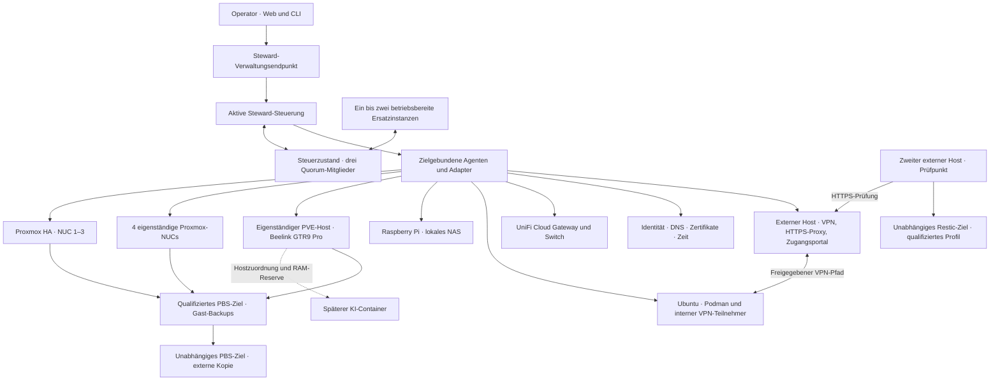

# Nach RC1: Steward als Infrastrukturverwaltung

**Status:** geplant. Start nach dem RC1-Abschluss gemäß
[goal.md](goal.md). Dieser Plan führt den Fahrplan mit M9–M15 bis RC2 fort.
Er setzt auf dem in RC1 tatsächlich freigegebenen Funktionsumfang auf.
Eine in RC1 zurückgestellte Funktion ist nur dann Voraussetzung, wenn ihre
Karte unten ausdrücklich genannt wird.

## Ziel und Reihenfolge

Ein Operator verwaltet Proxmox, Linux-Container, Geräte und gemeinsame
Dienste in OpsTend. Flotte, Standort, Host, Gast und Dienst verwenden
dasselbe Inventar, denselben Richtlinienstand und denselben Auftragsverlauf.
Das System gleicht Soll und Ist ab, führt zugelassene Maßnahmen aus und
prüft deren Wirkung. Zorec erklärt den Zustand, die Entscheidung und den
nächsten Schritt im jeweiligen Kontext. Proxmox bleibt mit seiner nativen
API die Autorität für PVE-Ressourcen. Für Spezialaufgaben verlinkt OpsTend
in die native Oberfläche. Die Flotte kann mit einem Einzelhost beginnen.

| Meilenstein | Karten und Arbeitspakete | Abschlusskriterien | Stand |
|---|---|---|---|
| M9 · Proxmox nativ | [PX01–PX03](plans/proxmox.md#px01--native-installation-und-preflight) | Signierte Einzelhost-Installation mit stabiler lokaler Bedienung, Inventar, Anlage aus Vorlagen und VM-/LXC-Lebenszyklus auf echtem PVE. Der lokale Einstieg zeigt offene Störungen und Entscheidungen für den Host. Upgrade, Neustart und Rückbau sind geprüft. | geplant |
| M10 · Flotte und Bedienbasis | [FL01–FL03](plans/fleet.md#fl01--registrierung-und-identität), [UI01](plans/infrastructure.md#ui01--bedienbasis-und-vollständigkeit) | Einzelhosts und bestehende PVE-Cluster unter gemeinsamer Verwaltung. Die Startansicht priorisiert Störungen und Entscheidungen über die Flotte, filtert nach Maschine und führt direkt zum Vorgang. Funktions- und Einstellungskatalog, stabile Zielnavigation, System/Hell/Dunkel und Zorecs Betriebsansicht sind im Browser abgenommen. | geplant |
| M11 · Gemischter Betrieb und Topologie | [IN01–IN03](plans/infrastructure.md#in01--eigenständige-linux-server) | Ein Linux-Container im Ubuntu-/Podman-Referenzprofil ist anlegbar und bedienbar. PVE und Linux teilen Inventar und Auftragsverlauf. Ein Cloud Gateway und ein Switch liefern UniFi-Lesedaten für die Live-Karte mit Netzebenen, Gerätebindung und konkreter Erreichbarkeitsprüfung. | geplant |
| M12 · Basisdienste, VPN und Wiederherstellung | [NX01–NX02](plans/infrastructure.md#nx01--identität-dns-zertifikate-und-zeit), [BK09–BK11](plans/fleet.md#bk09--gemeinsame-backup-richtlinien-und-zielkatalog) | Gemeinsame Identität, DNS, Zertifikate und Zeit sind angebunden. Ein externer Host veröffentlicht einen verifizierten HTTPS-Dienst über einen verwalteten Tunnel. Parallel werden Zielassistent, NAS-Anschluss und unabhängige Restores für PBS und Restic geprüft. | geplant |
| M13 · Grundverwaltung, Netzänderung und Fernzugang | [PX04, PH01–PH03](plans/proxmox.md#px04--erweiterte-grundverwaltung-in-proxmox-ve), [NX03–NX04](plans/infrastructure.md#nx03--externes-portal-für-ssh-und-gast-desktops) | PVE-Grundaktionen einschließlich Konsole und typischer Änderungen funktionieren im geprüften Profil. Native PVE-HA ist auf drei Knoten geprüft. Das separate Portal erreicht eine geschützte Website, SSH und einen Gast-Desktop. Eine reversible UniFi-Änderung durchläuft Vorschau, Apply und Readback. | geplant |
| M14 · Hochverfügbares Steward | [CP01–CP03](plans/infrastructure.md#cp01--replizierter-steuerzustand-und-wiederanlauf) | Für freigegebene Rollen gibt es eine aktive Instanz, geplante Reserven und geprüfte Standbys. Ein lokales 2-von-3-Quorum steuert den Rollenwechsel und sperrt frühere Writer. | geplant |
| M15 · RC2 | [IR01–IR02](plans/infrastructure.md#ir01--integrierte-abnahme-der-referenzflotte) | Die gemischte Referenzflotte besteht die integrierten Abläufe für Gastbetrieb, Selbstheilung, Netz, Veröffentlichung, Zugang und Recovery. Upgrade aus RC1 und signiertes Release enthalten eine nachgewiesene Support-Matrix. | geplant |

M9–M15 werden in dieser Reihenfolge begonnen. Unabhängige Zeit- und
Host-Gates laufen gemäß [Regel 8](goal.md#rules-that-prevent-circling)
parallel. Fehlt ein autorisierter Host, Anbieterzugang oder ein Ziel,
steht der belegte Umfang mit der offenen Voraussetzung im Status.
Der betroffene Teil wird als teilweise geprüft oder zurückgestellt geführt.
M9–M11 haben eigene Abnahmen für Einzelhost, Flotte und gemischten Betrieb.
M11 kann vorhandene Sicherungsbeobachtungen anzeigen und prüft
die Grundbedienung auch bei einer Schutzlücke. Der Sicherungsstrang in
M12 verwendet die freigegebene B08-Kette für Restic. Aktionen mit einer
Wiederherstellungsvoraussetzung bleiben bis zum konkreten Nachweis
gesperrt. Der Verbundstrang NX01–NX02 kann unabhängig von der externen
Backup-Abnahme vorankommen. X1 behält seinen eigenen Arbeitsstrang.

Die [OpsTend-Eigenupdates](plans/rc2-webapp.md#opstend-selbst-aktualisieren)
bauen auf IR02 auf. Pro Installation gehören die Update-Richtlinie, der
gesicherte Patchstand, der Abgleich und der nachgewiesene Rückweg zum
Auftrag. Ein isolierter Coding-Runner übergibt Portierungsvorschläge zur
unabhängigen Prüfung nach R05.

## Weboberfläche als Schwerpunkt für RC2

Das [RC2-Bedienkonzept](plans/rc2-webapp.md) definiert die gemeinsame
Oberfläche für Proxmox-Gäste, Linux-Container, Geräte und zentrale Dienste.
Es beginnt in M9 und M10 mit der Stabilisierung vorhandener Bedienpfade,
Flotten- und Maschinenkontext, Hell/Dunkel und einer Betriebsansicht mit
Zorec. Der Funktions- und Einstellungskatalog macht sichtbar, welche
Routinen bereits bedienbar sind und welche Voraussetzungen pro Ziel gelten.
Die native Einzelhost- und die Flottenoberfläche verwenden dieselben
Bedienbausteine. Die Integration von Inventar und Topologie wird in M11
abgenommen.

Beim Öffnen stehen Störungen und anstehende Entscheidungen zuerst.
Eine Störung führt zur laufenden Prüfung und eine ausstehende Entscheidung
zur konkreten Vorschau. M10 ergänzt eine gemeinsame Systemübersicht über
Hosts, Dienste, Netzwerk, Betrieb und Systemkonfiguration. Fachansichten
führen zu gezielten Aktionen mit demselben Geltungsbereich. Eigene
Objektseiten bündeln Ereignisse, Hardware, Netz und die jeweils
angebotene Konsole. M11 verbindet
die verfügbaren Beziehungen auf einer gemeinsamen Karte mit einblendbaren
Ebenen und stellt Geräte, Ports und Netze auch tabellarisch dar. M12 ergänzt
Sicherungsstatus und Zielassistent für NAS, PBS und Restic. Weitere
Distributions-, Cloud- und Geräteprofile bekommen jeweils eine eigene
Abnahme. Die [Ausbaustufen](plans/infrastructure-design/10-follow-up-iterations.md)
führen die nächsten Profile und die erweiterten Bedienfälle auf.

Die adaptergestützte Diensteinrichtung ist ein Schwerpunkt für RC2.
Deployments und Änderungen verwenden dieselbe versionierte Definition
für Einstellungen, Fähigkeiten und Wirkungen. Der
[Adaptervertrag](plans/rc2-webapp.md#adaptervertrag-als-rc2-schwerpunkt)
bindet Freigabe, Prüfung, Migration und Rückweg an konkrete Revisionen.

Zorec erhält getrennte Profile für Lesen, Ändern und Berichte mit
konfigurierbarer Recherche. UI und API verwenden denselben
Berechtigungsvertrag. OpenBao und ein getrenntes Tool-Gateway sind die
Kandidaten für die Verwendung von Zugangsdaten über Referenzen.
[Zorec-Shells](plans/rc2-webapp.md#zorec-shells-und-berechtigungen)

## Gemeinsamer Betriebsablauf

1. Ein Agent oder Adapter liefert beobachtete Ressourcen und Beziehungen
   mit Herkunft, Zeit und Abdeckung. Die UI benutzt diese Projektion
   für Liste und Excaliplant-Karte. Eine Rolle oder Adresse allein
   entscheidet weder über Identität noch über Erreichbarkeit.
2. Der Operator wählt einen Dienst und seinen Sollzustand. Die Steuerung
   prüft Eignung, freie Kapazität nach Abzug der Reserven, Abhängigkeiten,
   lokale Zuständigkeit und Richtlinie. Sie erzeugt einen Auftrag mit
   Ziel, Auswirkungen, Freigabe und Reihenfolge der Schritte.
3. Der Executor oder der zuständige native Adapter führt die einzelnen
   Schritte aus und meldet sie an denselben Auftragsverlauf. Beim
   Veröffentlichen eines Dienstes hängen DNS-Eintrag, Zertifikat,
   Tunnel, Proxy-Route und externer Abruf am selben Ziel und an derselben
   Revision. Ein Teilfehler bleibt als ausgeführter oder offener
   Schritt sichtbar und führt zum passenden Abgleich oder Rückweg.
4. Controller und Zorec verwenden dieselben Beobachtungen. Freigegebene
   lokale Selbstheilung kann im Rahmen der zuletzt wirksamen Richtlinie
   weiterlaufen. Der Auftrag zählt erst nach der vorgesehenen
   Zustands- oder Erreichbarkeitsprüfung als erfolgreich.

Beispiel für M15 ist ein Dienst in einem PVE-Gast oder Linux-Container,
der von einem registrierten externen Server erreicht wird. OpsTend zeigt
seine Host- und Gerätezuordnung, veröffentlicht ihn über VPN und HTTPS
und prüft den Pfad. Nach einer Teststörung erklärt Zorec die zugelassene
Maßnahme und den nachgewiesenen Wiederanlauf. Das separate Portal behält
seinen eigenen Login und seine zielbezogenen Sitzungen. [IR01](plans/infrastructure.md#ir01--integrierte-abnahme-der-referenzflotte)

## Referenzaufbau mit lokalen und externen Systemen

Das Referenzprofil umfasst **acht PVE-Hosts, einen lokalen Linux-Teilnehmer,
UniFi Cloud Gateway und Switch, ein NAS sowie zwei externe Linux-Server**.
Andere Installationen setzen dieselben Funktionen aus konfigurierbaren
Standorten, Ressourcen, Fähigkeiten und Rollen zusammen.

| System | Anschluss und geplante Rolle |
|---|---|
| **3 Intel NUCs mit Proxmox VE** | Drei Mitglieder eines PVE-HA-Clusters. Steward führt das Cluster als eine PVE-Instanz und zeigt die einzelnen Knoten sowie HA-Eignung und tatsächliche Platzierung je Gast. |
| **4 weitere Intel NUCs mit Proxmox VE** | Vier eigenständige PVE-Instanzen mit gemeinsamem Inventar und Richtlinien. Geeignete NUCs können Steward-Steuerung oder einen lokalen Backup-Dienst beherbergen. |
| **Beelink GTR9 Pro mit Proxmox VE** | Fünfte eigenständige PVE-Instanz mit höher eingestelltem RAM. Steward zeigt seine VMs und LXC. Für einen späteren KI-Container wird eine ausdrückliche Hostzuordnung mit RAM-Reserve vorgesehen. Die Dienstplatzierung berücksichtigt diese Reserve. |
| **Lokaler Ubuntu-Teilnehmer** | Eigenständiger Linux-Host oder registrierter Ubuntu-Gast mit freigegebenem Podman-Profil und lokalem VPN-Anschluss. Als Gast zählt er zu seinem physischen Host. |
| **UniFi Cloud Gateway und verwalteter Switch** | Netzwerkdaten aus IN02, bestätigte Teständerung aus NX04. Kontrollierter Link und VPN-Pfad mit getrennt ausgewiesener Regel und gemessener Erreichbarkeit. |
| **Raspberry Pi mit 2 × 2 TB NVMe-SSDs** | Vorläufiges lokales NAS. Die Oberfläche zeigt den NAS-Dienst, die zugeordneten Freigaben und lesend gemeldete Erreichbarkeit und Kapazität. Nutzbare Kapazität und Plattenredundanz folgen dem tatsächlich gewählten Layout. |
| **2 externe vServer mit Ubuntu 26.04 LTS** | Je 8 GB RAM und 4 vCPU. Ein Server übernimmt VPN-Host, HTTPS-Proxy und Zugangsportal als getrennte Rollen. Der andere ermöglicht den externen Prüfpunkt und nach eigener Qualifikation ein unabhängiges Restic-Ziel. |
| **Basisdienste in der Referenz** | Ein bereitgestelltes IPA-/OIDC-Profil, interne DNS-Zone und CA, vertrauenswürdige Zeitquelle und freigegebener ACME-Pfad. Der Bootstrap-Zugang ist unabhängig von deren Erreichbarkeit. |

Für Steward-HA sind drei lokal getrennt startfähige Management-Instanzen
vorgesehen, beispielsweise auf je einem der NUCs 1, 4 und 5. Die drei
Stimmberechtigten brauchen getrennte Host- und Boot-Pfade. Die vServer
werden im Referenzprofil außerhalb des Steward- und des PVE-Quorums geführt.
Bei WAN-Ausfall können beide lokalen Quoren weiterarbeiten, solange ihre
lokalen Voraussetzungen erfüllt sind. Provider, Region und Netzpfad
beschreiben die Ausfalldomäne der vServer.

Ein einzelner PVE-Host mit lokaler Steuerung bildet das kleinste Profil.
Mehrere eigenständige PVE-Hosts, mehrere Cluster oder reine Linux-/Geräteziele
können schrittweise hinzukommen. Im Datenmodell sind Anzahl,
Hersteller, CPU-Architektur und Standort Eigenschaften des Inventars.
Freigaben beruhen auf unterstützten Fähigkeiten und konkreten Adapter-,
Netz- und Ressourcenprüfungen. Bei Bedarf kann beispielsweise ein
Sieben-NUC-PVE-Cluster als eine Instanz angebunden werden. Mit den
Standardstimmen braucht dieses Cluster vier Stimmen, auch wenn ausgewählte
Gäste nur auf drei Knoten platziert werden.

Vor M13 werden CPU-Generationen, freier und reservierter RAM, SSDs,
Netzwerkkarten, Bridges/VLANs, Stromversorgung, Switches und Passthrough
dokumentiert. PVE-Cluster-Mitgliedschaft und der Umzug vorhandener Gäste
bleiben vorbereitete Betreiberaufgaben. Corosync nutzt den lokalen Netzpfad;
WAN-Ziele werden über das Steward-Managementnetz angebunden. Gemeinsamer
Strom, Switch oder Storage werden im Dashboard als Ausfalldomänen sichtbar.
[Proxmox-Clusterverwaltung](https://github.com/proxmox/pve-docs/blob/master/pvecm.adoc)

## Zuständigkeiten und Betriebsprofile

| Ebene | Führende Instanz | Verhalten bei Ausfall |
|---|---|---|
| VM, LXC, Bridge, Datastore, PVE-Task und Gastplatzierung | PVE-API und bei HA der PVE-HA-Manager. Steward zeigt deren tatsächlichen Zustand, prüft Vorbedingungen und beauftragt zugelassene Aktionen. | PVE führt Gast-Failover und Fencing selbst durch. Steward blockiert koordinierte Schreibaktionen bei fehlender Autorität oder unklarem Zustand. |
| Lokale Linux-Anwendungen | Der registrierte Executor führt freigegebene Podman-/Quadlet-Aktionen aus und protokolliert sie lokal. | Laufende Workloads und hostlokal verantwortete Funktionen arbeiten nach ihrer wirksamen Policy weiter. Flottenverwaltete Jobs brauchen eine gültige Freigabe. |
| Geräte, VLANs, Firewall und ACL | Der konkrete UniFi-Controller ist führend für seine Netzkonfiguration. OpsTend liefert Sicht, Prüfung und revisionsgebundene Änderungen in qualifizierten Profilen. | Letzte Beobachtung und Datenlücken bleiben sichtbar. Neue Änderungen brauchen einen belegten Ausgangszustand und überprüfbaren Rückweg. |
| Identität, DNS, Zertifikate und Zeit | Das registrierte Backend führt seinen Bereich. OpsTend bindet Gruppen, DNS-Zonen, Zertifikate und Zeitquellen an betroffene Rollen und Ziele. | Betroffene Abläufe zeigen den Ausfall und warten auf ihre Voraussetzungen. Der private Bootstrap-Zugang bleibt unabhängig erreichbar. |
| VPN, HTTPS-Veröffentlichung und Portal | Ein revisionsgebundener Auftrag ordnet die freigegebenen Ziele den zuständigen Rollen zu. Das Portal autorisiert seine eigenen Sitzungen. | Bei Tunnelausfall bleiben unabhängige lokale Pfade bedienbar. Neue externe Sitzungen und Routen brauchen die jeweils gültige Autorität. |
| Flottenrichtlinien, Freigaben und Rollen | Ab M10 eine führende Koordination; ab M14 optional ein replizierter Steuerzustand mit Quorum. Jede verfügbare UI-Instanz wendet die Rollen der Flotte an. | Eine Quorum-Mehrheit kann die Steward-Rolle neu vergeben. Die Minderheit kann datierte Informationen für bereits bestehende Sitzungen innerhalb einer begrenzten, zuvor bestätigten Lesefreigabe zeigen. Neue Sitzungen und Schreibzugriffe brauchen eine erreichbare Autorität. |
| Backup-Daten und Gerätebeobachtung | PBS oder Restic halten die Daten. Geräte liefern Beobachtungen über Einzeladapter oder einen Agenten im Zielnetz. | Backends und nativ verantwortete Zeitpläne laufen eigenständig. Die UI zeigt Zeitstempel und Erreichbarkeit. Ein Ausfall löst keine erfolgreiche Backup- oder Gesundheitsmeldung aus. |

Das Profil **Einzelhost** installiert den Agenten, optional die lokale
Steuerung und ihre SQLite-Datenbank direkt auf PVE mit eigenen systemd-Identitäten.
Das Profil **Agent** verbindet einen Host mit einer Flotte und lässt schwere
Dienste wie Scanner, Builder oder KI standardmäßig deaktiviert. Im Profil
**entfernter Anschluss** ruft ein registrierter Connector die PVE-API auf, wenn
auf einem Host keine Steward-Software installiert werden soll. Im Profil
**Steuerung** laufen API, Scheduler und Speicher auf ausgewählten Management-
Instanzen, beispielsweise in getrennt platzierten VMs oder auf separatem Linux.
M9–M13 nutzen für die Flotte eine einzelne Steuerung. In M14 kommt das optionale
Quorum-Profil hinzu. Die lokale SQLite- und Executor-Architektur aus
[ADR 0001](adr/0001-architecture.md) bleibt die Basis des Einzelhostbetriebs.
Der verteilte Steuerzustand wird in CP01 als eigenständiges Betriebsprofil in
einem ADR festgelegt.

## Gemeinsame Einstellungen und Befehle

- **Identitäten.** Eine Flotte vergibt stabile Site-, PVE-Instanz- und Host-IDs.
  Ein Gast hat die Identität `(PVE-Instanz-ID, Gasttyp, VMID, Generation)`.
  Der aktuelle PVE-Knoten ist eine Eigenschaft des Gasts. Eine nachweislich neu
  belegte VMID bekommt eine neue Generation. Bei unklarer Kontinuität muss der
  Operator bestätigen, bevor Rechte oder Richtlinien wieder verbunden werden.
  Name, IP und VMID allein liefern keinen Identitätsnachweis.
- **Vererbung.** Grundeinstellungen der Flotte liefern Vorgaben. Die
  Site-/Gruppenregel und danach die explizite Zielausnahme liefern zulässige
  Abweichungen. Pro Eigenschaft gilt höchstens eine Gruppenzuweisung auf
  derselben Ebene; widersprüchliche Treffer blockieren die Aktivierung.
  Flottenweite Berechtigungsgrenzen und der lokale Sicherheitsrahmen bilden
  gemeinsam die Obergrenze. Die Oberfläche erklärt Herkunft und wirksamen Wert.
- **Änderungen.** CLI und UI arbeiten gegen einen bekannten Revisionskopf.
  Plan, Zielmenge, Revision, Freigabe und Verfallszeit werden gebunden. Hosts
  melden ihre individuell zuletzt angewandte Revision. Offline-Ziele bleiben
  als ausstehend sichtbar und werden beim Wiederverbinden neu geprüft. Der
  Vollzug bleibt je Ziel nachvollziehbar, auch wenn ein Sammelauftrag teilweise
  erfolgreich war. Pro Zeitplan und Ressource wird genau ein Verantwortlicher
  festgelegt. Ein Wechsel zwischen lokaler und zentraler Verantwortung ist
  explizit und wartet laufende Arbeit ab.
- **Zugriff.** Zeitlich beschränktes Enrollment, bestätigte Identität und
  rotierbare Agentenzertifikate. Entfernte Agenten verbinden sich ausgehend über
  mTLS; Zielverbindungen, DNS und TLS-Identität bleiben fest an die Registrierung
  gebunden. Der jeweilige Ausführungspfad hält nur die für registrierte Ziel-IDs
  nötigen Credentials. Die UI, der Scheduler und der Beobachtungsagent
  erhalten keine Schreib-Tokens. Operator, Rolle, Ziel, Revision und native
  Task-ID sind in den freigegebenen Auditansichten korrelierbar.

## Backup, HA und Dienstplatzierung

Eine externe Backup-**Richtlinie** legt Zeitfenster, Ziel, Aufbewahrung,
Verschlüsselung und Wiederherstellungsziel pro Schutzklasse fest. PVE-Gäste
laufen über native Sicherungen zu PBS; die bestehende, freigegebene
Restic-Kette behandelt Linux- und Anwendungsdaten. Ein Standort außerhalb
des PVE- und Steward-Verbands hostet die unabhängige Kopie. Unterschiedliche
Geräte-/Datenklassen dürfen unterschiedliche Backends verwenden und erscheinen
im selben Katalog. Ein Gast mit separat gesicherter Anwendung weist beide
Schutzebenen aus. Der Katalog zeigt Sicherung, Kopie, Integritätsprüfung und
tatsächlichen Daten-Restore jeweils mit eigenem Datum. Für PBS ist ein
Offsite-Pull mit lesendem Quellzugang und eigener Aufbewahrung vorgesehen;
die Weitergabe von Löschungen ist deaktiviert. Schlüssel und Recovery-Daten
werden gesondert wiederherstellbar hinterlegt.
[PBS Remotes und Sync](https://pbs.proxmox.com/docs/managing-remotes.html)

Das Pi-NAS ist im Beispiel lokaler Datei- und Freigabespeicher. Es kann
freigegebene Backup-Exporte aufnehmen und wird mit dem tatsächlich eingesetzten
Protokoll als Speicherquelle angezeigt. Für native PBS-Sicherungen ist eine
unterstützte x86-64-PBS-Instanz mit geprüftem Datastore vorgesehen. Die
externe Kopie nutzt ein erreichbares Ziel in einer anderen Ausfalldomäne.
Auf einem geeigneten Ubuntu-vServer lässt sich der vorhandene
Restic-HTTPS-Pfad nutzen, sofern Platz, Aufbewahrung und Durchsatz geprüft
sind. Das externe PBS-Ziel wird separat qualifiziert. Solange für eine
Schutzklasse kein externes Ziel nachgewiesen ist, zeigt der Katalog die
Deckungslücke. Bei einem Ausfall des Pi-NAS zeigt das Dashboard die
betroffenen Freigaben und Backup-Wege. Das Referenzprofil hält PVE-HA-
Gastdisks und Steward-Quorum-Datenträger auf separat geprüften Speichern.
[PBS-Systemanforderungen](https://pbs.proxmox.com/docs/installation.html#system-requirements) ·
[Steward-Backup-Grundlage](backup-foundation.md)

Beim Proxmox-HA-Pfad prüft Steward Quorum, Storage-Zugriff oder qualifizierte
Replikation, Netzkompatibilität und die Platzierbarkeit der Gäste. Für einen
Gast mit lokalem Passthrough oder gebundenem Storage kann der Prüfbericht
bestimmte Ziele ausschließen. Asynchrone Storage-Replikation wird mit dem
möglichen Datenverlust seit der letzten Replikation angezeigt. Der native
HA-Manager entscheidet über Fencing und Wiederanlauf. Aus der PVE-Beobachtung
leitet Steward ausdrücklich ab, ob ein Gast noch migriert, bereits auf einem
anderen Knoten läuft oder der Zustand ungeklärt ist.
[Proxmox HA Manager](https://github.com/proxmox/pve-docs/blob/master/ha-manager.adoc) ·
[Proxmox Storage Replication](https://github.com/proxmox/pve-docs/blob/master/pvesr.adoc)

Im Steward-HA-Profil stimmen drei fest aufgenommene Mitglieder über den
Steuerzustand ab. Die Dienstspezifikation je Rolle enthält Anzahl aktiver
Instanzen (zunächst eine), ein bis zwei gewünschte Hot-Standbys,
Mindestkapazität, Version, Datenstand, erlaubte Standorte und
Ausfalldomänen. Der Scheduler schließt unpassende Kandidaten aus, sortiert
nach Richtlinienpriorität, freien Ressourcen und stabiler Host-ID und lässt
die Zuweisung atomar bestätigen. Das ergibt eine automatische, nachvollziehbare
Auswahl. Eine gesunde aktive Instanz bleibt bei Rückkehr eines bevorzugten
Kandidaten aktiv; neue Platzierung folgt Ausfall, Wartung oder einer
bestätigten Anforderung. Standbys sind vorgewärmt und folgen dem bestätigten
Steuerzustand. Ihre Eignung für eine Übernahme hängt unter anderem von einem
nachgewiesenen Datenstand ab. Ein Hot-Standby und ein stimmberechtigtes Mitglied
sind unterschiedliche Rollen. Zwei Dienstinstanzen allein bilden das Profil
mit automatischer Übernahme nur zusammen mit einem dritten erreichbaren
Quorum-Mitglied.
[etcd-Fehlerverhalten](https://etcd.io/docs/v3.6/op-guide/failures/) ·
[etcd API für Transaktionen und Leases](https://etcd.io/docs/v3.6/learning/api/)

Für M14 ist ein einzelner Standort mit getrennten Hosts vorgesehen.
Unabhängige externe Geräte, Agents und Backup-Ziele können bereits vorher
angebunden werden. Ein Standortausfall wird mit Wiederherstellung aus der
externen Kopie bearbeitet. Das Aufnehmen eines zusätzlichen Stimmberechtigten
sowie eine Verlagerung des Quorums bleiben geplante Betreiberaktionen.
Ein bestätigter Befehlsanspruch und sein Status bleiben beim Rollenwechsel
erhalten. Ein ungewisser nativer Task blockiert weitere kollidierende Aktionen
bis zur Abstimmung mit dem ursprünglichen Ziel. Die konkrete Absicherung
gegen verspätete Anfragen steht in [CP02](plans/infrastructure.md#cp02--rollenwahl-schreibsperren-und-job-übernahme).

## Sicht in der Weboberfläche

| Ansicht | Inhalt und Bedienung |
|---|---|
| Flottenübersicht | Status je Standort und PVE-Instanz, Hosts/VMs/LXC, CPU/RAM/Storage mit Zeitfenster, letzte Agentenmeldungen, Quorum je Ebene und jüngste Aufträge. Filter nach Standort, Typ, Gruppe und Status. |
| Infrastrukturkarte | Baum und PlantUML-/Excaliplant-Karte für `Standort → Cluster/Host → Gast → Dienst`. Ebenen für Verkabelung und Linkrate, VLAN und Regeln, VPN und Zugang. Hardwarebindungen, Storage, Backup und HA ergänzen den jeweiligen Fokus. Auswahl öffnet Details, Herkunft und Zeitstempel. |
| Ressourcendetail | Ist- und Soll-Zustand, beobachtete Platzierung, Ereigniszeitlinie, Messkurven, Backup-Kopien und Aktionen nach Rolle, Capability und Frische. |
| Backup und Wiederanlauf | Zeitplan, Fehlversuche, letzter externer Prüfstand, geplanter Restore, RPO/RTO je Schutzklasse und letzte tatsächlich gemessene Werte. |
| Steward-Dienste | Aktive Instanz, einsatzbereite Ersatzinstanzen, Datenstand, zugehörige Basisdienste und Reserven, ausgeschlossene Kandidaten mit Grund, Rollenwechsel und Replikationsstatus. |
| Zorec und Aufträge | Kontextbezogene Erklärung von Befund, Richtlinie, Freigabe, Ausführung und bestätigter Wirkung. Gesten folgen dem getypten Betriebszustand. |

Beispiel für den Referenzaufbau: Ein Klick auf eine HA-VM zeigt ihren
aktuellen NUC, mögliche Zielknoten, ihre Bridge, den Datastore und den
letzten geprüften externen PBS-Snapshot. Der darin betriebene Dienst
erscheint als eigener Knoten, wenn ein registrierter Agent oder eine
deklarierte Zuordnung ihn mit der VM verbindet. Sein separat gesicherter
Datenbestand zeigt auf das entsprechende Restic-Repository. Fällt ein NUC
aus, aktualisiert die Ansicht die Gastplatzierung aus PVE und führt den
Steward-Rollenwechsel, falls einer nötig ist, als eigenes Ereignis.

Eine Kante ist als **vom Adapter beobachtet**, **durch den Betreiber
deklariert** oder **abgeleitet mit Beleg** gekennzeichnet. Eine gemeinsame
Bridge belegt Netzanbindung. Schreibfreigaben, Backup-Erfolg und konkrete
Verbindungsnachweise brauchen jeweils eigene Evidenz. Offline und veraltet
verwenden eigene Zustände. Graph und Listenansicht filtern dieselben
berechtigten Objekte vor der Aggregation, einschließlich Kanten und Zählwerten.
Die wichtigste Überschneidung mit Proxmox Datacenter Manager liegt bei
PVE/PBS-Inventar und Gastaktionen. Steward bindet PVE und PBS über ihre
nativen APIs ein und verbindet diese Ansichten mit Linux, Geräten,
Richtlinien und Wiederherstellungsnachweisen.
[Proxmox Datacenter Manager](https://pdm.proxmox.com/docs/introduction.html)

## Budgets, Abnahme und offene Entscheidungen

- Ab M9 gelten Regeln 1–10 aus [goal.md](goal.md), die Stop-Regeln und der
  Lead-/Worker-Ablauf pro Implementierungsschritt. Zwei bis drei Schritte je
  Karte sind unten festgelegt. Eine Korrektur von Datenverlust oder
  Privilegienausweitung folgt Regel 2. Zusätzliche Adapter und Funktionen gehen
  mit Kartenzuordnung nach [backlog.md](backlog.md).
- Pro Meilenstein eine zusammengefasste Abnahme auf dem geprüften Commit. Maximal
  zwei Versuche pro Gate. Für M9 wird ein eigener freigegebener PVE-Testhost
  gebraucht. Verschachteltes PVE kann API-/Installationstests abdecken. Für M13
  und M14 werden physische Ausfälle, Quorum und die Wiederanlaufpfade in einer
  dafür freigegebenen Topologie geprüft. VM101 und die bestehenden
  RC1-Test-VMs haben ihre in [goal.md](goal.md) definierten Rollen.
  Referenzgeräte, Netzpfade und externe Ziele werden für echte Tests
  einzeln freigegeben.
- Vorgeschlagene Abnahmeziele für das Referenzprofil: Inventar im Normalbetrieb
  innerhalb von 120 Sekunden aktualisiert. Nach Verlust einer aktiven
  Steward-Instanz innerhalb von 60 Sekunden wieder lesbar und innerhalb von
  120 Sekunden wieder schreibbereit, sofern Quorum, Verwaltungsendpunkt und
  Ziel erreichbar sind. RPO 0 für per Quorum **bestätigte** Steueränderungen
  bei diesem Einzelausfall. Für das externe Gast-/Anwendungsbackup gilt im
  Referenztest ein anfängliches RPO-Ziel von 24 Stunden; die Zeit des Restores
  wird pro Datengröße, Backend und Link gemessen. Das RPO bei Quorum-
  Totalausfall ergibt sich aus dem letzten verifizierten externen Snapshot.
  Gast-HA-Zeiten werden separat gemessen. Alle Zeiten sind Zielwerte für die
  Abnahme und werden erst nach der Messung zugesichert.
- PX01 legt die getestete PVE-Version, Hardware-/OS-Profile und das
  Paketformat fest. BK09 fixiert externen Standort, Verantwortliche,
  Schlüsselhinterlegung und Schutzklassen. PH01 legt Storage-Profil,
  CPU-/Netzkompatibilität und besonders gebundene Gäste fest. CP01 legt die
  tatsächlichen Quorum-/Endpoint-Hosts nach Ausfalldomänen fest. IN02
  bindet Gerät, Firmware und API-Version. NX01–NX04 legen die konkreten
  Verzeichnis-, Tunnel-, Portal- und Netzprofile sowie deren Testwege
  fest. Diese Entscheidungen werden in den jeweiligen Karten belegt.
- RC2 deckt den kleinsten vollständig geprüften Umfang ab. Weitere
  Storage- und Geräteprofile, clusterübergreifende Live-Migration,
  automatisches Standort-Failover, automatisches PVE-Cluster-Bootstrap
  und automatische Aufnahme von Quorum-Mitgliedern sind Kandidaten für
  spätere Arbeit. RC2 dokumentiert pro Capability die angenommene Topologie
  und den tatsächlich geprüften Support.

### Karten im Detail

- [Proxmox nativ, Grundverwaltung und Proxmox HA](plans/proxmox.md)
- [Flottenverwaltung und externe Backups](plans/fleet.md)
- [Bedienbasis, Server, Geräte, Netzwerkdienste, Steward HA und RC2](plans/infrastructure.md)

Der [Recherche- und Architekturindex](plans/infrastructure-design/README.md)
führt pro Themengebiet Varianten, Primärquellen, Entscheidungspunkte und
Bezüge zur Abnahme zusammen. Die [optionalen Ausbaustufen nach RC2](plans/infrastructure-design/10-follow-up-iterations.md)
enthalten eigene Voraussetzungen und Abnahmekriterien.
