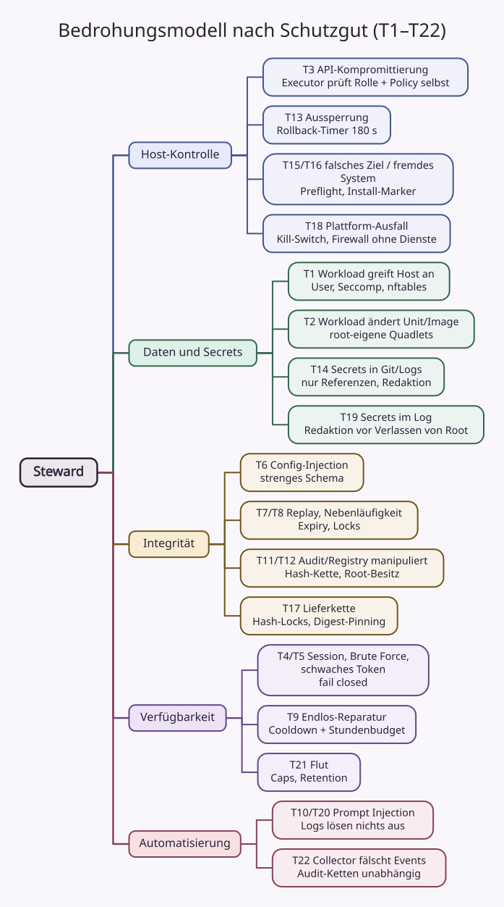

# Threat Model

The table covers threats to the single-host baseline and identifies the scope of
the recorded checks. **U** denotes an automated unit/contract test, **L** local
integration with Rootless Podman, and **VM** a host acceptance test.
[STATUS](STATUS.md#card-state) records current checks for guarded paths.

## Assets

1. Host control (root, SSH access, firewall).
2. Project data and secrets; admin token.
3. Integrity of configuration, releases, and audit.
4. Availability of services and observation.

## Trust boundaries

```
Controller machine ──SSH (verified host key)──▶ root via sudo (deployment only)

Browser ──TLS──▶ Traefik (steward-proxy) ──Loopback──▶ Admin API (steward-api)
                                                          │ Unix socket, SO_PEERCRED
Controller (steward-ctl) ─────────────────────────────────┤
                                                          ▼
                                                   Executor (root)
                                                          │ fixed argv, registry
                                                          ▼
                                       Service users' systemd units / containers
```

**Untrusted data** includes logs, status messages, unit names, scanner text,
repository contents, web content, model output, and everything sent by the web
UI. A system instruction to a model is not a security boundary.

## Attackers and mitigations



*Quelle: [`11-bedrohungsmodell.puml`](diagrams/src/11-bedrohungsmodell.puml), erzeugt mit `docs/diagrams/render.sh`.*

| # | Scenario | Mitigation | Evidence |
|---|---|---|---|
| T1 | Compromised workload attacks host, other projects, metadata service, or private networks | Dedicated user + sub-IDs, read-only rootfs, no capabilities, NNP, default Seccomp, RAM/CPU/PID limits; per-UID nftables egress (IPv4+IPv6), link-local always blocked; no host loopback access | U (rules, flags), L, VM (flags, limits, egress `none` including IPv6/metadata/private) |
| T2 | Workload changes its own unit or image | Root-owned Quadlet in `/etc/containers/systemd/users/<UID>`; `Pull=never`, image loaded only from root archive | U, VM |
| T3 | Compromised admin API requests root actions | API has no host privileges; executor accepts only registered actions and independently checks role/policy; no shell/path/playbook parameters | U (schema, roles, unknown actions, real peer credentials) |
| T4 | Stolen session cookie, CSRF, DNS rebinding, brute force | `__Host-` cookie (Secure, HttpOnly, SameSite=Strict), CSRF token + origin check, host allowlist, rate limit, server-side revocation, rotation revokes all sessions | U |
| T5 | Admin API starts without a secret or with a weak secret | Startup refused (fail closed); token ≥ 32 random bytes | U |
| T6 | Configuration injection (unit file, nftables, Traefik rule) through fields | Strict schema patterns, `extra=forbid`; rendering without unrestricted text | U (injection attempts), U (nft loads, Quadlet generator accepts) |
| T7 | Replay or delayed mutation execution | Single-use `request_id`, 120 s request TTL with server skew allowance, action policy checked on execution | U |
| T8 | Concurrent mutations of the same target | Target lock in executor (flock) and job queue | U |
| T9 | Endless repair loop | Controller cooldown, executor hourly budget, escalation with cause | U |
| T10 | Prompt injection in logs/status triggers actions | Findings and remediation admission use fixed rules over structured fields. Optional advice has no mutation authority | U |
| T11 | Audit tampering | Separate audit files per trust domain, hash chain, `O_APPEND`/`O_NOFOLLOW`; executor audit readable only by root | U (chain, symlink) |
| T12 | Tampered executor registry/policy | File must be root-owned and not group/world-writable; symlinks rejected | U |
| T13 | Lockout from SSH/firewall changes | Syntax check, rollback timer (180 s), proof of a new connection before disarming | VM (SSH rollback actually triggered and passed; firewall rollback not triggered) |
| T14 | Secrets in Git, plans, logs | References only in configuration; `no_log`/`diff: false`; redact before display; token never printed | U (variables without values, redaction) |
| T15 | Deploying to wrong target | `--limit` must match `server.name`; one inventory host; strict host key checks; install marker binds host to server name | U (CLI); host key checks and marker active in VM run, rejection not triggered |
| T16 | Modifying foreign/unknown system | Read-only preflight rejects other OS, `/srv/isobox`, foreign layouts, Docker, ufw/firewalld, port conflicts; no flag overrides this | Rejection cases not triggered — open |
| T17 | Supply chain (dependencies, images, Actions) | Hash-locked Python dependencies on controller and target, images by digest only, Actions pinned by commit SHA | U for local contracts. See [S01](STATUS.md#card-state) for CLI release verification and remaining deploy enforcement |
| T18 | Web UI, controller, or AI outage prevents protection | Kill switch is a root-owned file checked by executor; firewall and limits work without running platform services | U, VM (kill switch, firewall after reboot) |
| T19 | Secrets in collected logs reach the event log, UI or bot | The executor redacts journal lines before they leave root: known patterns plus exact values of deployed secrets; summaries are redacted again on write; only warning-or-worse lines of registered components are read | U (patterns, deployed values, byte-array messages); VM: see STATUS.md |
| T20 | Log content (attacker-controlled) steers automation | Collector role can only read; delivery classes and severities come from fixed rules over structured fields; log events have class `none`; UI renders text as text | U (hostile log line causes no action) |
| T21 | Flooding hides events or exhausts storage | Per-unit cap per cycle, backlog skip with an immediate `log.backlog` event, retention by age and count, read requests summarised hourly in the executor audit | U |
| T22 | Compromised collector forges or drops events | Collector cannot mutate anything (role check in the executor); executor and API audit chains stay independent and verifiable; a rewritten executor audit yields `audit.discontinuity`. A compromised collector can still omit or invent events in its own log | U; residual risk accepted |

## Known limitations (explicitly stated)

- **Containers do not provide VM isolation.** All workloads share the host
  kernel. This design makes container kernel exploits harder (non-root, no
  capabilities, Seccomp), but does not rule them out.
- **Host root is outside the model.** Root can modify audit, registry, and kill
  switch. A signed webhook can deliver redacted executor audit records with
  original hash anchors. Independent receiver verification remains a
  [V02 gate](STATUS.md#card-state).
- **`public-web` egress is not a domain allowlist.** DNS through the host resolver
  and TCP 80/443 to public addresses are allowed. DNS itself remains a possible
  exfiltration channel.
- **Host outage detection depends on a receiver.** The notifier can send
  heartbeats to a receiver that needs to detect missing or stale reports.
  Independent receiver acceptance is tracked in [V02](STATUS.md#card-state).
- **Image provenance** for baseline workloads is limited to digest integrity.
  Signature and SBOM admission for repository artifacts belongs to the
  guarded update and validator paths. [R04 gates](STATUS.md#card-state)
- **No AppArmor profile for workload containers.** On the test VM, `podman` and
  `pasta` are themselves restricted by AppArmor, but containers are not
  (Rootless Podman applies no profile). Isolation relies on user separation,
  namespaces, Seccomp, absence of capabilities, and nftables.
- **The controller machine** holds SSH access and secrets and is therefore a
  valuable target; protecting it is the operator's responsibility.

## Messaging inputs and destinations

A webhook signing caller attests tenant/user identity and must be trusted for
that endpoint; Discord attests its interaction identity through Ed25519. The
bot additionally checks explicit grants, application id, timestamp, bounded body,
replay id/body binding and per-identity rate limits before data access. Public
hosting exposes only the bot path on its configured hostname. Host mutations
remain outside the messaging boundary. Guarded advice additionally checks the
query grant and the inference worker's peer policy.

Outbound HTTPS resolution rejects private/metadata/transition addresses and
pins the checked address while verifying the original TLS hostname. Redirects
and environment proxies are disabled. Rate limits and outages affect only the
notifier queue. Separate process users, databases and systemd credentials keep
messaging credentials out of the collector and executor access out of both bot
and notifier. Delivery remains at least once; a receiver must deduplicate ids.
