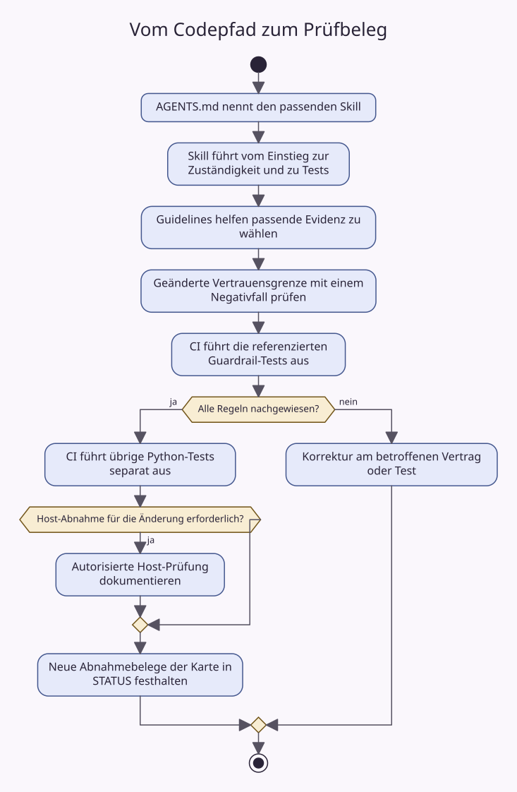

# Wie OpsTend und seine Entwicklungsregeln zusammenspielen

OpsTend übersetzt eine überprüfte Sollkonfiguration in einen isolierten
Linux-Betrieb. Beobachtungen liefern die Grundlage für Entscheidungen.
Host-Aktionen laufen über registrierte Executor-Aktionen. CLI und Ansible
installieren die geprüfte Konfiguration über den vorgesehenen Deploy-Pfad.
Optionale Funktionen und der Stand ihrer Abnahme stehen in [STATUS](STATUS.md).

| System | Beitrag und Übergabe | Diagramm |
|---|---|---|
| Konfiguration und Deploy | YAML wird zur kanonischen Revision und zu Artefakten für Ansible, nftables, Traefik, Quadlet und Executor. Der Deploy bindet Ziel, Revision und Wiederaufnahme zusammen. | [Deploy](diagrams/out/svg/03-deploy-und-revisionen.svg) · [Netz](diagrams/out/svg/09-netzwerk.svg) |
| Privilegierter Executor | Prüft Aufrufer, Aktion und Ziel, serialisiert Änderungen und schreibt Audit-Evidenz. | [Prüfkette](diagrams/out/svg/01-executor-pruefkette.svg) |
| Anwendungsbetrieb | Der Controller bewertet Health und Risiko. Wartung, Updates, Quarantäne und Archivierung verwenden eigene Zustände und die Executor-Freigaben. | [Selbstheilung](diagrams/out/svg/02-selbstheilung.svg) · [Lebenszyklus](diagrams/out/svg/06-anwendungs-lebenszyklus.svg) · [Risiko](diagrams/out/svg/04-kritisches-risiko.svg) |
| Backup und Wiederherstellung | Capture, Upload, Prüfung und Restore ergeben getrennte Nachweise. Der Executor prüft die Voraussetzungen für Aufbewahrung und Freigabe separat. | [Backup-Nachweise](diagrams/out/svg/12-backup-nachweise.svg) |
| Beobachtungen und Messaging | Scanner und Collector liefern begrenzte Befunde und Ereignisse. Notifier und signierte Bot-Abfragen geben sie nach außen weiter. | [Vertrauensdomänen](diagrams/out/svg/00-gesamtbild.svg) |
| KI und Beratung | Der optionale Worker prüft Aufrufer, Scope, Budget und Schema. Der Kandidatenpfad liefert Beratung mit Quellen, Zeitraum und Datenlücken. | [Inferenz](diagrams/out/svg/13-inferenz-und-advice.svg) |
| Repository und Release | Im Kandidatenpfad binden Fetch, Build, Validierung und separate Freigabe einen Digest an den Executor-Updatepfad. Reparatur verwendet einen PR-Vertrag. Werkzeug-Releases verwenden eine eigene Signaturprüfung. | [Repo-Deployment](diagrams/out/svg/07-repo-deployment.svg) · [Release-Vertrag](release.md) |
| Admin-API und UI | Zeigt geprüften Zustand, Evidenzlücken und Jobs. Bearbeitungen erzeugen eine ausstehende Revision. Der Executor kann zulässige Änderungen direkt anwenden. Änderungen an Host-Artefakten brauchen ein Deployment. | [Revisionen](diagrams/out/svg/03-deploy-und-revisionen.svg) |

In der [Diagrammübersicht](diagrams/README.md) sind die bearbeitbaren
Excalidraw-Dateien und die Zuordnung zu Kandidatenpfaden verlinkt.

## Von der Änderung zur Abnahme

[AGENTS.md](../AGENTS.md) führt zum passenden Skill. Die acht Skills zeigen
Einstiegspunkte, Zuständigkeiten und passende Tests. Die
[Guidelines](working-guidelines.md) helfen bei der Wahl der Evidenz.
Die [Guardrails](guardrails.md) binden jeden verbindlichen Vertrag an
ausführbare Prüfungen in CI. Reale Host-Effekte werden über die
[Abnahmeebenen](testing.md) belegt.

[Excalidraw-Datei zur Bearbeitung](diagrams/out/excalidraw/14-arbeitsweise-und-ci.excalidraw)
